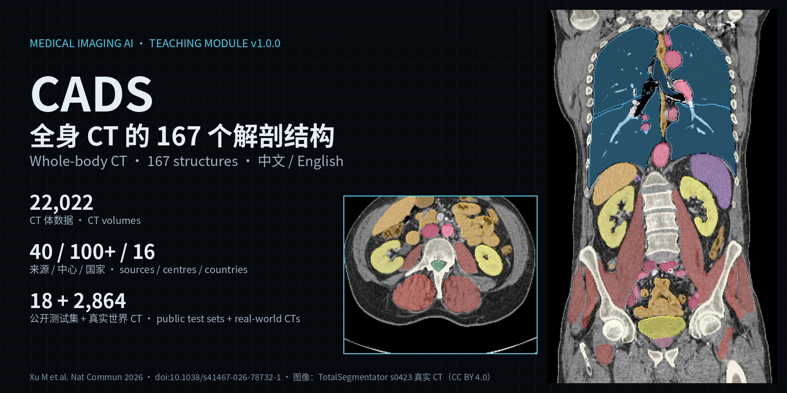
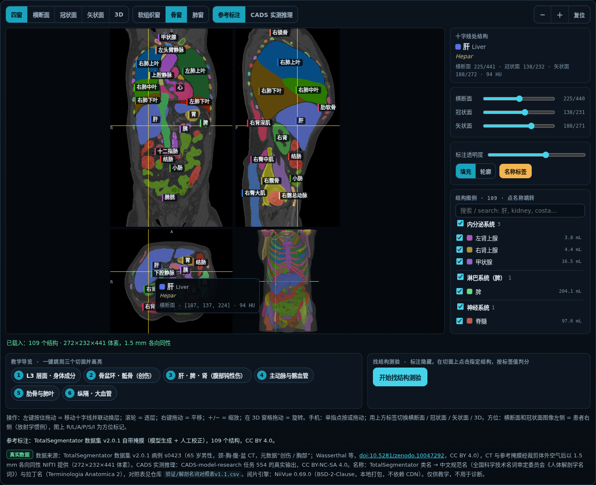
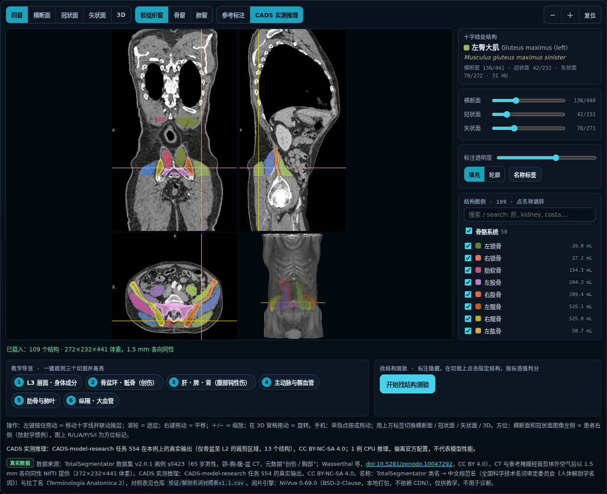
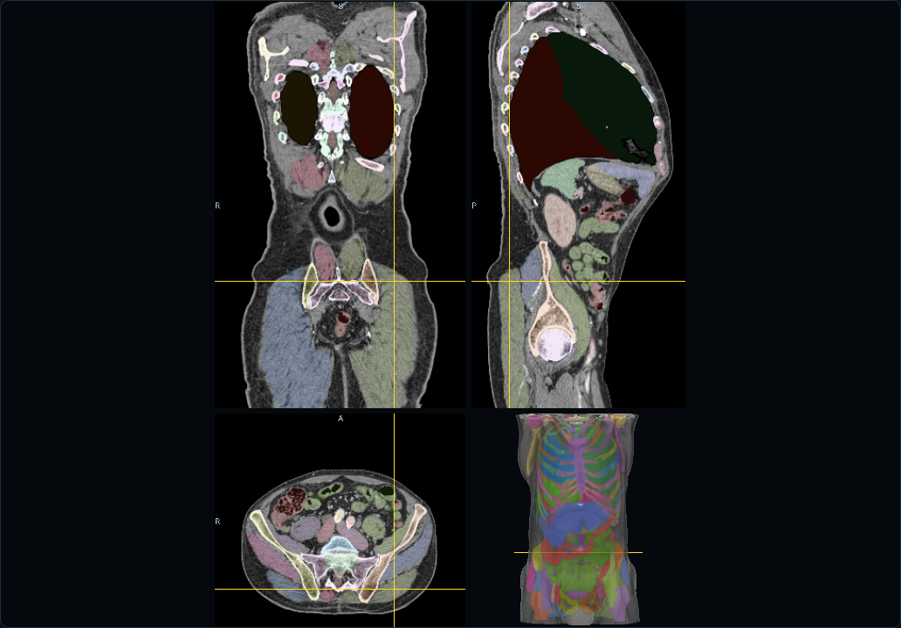
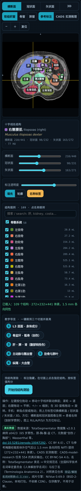
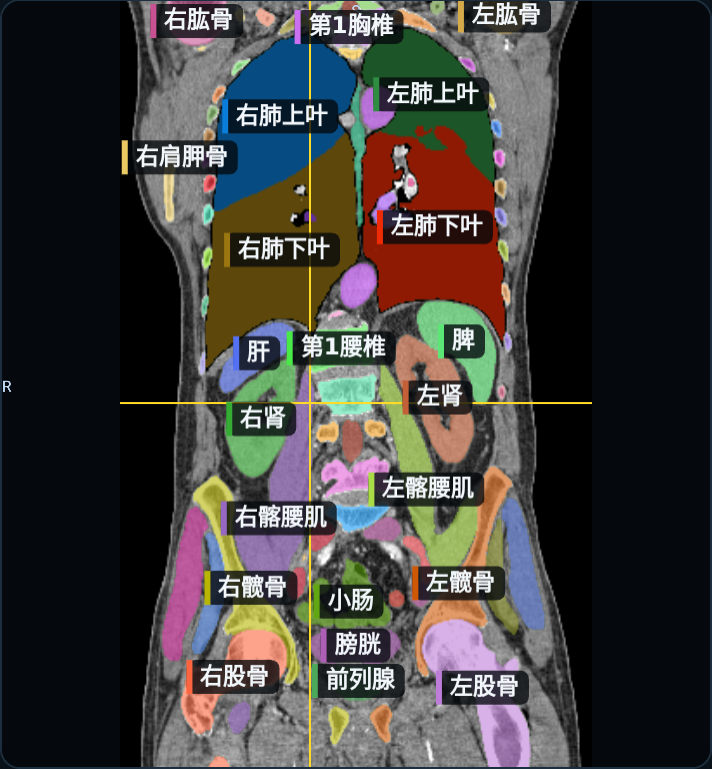

<p align="center">
  
</p>

<h1 align="center">CADS 全身 CT · 交互解剖阅片与双语教学课件<br>Real whole-body CT · Interactive anatomy viewer &amp; bilingual course</h1>

<p align="center">
  <strong>在一例真实全身 CT 上拖动横断面、冠状面、矢状面，3D 同步联动；悬停或点按即显示该处结构的中文、英文、拉丁名。109 个结构，每个一种颜色。</strong><br>
  Drag through the axial, coronal and sagittal planes of a real whole-body CT with a linked 3D view; hover or tap to see each structure's Chinese, English and Latin name. 109 structures, one distinct colour each.
</p>

<h3 align="center">
  <a href="https://tuanziding.github.io/cads-ct-teaching/">▶ 打开在线阅片器 · Open the live viewer</a>
</h3>

<p align="center">
  <a href="README.md">简体中文</a> · <a href="文档/英文说明v1.1.md">English</a>
</p>

<p align="center">
  <a href="https://github.com/TUANZIDING/cads-ct-teaching/actions"></a>
  
  <a href="https://creativecommons.org/licenses/by-nc/4.0/"></a>
  <a href="LICENSES/PolyForm-Noncommercial-1.0.0.md"></a>
  <a href="LICENSES/NiiVue-BSD-2-Clause.txt"></a>
  <a href="文档/图片说明v1.1.md"></a>
</p>

<p align="center">
  <code>横断面 / 冠状面 / 矢状面 / 3D 联动</code> · <code>109 个彩色结构 · 中 / 英 / 拉丁名</code> · <code>参考标注 ↔ CADS 实测推理对照</code> · <code>6 个教学导览 + 找结构测验</code> · <code>手机单窗模式</code> · <code>本地打包 · 不依赖 CDN</code> · <code>15 个论文教学模块</code>
</p>

<p align="center">
  <a href="#viewer">交互阅片器</a> ｜ <a href="#showcase">实际界面</a> ｜ <a href="#what-is-cads">CADS 是什么</a> ｜ <a href="#contents-page">课件内容</a> ｜ <a href="#inference">真实推理</a> ｜ <a href="#quick-start">快速开始</a> ｜ <a href="#contents">仓库内容</a> ｜ <a href="#license">版权与许可</a>
</p>

> ⚠️ 仅供教学与科研学习。CADS 是研究软件，论文明确说明其专家评审“不构成临床效用的正式证明”；本课件任何内容都不用于临床诊断或治疗决策。本课件为独立教学材料，与 CADS 作者团队无隶属关系，也未经其背书。

---

<a id="viewer"></a>

## 交互阅片器（v1.1 新增）· Interactive viewer (new in v1.1)

| 功能 | 说明 |
| --- | --- |
| 多平面联动 | 四窗：横断面、冠状面、矢状面 + 3D 体渲染。任一切面按住拖动，十字线移动，另两个切面与 3D 同步换层；滚轮逐层；每个平面有滑块；右键拖动平移，＋/− 缩放 |
| 窗宽窗位 | 软组织窗 / 骨窗 / 肺窗一键切换 |
| 分割叠加 | 病例 s0423 全部非空参考掩膜（TotalSegmentator 117 类中的 109 类）合并为一个标签体积；在 CIELAB 色彩空间为每个结构分配独有颜色，相邻结构、左右对侧、相邻肋骨/椎骨的最小色差 ΔE = 45；透明度滑块；填充 / 轮廓切换 |
| 解剖名称 | 悬停（手机点按）显示中文名 · 英文名 · 拉丁名（TA2）、平面、体素坐标与 CT 值；可开启“名称标签”在当前三个切面上常驻标注 |
| 图例 | 按骨骼 / 肌肉 / 心血管 / 呼吸 / 消化 / 泌尿 / 生殖 / 内分泌 / 淋巴 / 神经分组；中英文搜索；逐个或整组显示 / 隐藏；点名称三面同时跳到该结构并高亮（跳转点取该结构中位横断层面上距边界最远的体素，保证落在结构内部） |
| 来源切换 | **参考标注**（数据集自带掩膜，CC BY 4.0）↔ **CADS 实测推理**（CADS-model-research 任务 554 的真实输出，骨盆至 L2，CC BY-NC-SA 4.0）；同一结构同一颜色，便于对照 |
| 教学导览 | L3 层面身体成分 · 骨盆环与骶骨 · 肝脾肾（腹部钝性伤）· 主动脉与髂血管 · 肋骨与肺叶 · 纵隔大血管：一键跳到三个切面、切换窗位并高亮相关结构 |
| 找结构测验 | 隐藏标注，按题目在任一切面上点击指定结构，按点击处的标签值判分；三次未中自动显示答案 |
| 手机 | 窄屏自动切换为单窗模式，用“横断面 / 冠状面 / 矢状面 / 3D”标签切换；单指点按或拖动 |

- **方位**：放射学惯例，横断面与冠状面图像左侧 = 患者右侧；每个窗格标有 R/L/A/P/S/I。
- **数据**：CT 与掩膜为 1.5 mm 各向同性 NIfTI（272 × 232 × 441 体素，已裁去体外空气），合计约 22 MB（CT 20.8 MB、参考标注 1.2 MB、CADS 推理 0.25 MB）+ NiiVue 2.3 MB；载入时显示进度。
- **名称来源**：每个名称都来自 [`验证/解剖名词对照表v1.1.csv`](验证/解剖名词对照表v1.1.csv)（TotalSegmentator 类名 → 全国科学技术名词审定委员会《人体解剖学名词》规范名 + Terminologia Anatomica 2 拉丁名），来源与注意事项见 [`验证/解剖名词来源v1.1.md`](验证/解剖名词来源v1.1.md)。
- **引擎**：[NiiVue](https://github.com/niivue/niivue) 0.69.0（BSD-2-Clause，WebGL2），本地打包在 `assets/viewer/`，国内访问不依赖任何 CDN。需要支持 WebGL2 的浏览器（新版 Chrome / Edge / Safari / Firefox / 微信内置浏览器多数可用）。

<a id="what-is-cads"></a>

## CADS 是什么 · What CADS is

**CADS**（Comprehensive Anatomical Dataset and Segmentation）把 40 个来源、22,022 个 CT 统一到一个以 SNOMED CT 为参照的标签空间，用伪标签 + 形状质控补全稀疏标注，再训练 9 个分区 nnU-Net（ResEnc-L）模型，一次分割从头到膝的 167 个解剖结构；在 18 个公开数据集与苏黎世大学医院 2,864 例真实肿瘤 CT 上评估。代码 Apache-2.0，权重分 reference / research（CC BY-NC-SA 4.0）/ open（CC BY-SA 4.0）三种许可，另有 3D Slicer 插件。

> Xu M, Navarro F, Fritsak M, … Amiranashvili T, Menze B. CADS: a comprehensive anatomical dataset and segmentation for whole-body anatomy in computed tomography. *Nature Communications* (2026). doi:[10.1038/s41467-026-78732-1](https://doi.org/10.1038/s41467-026-78732-1). 开放获取，[CC BY 4.0](https://creativecommons.org/licenses/by/4.0/)。

<a id="contents-page"></a>

## 课件内容 · What the module contains

| 模块 | 内容 |
| --- | --- |
| 01 为什么需要 CADS | 全身分割的用途（放疗危及器官、异常检测、转移定位、身体成分）与标注稀缺的问题 |
| 02 数据集 | 22,022 个 CT、40 个来源、100+ 影像中心、16 个国家 |
| 03 四步流程 | 从稀疏标注到 167 类全身标签：标签统一 → 伪标签 → 形状质控 → 训练 |
| 04 标签浏览器 | 167 个结构可搜索、按 9 个模型组 / 系统筛选，附中文名、SNOMED CT 编码、出现例数 |
| 05 权重与许可 | reference / research / open / CADS-region 的区别与适用场景 |
| 06–07 评估与真实世界 | 18 个公开数据集基准、2,864 例肿瘤 CT 队列与专家评审 |
| 页首 · 交互阅片器 | 见上：三平面 + 3D 联动、109 个彩色结构、中英拉丁名、导览与测验 |
| 08 CADS 真实推理 | CADS T554 在本例上的真实输出、静态对照图与 Dice（阅片器内可逐体素切换对照） |
| 09 临床教学案例 | 急诊创伤外科视角：数肋骨与椎体、L3 层面身体成分、盆部肌肉与骨（每例都可一键在阅片器中打开） |
| 10 动手教程 | 命令行安装与推理、3D Slicer 插件 |
| 11–15 | 小测验、局限与注意事项、资源、参考文献、版权与许可 |

每条内容都标注来源类型：【论文事实】【教学解读】【作者推算】【真实数据】。中英文讲义 Markdown 版：[`文档/教学讲义-中文v1.0.md`](文档/教学讲义-中文v1.0.md) · [`文档/教学讲义-英文v1.0.md`](文档/教学讲义-英文v1.0.md)。

<a id="showcase"></a>

## 实际界面 · Showcase

[](https://tuanziding.github.io/cads-ct-teaching/)

<sub>桌面 1440 px：四窗联动 + 名称标签 + 悬停提示（中文 / 英文 / 拉丁 / CT 值）+ 按系统分组的图例。</sub>

| CADS 实测推理对照 | 轮廓模式 |
| --- | --- |
| [](https://tuanziding.github.io/cads-ct-teaching/) | [](https://tuanziding.github.io/cads-ct-teaching/) |

| 手机 · 横断面 | 手机 · 冠状面 |
| --- | --- |
| <a href="https://tuanziding.github.io/cads-ct-teaching/"></a> | <a href="https://tuanziding.github.io/cads-ct-teaching/"></a> |

<sub>真实截图：Chromium 无头浏览器 + SwiftShader WebGL 渲染 v1.1.0 网页（桌面 1440 px，手机 390 px @2x）。</sub>

<a id="inference"></a>

## 一次真实的 CADS 推理 · A real CADS inference

阅片器里的“CADS 实测推理”开关显示的不是示意图，而是真实运行模型得到的逐体素结果：

- **模型**：CADS-model-research 任务 554（躯干肌肉与骨盆），权重 CC BY-NC-SA 4.0，**本仓库不分发权重**。
- **输入**：TotalSegmentator 数据集 v2.0.1 病例 s0423（doi:[10.5281/zenodo.10047292](https://doi.org/10.5281/zenodo.10047292)，CC BY 4.0），属于 CADS 公开的测试划分。
- **环境**：2 核 CPU、约 8 GB 内存，6 个滑窗块耗时 634 s。
- **与官方流程的偏离**：滑窗块 128³（官方 192³，内存限制）；只推理骨盆至 L2 的裁剪区域；未执行官方 TPTBox 后处理。
- **结果**：与数据集参考掩膜比较，Dice 从骶骨 0.81 到左右髋骨 0.99（臀肌 0.94–0.98，背深肌 0.94，髂腰肌 0.95–0.96）。

只有 1 例，且参考掩膜的定义与 CADS 不完全一致，**不能代表模型性能**。完整参数、偏离说明与复现步骤见 [`验证/推理记录v1.0.md`](验证/推理记录v1.0.md)。

<a id="quick-start"></a>

## 先用起来 · Quick start

1. 手机或电脑浏览器打开 **[在线版](https://tuanziding.github.io/cads-ct-teaching/)**，页首就是阅片器（约 24 MB，首次载入显示进度）；右上角“中 / EN”切换语言。
2. 课堂投影：先点“教学导览”逐站讲解，再开“名称标签”边拖边讲，最后用“找结构测验”让学生上台点。
3. 离线使用：下载整个仓库（Code → Download ZIP），在根目录启动本地服务器。

```sh
git clone https://github.com/TUANZIDING/cads-ct-teaching.git
cd cads-ct-teaching && python3 -m http.server 8000      # 打开 http://localhost:8000
python3 验证/项目检查v1.1.py                             # 离线检查：阅片器数据与名称、链接、文献、署名、许可
python3 工具/阅片检查v1.1.py http://localhost:8000/ 输出目录   # 无头浏览器真实操作阅片器（需 playwright，数分钟）
```

<a id="contents"></a>

## 仓库内容 · Contents

```text
cads-ct-teaching/
├── index.html + assets/        互动网页（assets/viewer/ 阅片器：CT / 标注 NIfTI、结构表、NiiVue；assets/data/ 标签与病例数据）
├── 文档/
│   ├── 教学讲义-中文v1.0.md    中文讲义（由网页生成）
│   ├── 教学讲义-英文v1.0.md    English handout
│   ├── 英文说明v1.1.md         English README
│   ├── 图片说明v1.1.md         图片分类、许可与逐张署名表
│   ├── 主图/                   封面
│   └── 截图/                   真实界面截图（桌面 + 手机）
├── 图片/
│   ├── 论文原图/               6 张 CC BY 4.0 论文原图
│   ├── 真实CT/                 TotalSegmentator s0423 渲染图与 CADS 推理图
│   └── 插件截图/               3D Slicer 插件截图（Apache-2.0）
├── 示例/                       运行CADS示例v1.0.sh · L3面积示例v1.0.py · 示例说明v1.0.md
├── 验证/                       项目检查v1.1.py · 解剖名词对照表v1.1.csv · 解剖名词来源v1.1.md · 推理记录v1.0.md · 数字核验v1.0.json · 参考文献v1.0.json / .bib
├── 工具/                       构建阅片数据v1.1.py · 解剖名词表v1.1.py · 构建网页v1.1.py · 阅片检查v1.1.py，以及 v1.0 的渲染、推理与检查脚本
├── LICENSE · LICENSES/          许可全文
└── CITATION.cff
```

## 如何核验 · Verification

- 18 篇参考文献都有 DOI，并经 Crossref（16 篇）或 DataCite（2 个数据集）核对；网页中每个 [n] 都链接到文献表。
- 论文中的关键数字逐条记录在 [`验证/数字核验v1.0.json`](验证/数字核验v1.0.json)。
- [`验证/项目检查v1.1.py`](验证/项目检查v1.1.py) 每次推送自动检查：阅片器数据齐全且体积受控（单文件 < 50 MB、合计 < 30 MB）、每个名称可追溯到对照表、109 种颜色互不相同且相邻结构 ΔE ≥ 30、NIfTI 维度与间距、NiiVue 本地打包与许可、页面无 CDN 引用、阅片器控件齐全；以及本地链接、文献编号、167 个标签、论文原图署名、许可文件、隐私、文件命名，不分发 CADS 权重与 CADS-dataset 数据。
- [`工具/阅片检查v1.1.py`](工具/阅片检查v1.1.py) 在无头 Chromium（SwiftShader WebGL）中真实操作阅片器：拖动换层与三面联动、滚轮、滑块；12 个结构悬停名称与掩膜值逐一核对（含左右肾、左右髋骨的方位）；来源切换、轮廓、名称标签、图例搜索与分组隐藏、点击跳转、导览、测验判分、中英切换；手机单窗与平面标签；控制台无报错。结果写入 `viewer-check-v1.1.json`。

## 如何引用 · How to cite

请同时引用本课件与 CADS 原论文。GitHub 会识别根目录的 [`CITATION.cff`](CITATION.cff)。

> Ding H. CADS 全身 CT 交互解剖阅片 · 双语教学课件（CADS Whole-body CT: Interactive Anatomy Viewer and Bilingual Teaching Module）. Version 1.1.0. 2026-11-13. https://github.com/TUANZIDING/cads-ct-teaching

<a id="license"></a>

## 版权与许可 · License

本仓库仅供**非商业**学习、教学与科研使用 / For **non-commercial** use only.

| 部分 | 范围 | 许可 |
| --- | --- | --- |
| 论文原图 | `图片/论文原图/`（6 张，Xu et al., Nat Commun 2026） | **不属于**本仓库许可：版权归原作者，[CC BY 4.0](https://creativecommons.org/licenses/by/4.0/)，doi:10.1038/s41467-026-78732-1 |
| 真实 CT 与掩膜（派生） | `图片/真实CT/`、`assets/viewer/ct-s0423-v1.1.nii.gz`、`assets/viewer/ref-s0423-v1.1.nii.gz`（TotalSegmentator v2.0.1 病例 s0423） | [CC BY 4.0](https://creativecommons.org/licenses/by/4.0/)，doi:[10.5281/zenodo.10047292](https://doi.org/10.5281/zenodo.10047292) |
| CADS 推理结果 | `图片/真实CT/*cads554*`、`assets/viewer/cads554-s0423-v1.1.nii.gz` | [CC BY-NC-SA 4.0](https://creativecommons.org/licenses/by-nc-sa/4.0/)（随 CADS-model-research 权重许可） |
| CADS / Slicer 插件材料 | `图片/插件截图/`、标签结构名与组号 | [Apache-2.0](LICENSES/Apache-2.0.txt)（murong-xu/CADS、murong-xu/SlicerCADSWholeBodyCTSeg） |
| 作者原创内容 | `文档/`、网页与本 README 的文字、`验证/` 的核验记录与名词对照表、`assets/data/` 与 `assets/viewer/structures-v1.1.json` 中作者整理部分、封面与截图 | [CC BY-NC 4.0](https://creativecommons.org/licenses/by-nc/4.0/)，全文见 [`LICENSES/CC-BY-NC-4.0.txt`](LICENSES/CC-BY-NC-4.0.txt) |
| 代码 | `index.html` 的页面结构与脚本、`assets/*.css`、`assets/*.js`（含阅片器 `cads-viewerv1.1.js`）、`工具/`、`验证/*.py`、`示例/`、`.github/` | [PolyForm Noncommercial 1.0.0](LICENSES/PolyForm-Noncommercial-1.0.0.md) |
| 阅片引擎 | `assets/viewer/niivue-v0.69.0.umd.js`（NiiVue 0.69.0，未修改） | [BSD-2-Clause](LICENSES/NiiVue-BSD-2-Clause.txt) |

本仓库不分发 CADS-dataset 的影像 / 掩膜，也不分发 CADS 模型权重（阅片器只含 TotalSegmentator 公开病例 s0423 及其 CADS 推理结果）。逐项署名见 [`文档/图片说明v1.1.md`](文档/图片说明v1.1.md)，许可总说明见 [`LICENSE`](LICENSE)。

<a id="commercial-use"></a>

### 商业使用 · Commercial use

**商业用途需事先联系作者获得授权合作**（第三方材料仍须遵守其原始许可）。<br>
**Commercial use requires prior permission; contact the author** (third-party material remains under its original licence).

👉 [联系作者 / Contact the author](https://tuanziding.github.io/#contact)

<p align="center"><sub>CADS 全身 CT 教学 · 丁海祥 Haixiang Ding · <a href="https://tuanziding.github.io/#research">个人主页</a></sub></p>
