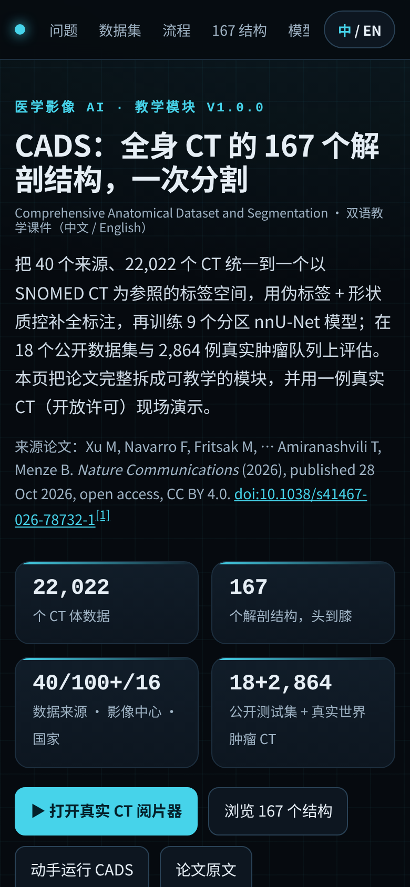

<p align="center">
  
</p>

<h1 align="center">CADS 全身 CT 解剖分割 · 双语教学课件<br>CADS Whole-body CT Anatomy Segmentation</h1>

<p align="center">
  <strong>一个框架，167 个解剖结构，从头到膝。先看它是怎么做出来的，再在一例真实 CT 上亲眼看它分割得怎么样。</strong><br>
  One framework, 167 anatomical structures, head to knees. Learn how it was built, then see it segment one real CT.
</p>

<p align="center">
  把 Xu 等 2026 年发表于 <i>Nature Communications</i> 的 CADS 论文拆成 15 个可教学模块：数据集、四步流程、167 个结构的标签浏览器、权重与许可、评估、真实世界队列、真实 CT 阅片器、急诊创伤外科教学案例、动手教程与小测验；中英文一键切换。<br>
  The CADS paper (Xu et al., <i>Nature Communications</i> 2026) turned into 15 teachable modules, with an interactive label browser, a real-CT viewer, trauma-surgery teaching cases, a hands-on tutorial and a quiz; one-click Chinese / English toggle.
</p>

<h3 align="center">
  <a href="https://tuanziding.github.io/cads-ct-teaching/">▶ 在线阅读 · Read online</a>
</h3>

<p align="center">
  <a href="README.md">简体中文</a> · <a href="文档/英文说明v1.0.md">English</a>
</p>

<p align="center">
  <a href="https://github.com/TUANZIDING/cads-ct-teaching/actions"></a>
  
  <a href="https://creativecommons.org/licenses/by-nc/4.0/"></a>
  <a href="LICENSES/PolyForm-Noncommercial-1.0.0.md"></a>
  <a href="文档/图片说明v1.0.md"></a>
</p>

<p align="center">
  <code>15 个教学模块</code> · <code>167 个结构 · 9 个模型组</code> · <code>真实 CT 阅片器（147 层）</code> · <code>一次真实 CADS 推理</code> · <code>6 张论文原图</code> · <code>18 篇 DOI 核验文献</code> · <code>中英双语</code> · <code>纯静态 · 可离线 · 手机友好</code>
</p>

<p align="center">
  <a href="#what-is-cads">CADS 是什么</a> ｜ <a href="#contents-page">课件内容</a> ｜ <a href="#showcase">实际界面</a> ｜ <a href="#inference">真实推理</a> ｜ <a href="#quick-start">快速开始</a> ｜ <a href="#contents">仓库内容</a> ｜ <a href="#license">版权与许可</a>
</p>

> ⚠️ 仅供教学与科研学习。CADS 是研究软件，论文明确说明其专家评审“不构成临床效用的正式证明”；本课件任何内容都不用于临床诊断或治疗决策。本课件为独立教学材料，与 CADS 作者团队无隶属关系，也未经其背书。

---

<a id="what-is-cads"></a>

## CADS 是什么 · What CADS is

**CADS**（Comprehensive Anatomical Dataset and Segmentation）把 40 个来源、22,022 个 CT 统一到一个以 SNOMED CT 为参照的标签空间，用伪标签 + 形状质控补全稀疏标注，再训练 9 个分区 nnU-Net（ResEnc-L）模型，一次分割从头到膝的 167 个解剖结构；在 18 个公开数据集与苏黎世大学医院 2,864 例真实肿瘤 CT 上评估。代码 Apache-2.0，权重分 reference / research（CC BY-NC-SA 4.0）/ open（CC BY-SA 4.0）三种许可，另有 3D Slicer 插件。

> Xu M, Navarro F, Fritsak M, … Amiranashvili T, Menze B. CADS: a comprehensive anatomical dataset and segmentation for whole-body anatomy in computed tomography. *Nature Communications* (2026). doi:[10.1038/s41467-026-78732-1](https://doi.org/10.1038/s41467-026-78732-1). 开放获取，[CC BY 4.0](https://creativecommons.org/licenses/by/4.0/)。

<a id="contents-page"></a>

## 课件内容 · What the module contains

| 模块 | 内容 |
| --- | --- |
| 01 为什么需要 CADS | 全身分割的用途（放疗危及器官、异常检测、转移定位、身体成分）与标注稀缺的问题 |
| 02 数据集 | 22,022 个 CT、40 个来源、100+ 影像中心、16 个国家 |
| 03 四步流程 | 从稀疏标注到 167 类全身标签：标签统一 → 伪标签 → 形状质控 → 训练 |
| 04 标签浏览器 | 167 个结构可搜索、按 9 个模型组 / 系统筛选，附中文名、SNOMED CT 编码、出现例数 |
| 05 权重与许可 | reference / research / open / CADS-region 的区别与适用场景 |
| 06–07 评估与真实世界 | 18 个公开数据集基准、2,864 例肿瘤 CT 队列与专家评审 |
| 08 真实 CT 阅片器 | 一例开放许可创伤 CT（147 层），软组织 / 肺 / 骨窗，叠加参考掩膜或 **CADS 真实推理结果** |
| 09 临床教学案例 | 急诊创伤外科视角：数肋骨与椎体、L3 层面身体成分、盆部肌肉与骨 |
| 10 动手教程 | 命令行安装与推理、3D Slicer 插件 |
| 11–15 | 小测验、局限与注意事项、资源、参考文献、版权与许可 |

每条内容都标注来源类型：【论文事实】【教学解读】【作者推算】【真实数据】。中英文讲义 Markdown 版：[`文档/教学讲义-中文v1.0.md`](文档/教学讲义-中文v1.0.md) · [`文档/教学讲义-英文v1.0.md`](文档/教学讲义-英文v1.0.md)。

<a id="showcase"></a>

## 实际界面 · Showcase

[](https://tuanziding.github.io/cads-ct-teaching/)

<sub>首页（桌面 1440 px）：标题、四个核心数字、阅片器与标签浏览器入口。</sub>

| 真实 CT 阅片器 | 英文界面 |
| --- | --- |
| [](https://tuanziding.github.io/cads-ct-teaching/#lab) | [](https://tuanziding.github.io/cads-ct-teaching/) |

| 手机 · 首页 | 手机 · 阅片器 |
| --- | --- |
| <a href="https://tuanziding.github.io/cads-ct-teaching/"></a> | <a href="https://tuanziding.github.io/cads-ct-teaching/#lab"></a> |

<sub>真实截图（Chromium 渲染 v1.0.0 网页；桌面 1440 px，手机 390 px）。交互效果请在线查看。</sub>

<a id="inference"></a>

## 一次真实的 CADS 推理 · A real CADS inference

阅片器里的“CADS 推理”叠加层不是示意图，而是真实运行模型得到的结果：

- **模型**：CADS-model-research 任务 554（躯干肌肉与骨盆），权重 CC BY-NC-SA 4.0，**本仓库不分发权重**。
- **输入**：TotalSegmentator 数据集 v2.0.1 病例 s0423（doi:[10.5281/zenodo.10047292](https://doi.org/10.5281/zenodo.10047292)，CC BY 4.0），属于 CADS 公开的测试划分。
- **环境**：2 核 CPU、约 8 GB 内存，6 个滑窗块耗时 634 s。
- **与官方流程的偏离**：滑窗块 128³（官方 192³，内存限制）；只推理骨盆至 L2 的裁剪区域；未执行官方 TPTBox 后处理。
- **结果**：与数据集参考掩膜比较，Dice 从骶骨 0.81 到左右髋骨 0.99（臀肌 0.94–0.98，背深肌 0.94，髂腰肌 0.95–0.96）。

只有 1 例，且参考掩膜的定义与 CADS 不完全一致，**不能代表模型性能**。完整参数、偏离说明与复现步骤见 [`验证/推理记录v1.0.md`](验证/推理记录v1.0.md)。

<a id="quick-start"></a>

## 先用起来 · Quick start

1. 手机或电脑浏览器打开 **[在线版](https://tuanziding.github.io/cads-ct-teaching/)**，右上角“中 / EN”切换语言。
2. 课堂投影：从“真实 CT 阅片器”开始，拖动层面、切换窗位与叠加层。
3. 离线使用：下载整个仓库（Code → Download ZIP），在根目录启动本地服务器。

```sh
git clone https://github.com/TUANZIDING/cads-ct-teaching.git
cd cads-ct-teaching && python3 -m http.server 8000      # 打开 http://localhost:8000
python3 验证/项目检查v1.0.py                             # 离线检查链接、文献、标签、图片署名与许可
```

<a id="contents"></a>

## 仓库内容 · Contents

```text
cads-ct-teaching/
├── index.html + assets/        互动网页（assets/ct/ 阅片器切片，assets/data/ 标签与病例数据）
├── 文档/
│   ├── 教学讲义-中文v1.0.md    中文讲义（由网页生成）
│   ├── 教学讲义-英文v1.0.md    English handout
│   ├── 英文说明v1.0.md         English README
│   ├── 图片说明v1.0.md         图片分类、许可与逐张署名表
│   ├── 主图/                   封面
│   └── 截图/                   真实界面截图（桌面 + 手机）
├── 图片/
│   ├── 论文原图/               6 张 CC BY 4.0 论文原图
│   ├── 真实CT/                 TotalSegmentator s0423 渲染图与 CADS 推理图
│   └── 插件截图/               3D Slicer 插件截图（Apache-2.0）
├── 示例/                       运行CADS示例v1.0.sh · L3面积示例v1.0.py · 示例说明v1.0.md
├── 验证/                       项目检查v1.0.py · 推理记录v1.0.md · 数字核验v1.0.json · 参考文献v1.0.json / .bib
├── 工具/                       构建、渲染、推理与网页检查脚本
├── LICENSE · LICENSES/          许可全文
└── CITATION.cff
```

## 如何核验 · Verification

- 18 篇参考文献都有 DOI，并经 Crossref（16 篇）或 DataCite（2 个数据集）核对；网页中每个 [n] 都链接到文献表。
- 论文中的关键数字逐条记录在 [`验证/数字核验v1.0.json`](验证/数字核验v1.0.json)。
- [`验证/项目检查v1.0.py`](验证/项目检查v1.0.py) 每次推送自动检查：本地链接与图片、文献编号、167 个标签、论文原图署名与 DOI、真实 CT 数据来源、许可文件、隐私（无个人邮箱 / 电话）、文件命名，以及不分发 CADS 权重与 NIfTI 体数据。

## 如何引用 · How to cite

请同时引用本课件与 CADS 原论文。GitHub 会识别根目录的 [`CITATION.cff`](CITATION.cff)。

> Ding H. CADS 全身 CT 解剖分割 · 双语教学课件（CADS Whole-body CT Anatomy Segmentation: A Bilingual Teaching Module）. Version 1.0.0. 2026-11-13. https://github.com/TUANZIDING/cads-ct-teaching

<a id="license"></a>

## 版权与许可 · License

本仓库仅供**非商业**学习、教学与科研使用 / For **non-commercial** use only.

| 部分 | 范围 | 许可 |
| --- | --- | --- |
| 论文原图 | `图片/论文原图/`（6 张，Xu et al., Nat Commun 2026） | **不属于**本仓库许可：版权归原作者，[CC BY 4.0](https://creativecommons.org/licenses/by/4.0/)，doi:10.1038/s41467-026-78732-1 |
| 真实 CT 数据派生图 | `图片/真实CT/`、`assets/ct/`（TotalSegmentator v2.0.1 病例 s0423） | [CC BY 4.0](https://creativecommons.org/licenses/by/4.0/)，doi:[10.5281/zenodo.10047292](https://doi.org/10.5281/zenodo.10047292) |
| CADS 推理结果图 | `图片/真实CT/*cads554*`、`assets/ct/*-cads.png` | [CC BY-NC-SA 4.0](https://creativecommons.org/licenses/by-nc-sa/4.0/)（随 CADS-model-research 权重许可） |
| CADS / Slicer 插件材料 | `图片/插件截图/`、标签结构名与组号 | [Apache-2.0](LICENSES/Apache-2.0.txt)（murong-xu/CADS、murong-xu/SlicerCADSWholeBodyCTSeg） |
| 作者原创内容 | `文档/`、网页与本 README 的文字、`验证/` 的核验记录、`assets/data/` 中作者整理部分、封面与截图 | [CC BY-NC 4.0](https://creativecommons.org/licenses/by-nc/4.0/)，全文见 [`LICENSES/CC-BY-NC-4.0.txt`](LICENSES/CC-BY-NC-4.0.txt) |
| 代码 | `index.html` 的页面结构与脚本、`assets/*.css`、`assets/*.js`、`工具/`、`验证/*.py`、`示例/`、`.github/` | [PolyForm Noncommercial 1.0.0](LICENSES/PolyForm-Noncommercial-1.0.0.md) |

本仓库不分发 CADS-dataset 的影像 / 掩膜，也不分发 CADS 模型权重。逐项署名见 [`文档/图片说明v1.0.md`](文档/图片说明v1.0.md)，许可总说明见 [`LICENSE`](LICENSE)。

<a id="commercial-use"></a>

### 商业使用 · Commercial use

**商业用途需事先联系作者获得授权合作**（第三方材料仍须遵守其原始许可）。<br>
**Commercial use requires prior permission; contact the author** (third-party material remains under its original licence).

👉 [联系作者 / Contact the author](https://tuanziding.github.io/#contact)

<p align="center"><sub>CADS 全身 CT 教学 · 丁海祥 Haixiang Ding · <a href="https://tuanziding.github.io/#research">个人主页</a></sub></p>
