# CADS 全身 CT 解剖分割 · 教学讲义 v1.0

> 本讲义由网页自动生成（v1.0.0）。互动功能（167 结构浏览器、真实 CT 阅片器、测验）请在线使用：https://tuanziding.github.io/cads-ct-teaching/

医学影像 AI · 教学模块 v1.0.0

# CADS：全身 CT 的 167 个解剖结构，一次分割 Comprehensive Anatomical Dataset and Segmentation · 双语教学课件（中文 / English）

把 40 个来源、22,022 个 CT 统一到一个以 SNOMED CT 为参照的标签空间，用伪标签 + 形状质控补全标注，再训练 9 个分区 nnU-Net 模型；在 18 个公开数据集与 2,864 例真实肿瘤队列上评估。本页把论文完整拆成可教学的模块，并用一例真实 CT（开放许可）现场演示。

来源论文：Xu M, Navarro F, Fritsak M, … Amiranashvili T, Menze B. *Nature Communications* (2026), published 28 Oct 2026, open access, CC BY 4.0. [doi:10.1038/s41467-026-78732-1](https://doi.org/10.1038/s41467-026-78732-1)^([\[1\]](#ref-1))

22,022 个 CT 体数据

167 个解剖结构，头到膝

40/100+/16 数据来源 · 影像中心 · 国家

18+2,864 公开测试集 + 真实世界肿瘤 CT

标签说明：【论文事实】论文或官方 README 直接写明 【教学解读】作者的教学解读 【作者计算】作者由论文数字换算 【真实数据】真实影像与真实掩膜

仅供教学与科研学习。CADS 是研究用软件，论文明确说专家审阅“不构成临床效用的正式证明”；本页任何内容都不能用于临床诊断或放疗计划。

## 01 · 为什么需要 CADS

CT 全身分割能把影像变成结构化的解剖信息，用于放疗计划、异常检测与分诊、转移灶定位和身体成分分析。^([\[1\]](#ref-1),[\[14\]](#ref-14),[\[15\]](#ref-15))

#### 【论文事实】标注稀缺

本研究纳入的 40 个公开 CT 来源中，只有 21% 的扫描带解剖标注，而且大多只标了一两个结构。

#### 【论文事实】模型碎片化

多数 AI 方法只针对单一器官，标签定义不一致，训练与评估方案各不相同。

#### 【论文事实】现有资源的缺口

解剖覆盖有限、数据多样性不足、复杂结构存在系统性标注错误、依赖人工流程、外部验证不足、模型或数据不开放、缺少易用工具。

【教学解读】一句话理解：CADS 的贡献不是新的网络结构，而是“数据为中心”——把碎片化的公开数据整理成统一、完整、可复用的标注，再用成熟的 nnU-Net 训练。论文原话：“The contribution is not a new network architecture”。

## 02 · CADS-dataset：22,022 个 CT

把公开档案、挑战赛数据和两份新医院数据整合到同一个解剖标签空间。

#### 【论文事实】规模与来源^([\[1\]](#ref-1))

- 22,022 个 CT，来自 40 个来源、16 个国家、100 多个影像中心，采集年份 2007–2024。
- 其中只有 4,695 个（21%）带部分标注；约 79% 完全没有标注。
- 与 TotalSegmentator 数据集相比：扫描数约 18 倍，独立目标多 60%。^([\[3\]](#ref-3))
- 大宗来源：NLST 7,172、CT-RATE 3,134、TotalSegmentator 1,203（104 个结构的标注）、AbdomenCT-1K 1,062。
- 新贡献：484 个头部 CT（土耳其，Istanbul Medipol University 伦理批准）与 586 个三期增强腹部 CT（德国，TUM 伦理批准）。
- 涵盖健康人与多种疾病：肿瘤（癌、淋巴瘤、转移）、COVID-19、创伤和罕见病；增强与平扫；头颈、胸、腹、盆、脊柱及全身视野。

#### 【论文事实】统一预处理^([\[1\]](#ref-1))

- 全部重定向到 RAS 坐标，并重采样到 1.5 mm 各向同性。
- 简化仿射矩阵：去除旋转与平移，保留缩放与剪切，便于形状质控和跨扫描比较。
- 新头部 CT 的面部区域用高斯滤波模糊（1.5 mm 下 σ = 5 体素）以降低可识别性。
- 标签空间以 SNOMED CT 为参照：每个目标给出 SNOMED 编码、包含/重叠关系与标注规范（补充表 1）。

【教学解读】教学提示：1.5 mm 各向同性重采样意味着耳蜗（中位仅 33 体素）这类小结构天然受部分容积效应限制——这也解释了后面小结构分割较难。

### 【论文事实】40 个数据来源（体数据量与许可）

数量与身体区域来自论文表 1；许可来自 Hugging Face 数据集卡片与表 1。区域：WB 全身，HN 头颈，TH 胸，AB 腹，PR 盆，SP 脊柱，VR 多区域。合计 22,022。

| 来源                            | 区域   | CT 数 | 许可                        |
|---------------------------------|--------|-------|-----------------------------|
| NLST                            | TH     | 7,172 | CC BY 4.0                   |
| CT-RATE                         | TH     | 3,134 | CC BY-NC-SA 4.0             |
| STOIC2021                       | TH     | 2,000 | CC BY-NC 4.0                |
| TotalSegmentator                | VR     | 1,203 | CC BY 4.0                   |
| AbdomenCT-1K                    | AB     | 1,062 | CC BY 4.0                   |
| LIDC-IDRI                       | TH     | 997   | CC BY 3.0                   |
| SAROS                           | WB, VR | 900   | CC BY 3.0 / 4.0 / BY-NC 3.0 |
| RibFrac                         | TH, AB | 660   | CC BY-NC 4.0                |
| New: CT-TRI (triphasic abdomen) | AB     | 586   | CC BY-NC-SA 4.0             |
| New: BrainCT-1mm (head CT)      | HN     | 484   | CC BY 4.0                   |
| TCGA-KIRC                       | AB     | 398   | CC BY 3.0                   |
| VerSe                           | SP     | 374   | CC BY-SA 4.0                |
| KiTS                            | AB     | 300   | CC BY-NC-SA 4.0             |
| LNDb                            | TH     | 294   | CC BY-NC-ND 4.0             |
| CPTAC-CCRCC                     | TH, AB | 258   | CC BY 3.0                   |
| TCGA-LIHC                       | AB     | 242   | CC BY 3.0                   |
| LiTS                            | AB     | 201   | CC BY-NC-SA 4.0             |
| AMOS                            | AB     | 200   | CC BY 4.0                   |
| CT Lymph Nodes                  | TH, AB | 174   | CC BY 3.0                   |
| CT-ORG                          | WB, AB | 140   | CC BY 3.0                   |
| CPTAC-LUAD                      | TH, AB | 133   | CC BY 3.0                   |
| NSCLC Radiogenomics             | TH     | 131   | CC BY 3.0                   |
| VISCERAL Silver Corpus          | WB, VR | 127   | Customized                  |
| CT Images in COVID-19           | TH     | 121   | CC BY 4.0                   |
| Pancreatic-CT-CBCT-SEG          | TH, AB | 93    | CC BY 4.0                   |
| Pancreas-CT                     | AB     | 80    | CC BY 3.0                   |
| EMPIRE10                        | TH     | 60    | Customized                  |
| RIDER Lung CT                   | TH     | 59    | CC BY 4.0                   |
| LOLA11                          | TH     | 55    | Customized                  |
| BTCV-Abdomen                    | AB     | 50    | CC BY 4.0                   |
| BTCV-Cervix                     | PR     | 50    | CC BY 4.0                   |
| HaN-Seg                         | HN     | 42    | CC BY-NC-ND 4.0             |
| VISCERAL Gold Corpus            | WB, VR | 40    | Customized                  |
| CHAOS (CT)                      | AB     | 40    | CC BY-NC-SA 4.0             |
| EXACT'09                        | TH     | 40    | Customized                  |
| CAD-PE                          | TH     | 40    | CC BY 4.0                   |
| SLIVER07                        | TH     | 30    | Customized                  |
| TCGA-KIRP                       | AB     | 19    | CC BY 3.0                   |
| TCGA-KICH                       | AB     | 17    | CC BY 3.0                   |
| Learn2Reg                       | AB     | 16    | CC BY 3.0 + TCIA            |

数据许可是逐来源的：CADS 团队并不拥有外部来源 CT 的原始所有权；在 Hugging Face 申请访问时须同意逐个数据集的许可条款（其中包含 CC BY-NC-ND、定制许可等）。本课件不转载任何 CADS-dataset 的影像或掩膜，只链接。

## 03 · 从稀疏标注到 167 类全身标签：四步流程

两轮迭代：先用全标注数据训练模型生成伪标签，再用筛选后的标签训练最终模型。

#### 全身伪标注

【论文事实】把 167 个目标分成 9 个解剖组，每组训练一个专用 nnU-Net，初始训练数据来自 5 个来源：TotalSegmentator（104 类，构成 9 组中的 5 组）、VISCERAL 上新勾画的 10 个放疗危及器官、HaN-Seg 头颈结构、经 ANTs 配准 SimNIBS 图谱得到的脑结构、SAROS 体腔/组织（2D 稀疏标注层间插值成 3D）。随后对 22,022 个 CT 全部生成伪标签。

#### 形状质控

【论文事实】用神经隐式函数的 auto-decoder 只在真实标注上学习“正常形状”；对每个伪标签求最能重建它的隐编码，以伪标签与重建之间的 90 百分位 Hausdorff 距离作为异常分数。总分最差的 10% 图像不进入 Shape 版本的训练集。^([\[7\]](#ref-7))

#### 逐结构选标签

【论文事实】训练三种“口味”模型：GT（只用原始真标注）、Pseudo（全部伪标签）、Shape（质控后伪标签）。每个结构在验证集上按 Dice 排名（优先用来源不匹配的 OOD 验证），p \< 0.05 无差异时用 HD95 决胜。最终标签：原始真标注优先，其余用选中口味的预测，并按可靠性逐步合并。

#### 训练最终模型

【论文事实】nnU-Net v2.5.1 的残差编码器 U-Net（ResEnc-L），按类出现概率的倒数做类均衡采样——例如 C1–C5 椎骨只出现在 905–3,255 个 CT 中，而肝、脾、主动脉都超过 21,000 个。9 个分区模型共同覆盖 167 个目标。^([\[5\]](#ref-5),[\[6\]](#ref-6))

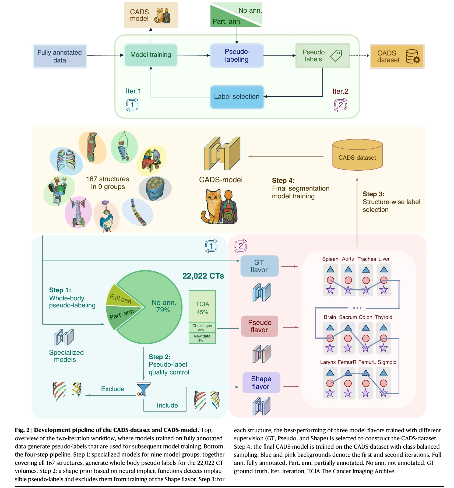

【论文事实】图 2：CADS-dataset 与 CADS-model 的开发流程（上：两轮迭代；下：四步流程）。转载自 Xu M 等，Nat Commun 2026，图 2，[doi:10.1038/s41467-026-78732-1](https://doi.org/10.1038/s41467-026-78732-1)，[CC BY 4.0](https://creativecommons.org/licenses/by/4.0/)。从 Article-in-Press PDF 页面裁出（保留原英文图注），缩放并转为 WebP，无其他改动。

【教学解读】类比：Pseudo 像“大量实习生勾画”，Shape 像“先让主任按解剖常识剔除明显离谱的勾画”，GT 像“少量专家金标准”。CADS 不是只信一种，而是对每个结构挑在外部数据上表现最好的那一种。论文讨论部分指出，多模型平均主要降低伪标签中随机（方差）部分的误差；系统性错误需要像保留肋椎关节这样的定向解剖修正。

## 04 · 167 个结构：交互式标签浏览器

按教学系统或按模型组（T551–T559）浏览；点击任一结构查看 SNOMED CT 编码、出现例数与中位体积。

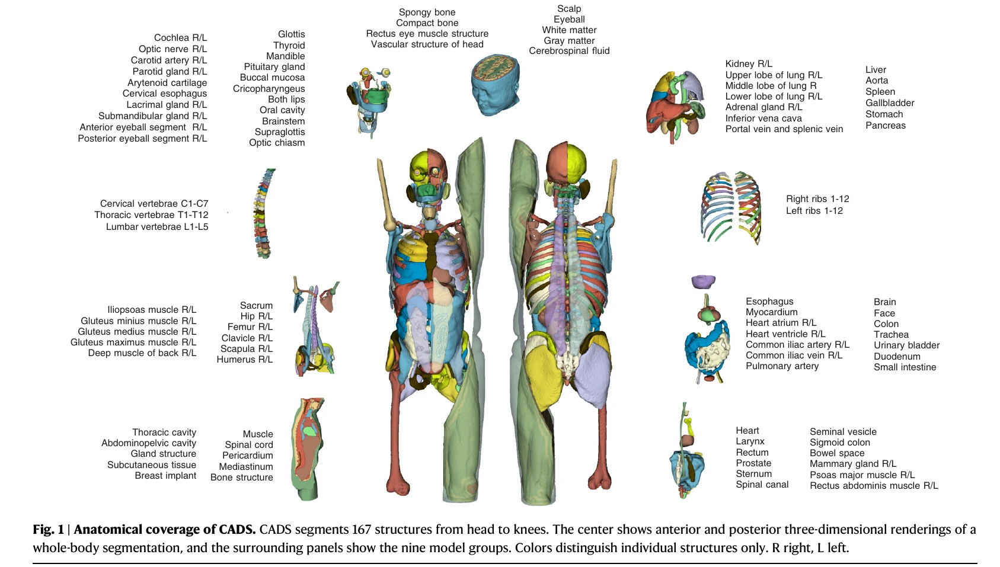

【论文事实】图 1：CADS 从头到膝分割 167 个结构；中间为全身分割的前后位三维渲染，周围为 9 个模型组。转载自 Xu M 等，Nat Commun 2026，图 1，[doi:10.1038/s41467-026-78732-1](https://doi.org/10.1038/s41467-026-78732-1)，[CC BY 4.0](https://creativecommons.org/licenses/by/4.0/)。从 Article-in-Press PDF 页面裁出（保留原英文图注），缩放并转为 WebP，无其他改动。

【论文事实】名称与组号：官方 labelmap.md（Apache-2.0）；SNOMED CT 与上级系统：补充表 1；出现例数与中位体素：论文表 2。 【教学解读】“按系统”分组是作者为教学做的归类（论文图 3 用了类似但不完全相同的系统配色），不是论文的正式分组。

### 【论文事实】9 个模型组

| 任务 | 内容（官方 README）                | 3D Slicer 中的名称 | 结构数 |
|------|------------------------------------|--------------------|--------|
| T551 | 腹部主要器官、肺叶与腹部大血管     | Core organs        | 17     |
| T552 | 全脊柱椎骨 C1–L5                   | Spine complete     | 24     |
| T553 | 胸腹器官、心腔、脑、盆腔血管与面部 | Heart & vessels    | 18     |
| T554 | 四肢带骨、骶骨与躯干大肌群         | Trunk muscles      | 21     |
| T555 | 左右第 1–12 肋                     | Ribs complete      | 24     |
| T556 | 放疗相关结构                       | RT risk organs     | 15     |
| T557 | 脑与头部组织                       | Brain tissues      | 9      |
| T558 | 头颈部结构（放疗危及器官）         | Head-neck organs   | 29     |
| T559 | 组织类型与体腔                     | Body regions       | 10     |

【教学解读】标签空间是“层级的”：粗类和细类可以共存并重叠。例如 T559 的“肌肉”覆盖全身肌肉软组织，而 T554 的髂腰肌、T556 的腰大肌是其中的细类；T556 的“心脏”含心包囊，T553 另有四个心腔和心肌。用于计量时要先想清楚取哪一级。

## 05 · CADS-model：权重版本与许可

同一网络结构、同样 9 个任务（T551–T559）、同样 167 个目标；差别在训练数据的许可范围。

| 版本（CLI 名） | 权重许可                | 最大训练集 | 适用                                                                             |
|----------------|-------------------------|------------|----------------------------------------------------------------------------------|
| `reference`    | CADS 定制模型许可       | 21,277     | 复现论文结果；额外用了 EXACT09、LOLA11、SLIVER07、EMPIRE10，须遵守这些挑战赛条款 |
| `research`     | CC BY-NC-SA 4.0         | 21,124     | 官方推荐：多数学术、非商业研究；在报告的评估中与 reference 近乎相同              |
| `open`         | CC BY-SA 4.0            | 13,269     | 需要可再分发（含商业）的派生权重；部分精细头颈危及器官性能可能下降               |
| CADS-region    | 同 reference 的定制许可 | –          | 按解剖区域重组为 13 个任务（T601–T613）                                          |

【论文事实】来源：官方仓库 README 与 cads/LICENSE_MODEL；代码本身为 Apache-2.0。“最大训练集”指过滤后 9 个任务中最大的训练集。

#### 【论文事实】工程参数（官方文档）

- 代码版本 v1.0.3；reference 权重为 release v1.0.0。
- 每个任务的预训练模型约 727 MB；全部 9 个任务建议预留约 7 GB 磁盘。
- CPU 模式更慢：胸腹 CT 约需 10 分钟以上（3D Slicer 插件 README）。
- 输出可显示为 SNOMED CT 标准名称，便于进入临床研究流程。

#### 【论文事实】网络结构基准（补充说明 3）

在相同数据、预处理和划分下，把 ResEnc-L 与 MedNeXt-M、SegResNet、SwinUNETR、U-Mamba Bot 比较；论文把这作为补充分析，正文结论不依赖新结构。

## 06 · 评估：18 个公开数据集

主对照是同样基于 nnU-Net 的 TotalSegmentator v2.4.0（最强推理配置），以把“数据的贡献”与“网络的贡献”分开。^([\[3\]](#ref-3))

| 测试数据                                    | TotalSeg Dice % | CADS Dice % | TotalSeg HD95 mm | CADS HD95 mm |
|---------------------------------------------|-----------------|-------------|------------------|--------------|
| 主测试（完整标注，117 个共同目标）          | 89.22           | 91.51       | 5.63             | 3.21         |
| 次测试（部分标注）                          | 81.78           | 83.90       | 10.70            | 7.60         |
| 全部测试数据（117 个共同目标）              | 88.12           | 90.52       | 7.38             | 4.36         |
| CADS 全部目标（图 4a：不含面部，共 166 个） | –               | 85.87       | –                | 5.23         |

【论文事实】来源：图 4a 表格与正文。共同目标的宏平均 Dice：CADS 90.52%（95% CI 88.12–92.41，中位 92.33）对 TotalSegmentator 88.12%（95% CI 85.18–90.48，中位 90.13）。CADS 在 71 个结构上 Dice 更高，其中 44 个 p \< 0.05（逐结构配对比较，未做多重比较校正）。

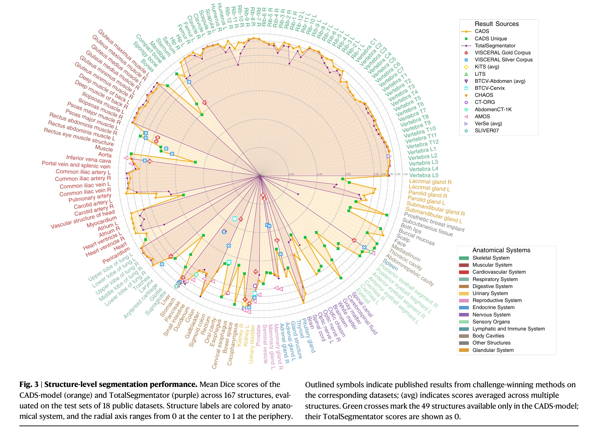

【论文事实】图 3：167 个结构的平均 Dice（橙：CADS；紫：TotalSegmentator）。绿色十字标出 49 个只有 CADS 能分割的结构。转载自 Xu M 等，Nat Commun 2026，图 3，[doi:10.1038/s41467-026-78732-1](https://doi.org/10.1038/s41467-026-78732-1)，[CC BY 4.0](https://creativecommons.org/licenses/by/4.0/)。从 Article-in-Press PDF 页面裁出（保留原英文图注），缩放并转为 WebP，无其他改动。

#### 【论文事实】数据集层面：Dice 差值（CADS − TotalSeg，百分点）

BTCV-Cervix+18.63

HaN-Seg+12.18

VISCERAL GC-Extra+9.01

SAROS+3.67

KiTS+2.95

TotalSegmentator+1.66

VISCERAL SC+1.16

AbdomenCT-1K+0.78

VISCERAL GC+0.27

VerSe+0.22

SLIVER07+0.22

LiTS+0.19

AMOS+0.18

Learn2reg+0.15

CHAOS+0.06

CT-ORG-0.24

BTCV-Abdomen-1.31

EMPIRE10-6.49

数值读自图 4b 的标注。18 个数据集中 15 个 Dice 更高、16 个 HD95 更低；18 个数据集平均 Dice 高 2.40 个百分点、HD95 低 3.96 mm；HD95 降幅最大的是 BTCV-Cervix（42.21 mm）与 HaN-Seg（14.18 mm）。

#### 【论文事实】为什么全部 167 个的平均更低？

- 训练数据有限：如颊黏膜只出现在不到 1,000 个扫描中，且只有 30 个真标注。
- 极小器官（\< 0.5 mL），如杓状软骨，受 CT 分辨率与部分容积效应限制。
- 解剖复杂的结构，尤其小腺体。

#### 【论文事实】参考标注本身也会错

作者逐一审阅 TotalSegmentator 测试集的 4,597 个“病例-结构”对，3,002 个判定可靠并保留；肋骨与椎骨错误最突出。放射科医师人工修正了 9 个结构共 72 个被排除的对，作为修正后的小基准。在专家核实子集上 CADS 的 Dice 为 93.15%。

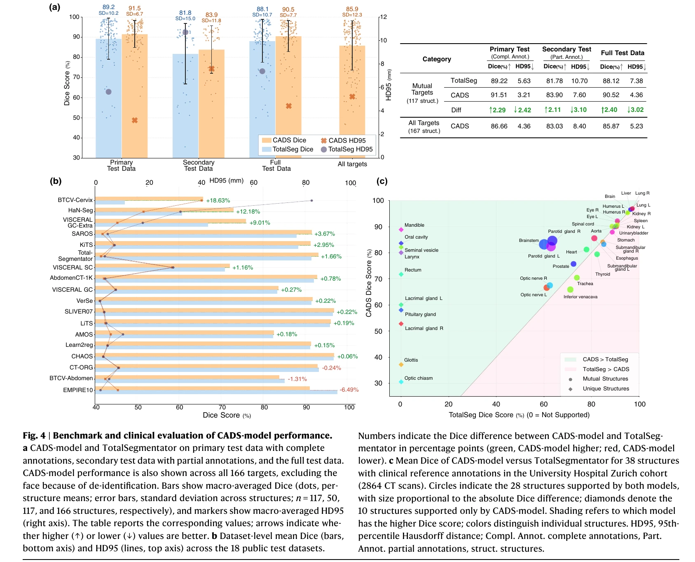

【论文事实】图 4：(a) 主/次/全部测试数据的 Dice 与 HD95；(b) 18 个数据集的 Dice 与 HD95；(c) 苏黎世大学医院队列 38 个结构的 Dice 对比。转载自 Xu M 等，Nat Commun 2026，图 4，[doi:10.1038/s41467-026-78732-1](https://doi.org/10.1038/s41467-026-78732-1)，[CC BY 4.0](https://creativecommons.org/licenses/by/4.0/)。从 Article-in-Press PDF 页面裁出（保留原英文图注），缩放并转为 WebP，无其他改动。

【教学解读】读数要点：Dice 衡量重叠（越高越好），HD95 衡量边界最差处的距离（越低越好）。论文提醒，CADS 与基线在数据规模、解剖覆盖、来源多样性和标签整理上都不同，提升不应只归因于训练集变大。

## 07 · 真实世界：苏黎世大学医院 2,864 例肿瘤 CT

独立队列，未参与模型开发；参考掩膜在 MIM 软件中生成并经医师确认，或由放射肿瘤医师按临床规范直接勾画。

#### 【论文事实】队列

2,864 个 CT，38 个有临床参考的结构（28 个两模型都支持 + 10 个仅 CADS 支持）；最大病种组为中枢神经系统恶性肿瘤、骨肿瘤和头颈癌。数据不对外开放。

#### 【论文事实】最大提升

都是放疗相关结构：脑干 +23.08 个百分点，腮腺左 +19.40、右 +21.02。

#### 【论文事实】专家审阅

一位有 5.5 年经验的放射肿瘤医师逐层审阅；每个结构看中位 Dice 附近的 3 例，以反映“典型”而非最好表现。另有 6 个外部队列共 1,160 个 CT（补充说明 6）。

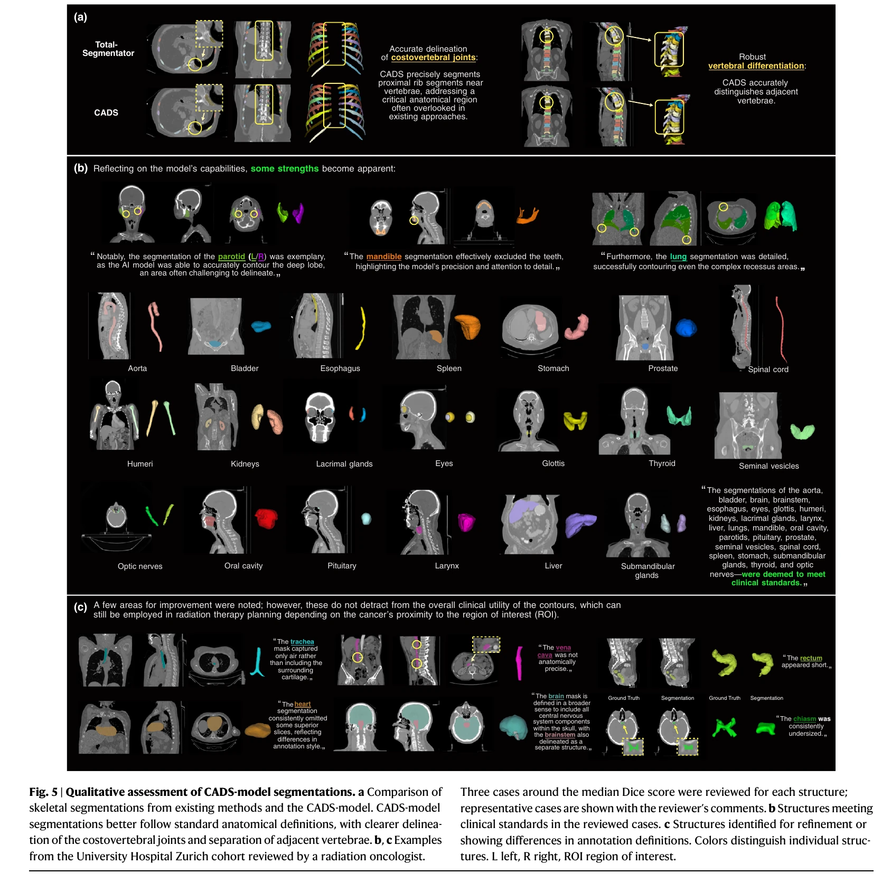

【论文事实】图 5：(a) 肋椎关节与相邻椎骨分离；(b) 达到临床标准的结构与审阅意见；(c) 需要改进或定义不同的结构（气管只含气腔、下腔静脉不精确、直肠偏短、心脏缺少部分上层、脑掩膜定义宽、视交叉偏小）。转载自 Xu M 等，Nat Commun 2026，图 5，[doi:10.1038/s41467-026-78732-1](https://doi.org/10.1038/s41467-026-78732-1)，[CC BY 4.0](https://creativecommons.org/licenses/by/4.0/)。从 Article-in-Press PDF 页面裁出（保留原英文图注），缩放并转为 WebP，无其他改动。

【论文事实】论文原意：这项定性评估提示 CADS 可能与放疗勾画工作流相关，但不构成临床效用的正式证明；那需要盲法、多读者、把 CADS 勾画与人工临床勾画对比的研究。审阅者只有一位且未设盲。

## 08 · 真实 CT 阅片器：一例开放许可的创伤 CT

【真实数据】病例 s0423（TotalSegmentator 数据集 v2.0.1，CC BY 4.0）：65 岁男性，颈-胸-腹-盆 CT，数据集元数据记为“创伤，胸部”。叠加的是数据集自带的 117 类参考掩膜（不是 CADS 输出）。每 3 层取 1 层（层间 4.5 mm），共 147 层。

提示：直接双击本地文件打开时，浏览器会阻止读取标签像素。请用 `python3 -m http.server` 在本地起一个服务器再打开。

### 【真实数据】真的跑了一次 CADS：T554（躯干肌肉与骨盆）在 CPU 上的推理

模型：CADS-model-research（CC BY-NC-SA 4.0）任务 554 的官方权重，经 nnU-Net 2.5.2 推理接口在 2 核 CPU 上运行，约 10 分钟。为适应约 8 GB 内存，我们把滑窗块从 192³ 缩小到 128³，并只推理骨盆到 L2 的躯干区域（裁剪范围见数据文件），也没有执行官方脚本的 TPTBox 后处理——所以这是“近似官方流程”的真实输出，不等同于论文报告的性能。本页不分发权重，只展示在一例开放数据上的结果。

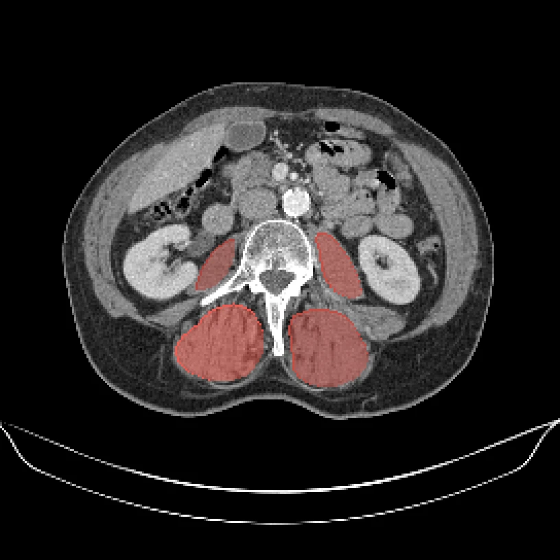

【真实数据】L3 层面：CADS T554 的真实推理结果（髂腰肌、背深肌）。作者用代码从 TotalSegmentator 数据集 v2.0.1 病例 s0423 渲染（Wasserthal 等，[doi:10.5281/zenodo.10047292](https://doi.org/10.5281/zenodo.10047292)，CC BY 4.0）。除特别注明外，彩色叠加为该数据集自带的参考掩膜，不是 CADS 的输出。图像左侧 = 患者右侧。

【真实数据】同一层面：数据集自带的参考掩膜（同类结构）。作者用代码从 TotalSegmentator 数据集 v2.0.1 病例 s0423 渲染（Wasserthal 等，[doi:10.5281/zenodo.10047292](https://doi.org/10.5281/zenodo.10047292)，CC BY 4.0）。除特别注明外，彩色叠加为该数据集自带的参考掩膜，不是 CADS 的输出。图像左侧 = 患者右侧。

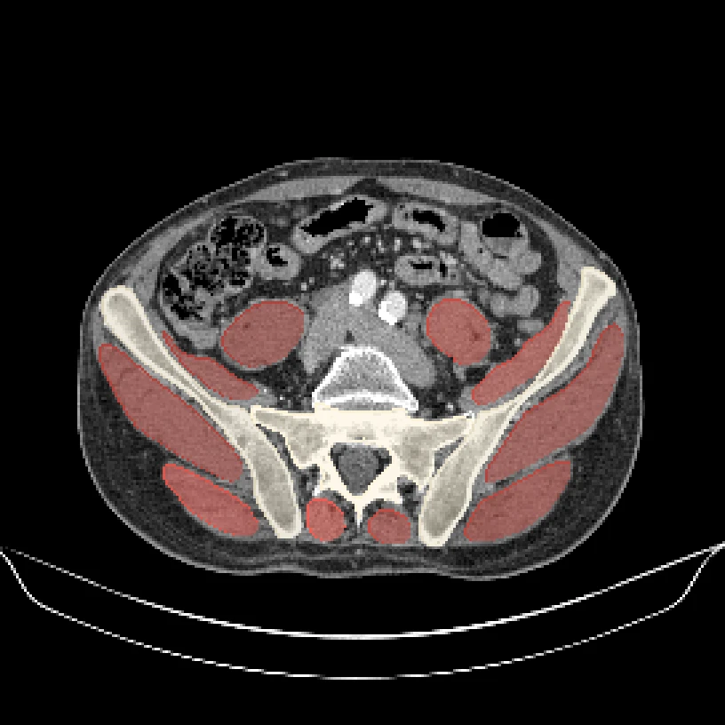

【真实数据】髂骨翼 / 骶骨上部层面：CADS T554 推理（髋骨、骶骨、臀肌、髂腰肌、背深肌）。作者用代码从 TotalSegmentator 数据集 v2.0.1 病例 s0423 渲染（Wasserthal 等，[doi:10.5281/zenodo.10047292](https://doi.org/10.5281/zenodo.10047292)，CC BY 4.0）。除特别注明外，彩色叠加为该数据集自带的参考掩膜，不是 CADS 的输出。图像左侧 = 患者右侧。

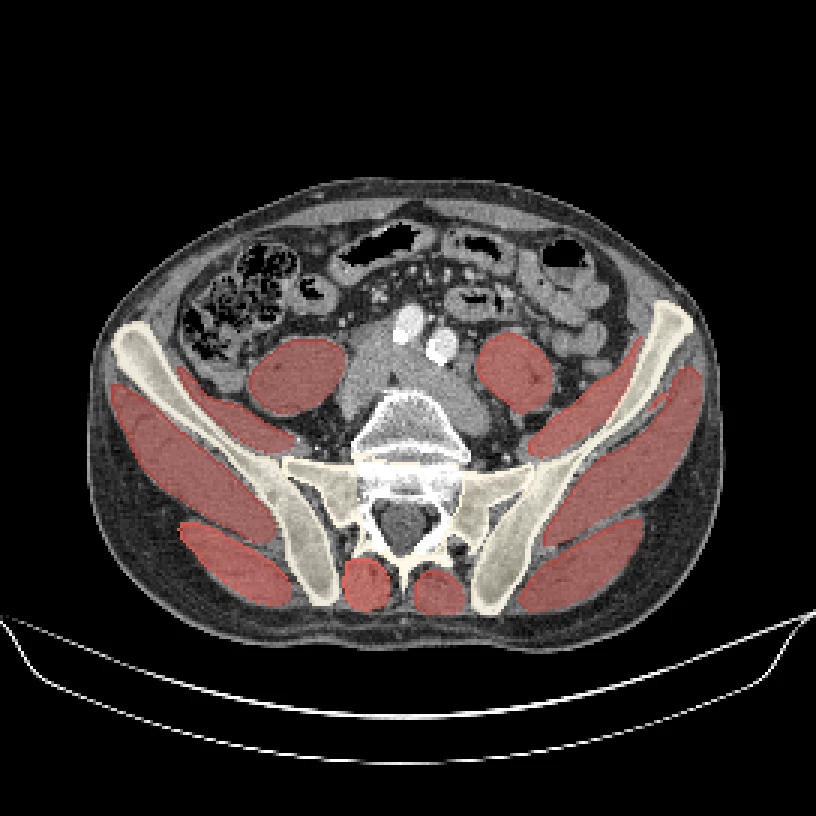

【真实数据】同一层面：参考掩膜。作者用代码从 TotalSegmentator 数据集 v2.0.1 病例 s0423 渲染（Wasserthal 等，[doi:10.5281/zenodo.10047292](https://doi.org/10.5281/zenodo.10047292)，CC BY 4.0）。除特别注明外，彩色叠加为该数据集自带的参考掩膜，不是 CADS 的输出。图像左侧 = 患者右侧。

#### 【作者计算】与参考掩膜的 Dice（推理区域内，体素级）

| CADS T554            | TotalSegmentator      | Dice  | 参考体素 | 预测体素 |
|----------------------|-----------------------|-------|----------|----------|
| 左髋骨               | hip_left              | 0.988 | 56,186   | 56,415   |
| 右髋骨               | hip_right             | 0.986 | 53,623   | 53,529   |
| 骶骨                 | sacrum                | 0.811 | 45,124   | 59,068   |
| 左臀大肌             | gluteus_maximus_left  | 0.976 | 22,822   | 22,246   |
| 右臀大肌             | gluteus_maximus_right | 0.968 | 21,022   | 20,002   |
| 左臀中肌             | gluteus_medius_left   | 0.971 | 45,340   | 43,679   |
| 右臀中肌             | gluteus_medius_right  | 0.972 | 40,913   | 39,573   |
| 左臀小肌             | gluteus_minimus_left  | 0.937 | 5,202    | 4,968    |
| 右臀小肌             | gluteus_minimus_right | 0.939 | 3,165    | 2,967    |
| 左背深肌（竖脊肌群） | autochthon_left       | 0.941 | 106,277  | 94,591   |
| 右背深肌（竖脊肌群） | autochthon_right      | 0.940 | 102,935  | 91,477   |
| 左髂腰肌             | iliopsoas_left        | 0.952 | 62,192   | 57,928   |
| 右髂腰肌             | iliopsoas_right       | 0.960 | 56,522   | 52,687   |

【教学解读】解读注意：(1) 只有 1 例，不能代表整体性能；(2) 参考掩膜是 TotalSegmentator 的“模型生成 + 人工校正”标注，标签定义与 CADS 不完全相同（例如“背深肌”对应 autochthon）；(3) 被推理区域截断的结构（如股骨下段）会拉低 Dice；(4) 该病例在 CADS 公开的测试划分中，未用于训练。

## 09 · 临床教学案例（急诊创伤外科视角）

【教学解读】以下三例用同一例真实 CT 讲解“全身分割能帮临床看什么”。它们是教学解读，不是论文结论，也不是诊断建议。

### 案例 1 · 创伤 CT 的解剖定位：数肋骨、数椎骨

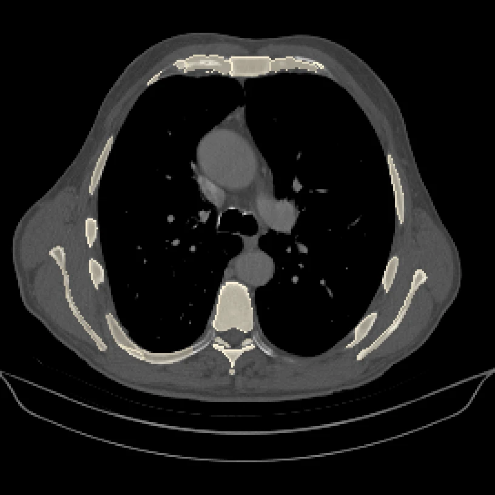

【真实数据】T6 层面骨窗：参考掩膜把每根肋骨、胸椎、胸骨、肩胛骨分别着色。作者用代码从 TotalSegmentator 数据集 v2.0.1 病例 s0423 渲染（Wasserthal 等，[doi:10.5281/zenodo.10047292](https://doi.org/10.5281/zenodo.10047292)，CC BY 4.0）。除特别注明外，彩色叠加为该数据集自带的参考掩膜，不是 CADS 的输出。图像左侧 = 患者右侧。

#### 【教学解读】教学要点

- 在创伤 CT 报告中，“左第 6 肋骨折”的准确性依赖逐根计数；逐根肋骨、逐节椎骨的分割（CADS 的 T552、T555）可以作为计数的核对工具。
- 【论文事实】CADS 专门修正了肋骨标注，保留常被公开数据集漏掉的肋椎关节，并更好地区分相邻椎骨（图 5a）。
- 注意：分割模型不检测骨折；CADS 的标签空间中没有“骨折”“出血”“气胸”等病灶类别。
- 【论文事实】数据集中颈椎上段（C1–C5）出现例数少（905–3,255 例），模型训练时专门做了类均衡采样。

### 案例 2 · 放疗危及器官（OAR）

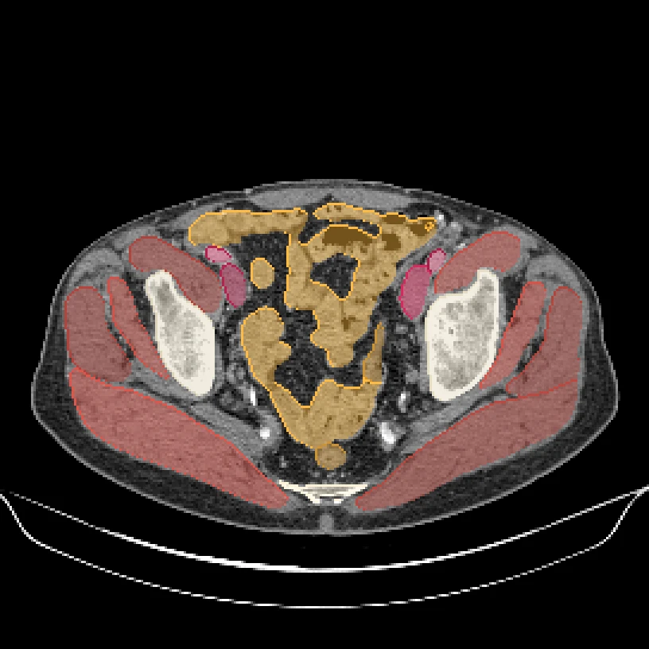

【真实数据】髋臼层面软组织窗：膀胱、髋骨、股骨头、臀肌、髂血管等参考掩膜。作者用代码从 TotalSegmentator 数据集 v2.0.1 病例 s0423 渲染（Wasserthal 等，[doi:10.5281/zenodo.10047292](https://doi.org/10.5281/zenodo.10047292)，CC BY 4.0）。除特别注明外，彩色叠加为该数据集自带的参考掩膜，不是 CADS 的输出。图像左侧 = 患者右侧。

#### 【教学解读】教学要点

- 【论文事实】T556（放疗相关结构：椎管、喉、心脏、肠道空间、乙状结肠、直肠、前列腺、精囊、乳腺、胸骨、腰大肌、腹直肌）与 T558（头颈 OAR 29 个）直接服务于放疗勾画。
- 【论文事实】T556 的多个结构按放疗规范定义：例如“肠道空间”是从幽门到直乙交界肠管可能占据的空间，“心脏”包含心包囊；头颈 OAR 的勾画参照 HaN-Seg 与国际共识。^([\[9\]](#ref-9),[\[13\]](#ref-13))
- 自动勾画的价值在于“先给初稿、再由医师逐层修改”；论文专家指出的问题（直肠偏短、视交叉偏小等）正是需要人工复核的位置。

### 案例 3 · 身体成分：L3 层面的肌肉

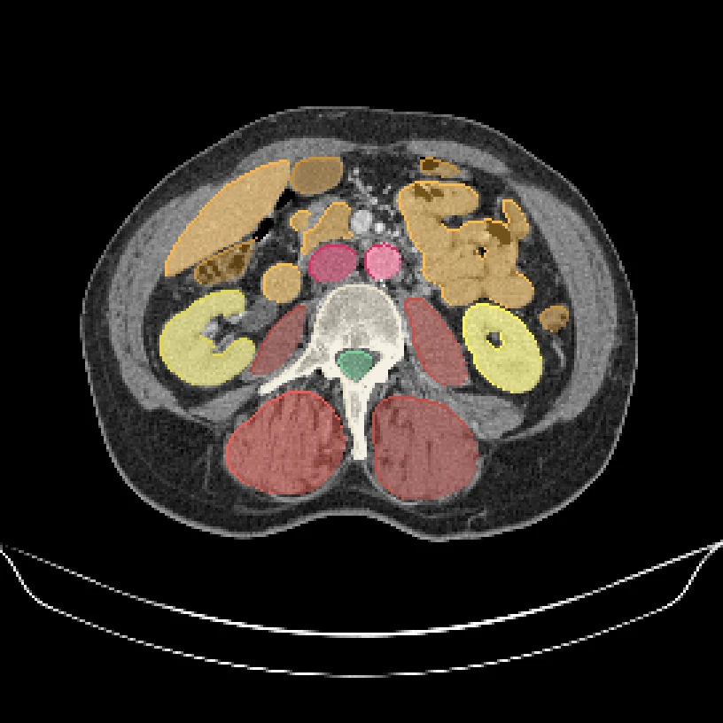

【真实数据】L3 椎体中层软组织窗：髂腰肌、背深肌（竖脊肌群）、肾、肝、结肠、小肠、主动脉、下腔静脉的参考掩膜。作者用代码从 TotalSegmentator 数据集 v2.0.1 病例 s0423 渲染（Wasserthal 等，[doi:10.5281/zenodo.10047292](https://doi.org/10.5281/zenodo.10047292)，CC BY 4.0）。除特别注明外，彩色叠加为该数据集自带的参考掩膜，不是 CADS 的输出。图像左侧 = 患者右侧。

#### 【教学解读】教学要点

- L3 单层面的组织面积与全身脂肪和去脂组织量高度相关（r = 0.86–0.94），因此 L3 常被用作 CT 身体成分分析的标准层面。^([\[16\]](#ref-16))
- 骨骼肌面积常用身高平方校正为骨骼肌指数（SMI）；具体诊断阈值因人群而异，引用时应回到原始文献。^([\[17\]](#ref-17),[\[18\]](#ref-18))
- 【论文事实】CADS 提供多级肌肉标签：T559“肌肉”（全身肌肉软组织，SAROS 定义，含筋膜与肌间脂肪，后续自动扣除肌间/肌内脂肪）、T556 腰大肌与腹直肌、T554 髂腰肌与背深肌。
- 【作者计算】本例 L3 中层，参考掩膜面积：双侧髂腰肌 16.4 cm²，双侧背深肌 58.1 cm²（像素 1.5 × 1.5 mm）。这只是演示“掩膜 → 面积”的计算，不是完整的骨骼肌面积，也未做 HU 阈值处理。

## 10 · 动手教程：命令行与 3D Slicer

【论文事实】步骤摘自官方 README（2026-11 版本）。使用权重即表示接受对应的模型许可。

#### A. Python 命令行

    # 1) 克隆仓库
    git clone https://github.com/murong-xu/CADS.git
    # 2) 环境（Python ≥ 3.9）
    conda create -n CADS_env python=3.11
    conda activate CADS_env
    # 3) 按系统/CUDA 安装 PyTorch（要求 torch ≥ 2.1.2），例如 Linux + CUDA 12.4：
    pip install torch==2.5.1 torchvision==0.20.1 torchaudio==2.5.1 \
      --index-url https://download.pytorch.org/whl/cu124
    # 4) 安装 CADS
    cd CADS && pip install -e .

    # 一条命令推理（-task 为 all 或 551–559；-license 为 reference/research/open）
    python cads/scripts/predict_images.py \
      -in /path/to/ct_images -out /path/to/output \
      -task all -license research          # 无 GPU 时加 --cpu

大批量（约 100–1000 例以上）用分阶段流程：`run_01_preprocess.py`（CPU，重定向+重采样）→ `run_02_inference.py`（GPU，输出 \_part_551…\_part_559）→ `run_03_restore_seg.py`（CPU，还原到原始几何）。

#### B. 3D Slicer 插件（CADSWholeBodyCTSeg）

1.  安装 3D Slicer（官方测试过 5.10.0 稳定版与 5.11.0 预览版）。
2.  Extension Manager 搜索 **PyTorch** 安装并重启；在 PyTorch Utils 中输入 `>=2.1.2` 安装（2.1.2–2.8.0 均可）。
3.  Extension Manager 搜索 **NNUNet** 安装并重启；在 nnUNet 模块中安装**精确版本** `==2.5.2`。
4.  Extension Manager 搜索 **CADSWholeBodyCTSeg** 安装并重启。
5.  载入 CT → 选 Input volume、Segmentation task（或 All）、Target mode → Apply。默认显示 SNOMED CT 标准名；无 GPU 可勾选 Force to use CPU。
6.  每个任务首次运行会下载约 727 MB 模型；全部任务预留约 7 GB。Windows + Slicer ≤ 5.10.0 可能遇到路径反斜杠问题，官方建议升级到 5.11.0。

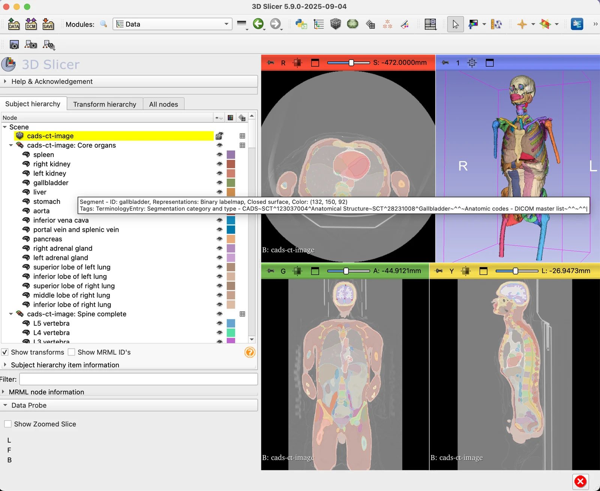

【论文事实】插件运行后的界面：左侧按模型组列出结构，悬停显示 SNOMED CT 术语。Screenshot_02.png，来自 [murong-xu/SlicerCADSWholeBodyCTSeg](https://github.com/murong-xu/SlicerCADSWholeBodyCTSeg)（Apache-2.0），缩放并转为 WebP。

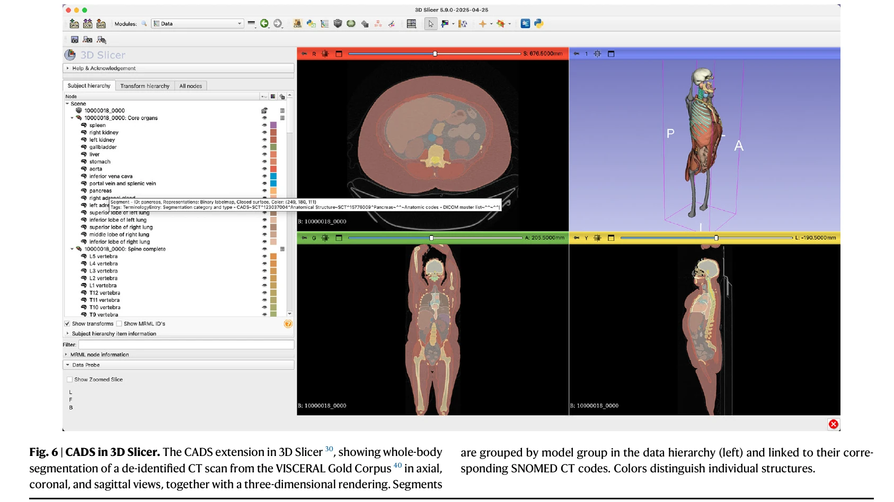

【论文事实】图 6：3D Slicer 中的 CADS 扩展，VISCERAL Gold Corpus 去标识 CT 的全身分割（轴、冠、矢状位与三维）。转载自 Xu M 等，Nat Commun 2026，图 6，[doi:10.1038/s41467-026-78732-1](https://doi.org/10.1038/s41467-026-78732-1)，[CC BY 4.0](https://creativecommons.org/licenses/by/4.0/)。从 Article-in-Press PDF 页面裁出（保留原英文图注），缩放并转为 WebP，无其他改动。

【教学解读】课堂建议：先用 3D Slicer 跑单个任务（如 T551 腹部器官）让学员看结果，再讨论“模型输出 ≠ 诊断”；需要批量研究时再用命令行。本仓库 `示例/` 给出了在开放数据上计算 L3 肌肉面积的脚本。

## 11 · 小测验

点击选项即判分；每题都附出处要点。得分：0 / 0

#### 1. CADS-dataset 一共有多少个 CT？

◻️ A. 4,695

✅ B. 22,022

◻️ C. 2,864

◻️ D. 1,203

22,022 个，来自 40 个来源；其中只有 4,695 个（21%）带部分标注。

#### 2. CADS 的核心贡献是什么？

◻️ A. 一种新的 Transformer 网络

✅ B. 数据为中心：统一、补全并整理大规模标注，再用成熟的 nnU-Net 训练

◻️ C. 一种新的骨折检测算法

◻️ D. 一台新的 CT 设备

论文明确说贡献“不是新的网络结构”，而是大规模、一致整理的标注。

#### 3. 形状质控用什么度量判断伪标签是否离谱？

◻️ A. Dice

✅ B. 90 百分位 Hausdorff 距离（伪标签与其形状重建之间）

◻️ C. 体积

◻️ D. HU 均值

它对离群点敏感、又不被少数远处体素主导；最差的 10% 图像不进 Shape 版本训练。

#### 4. 最终每个结构的标签来自哪里？

◻️ A. 永远来自 Pseudo 模型

✅ B. 原始真标注优先；没有时用在验证集上排名最高的口味（GT/Pseudo/Shape）

◻️ C. 随机挑一个

◻️ D. 由 3D Slicer 用户手工勾画

逐结构选择，优先用来源不匹配的 OOD 验证排名。

#### 5. 在 117 个共同目标上，CADS 与 TotalSegmentator 的宏平均 Dice 分别是？

◻️ A. 85.87% vs 88.12%

✅ B. 90.52% vs 88.12%

◻️ C. 93.15% vs 90.52%

◻️ D. 99% vs 80%

90.52%（95% CI 88.12–92.41）对 88.12%（95% CI 85.18–90.48）。93.15% 是专家核实子集上的结果，85.87% 是 CADS 全部目标的平均。

#### 6. 真实世界队列中提升最大的结构是？

◻️ A. 肝

✅ B. 脑干（+23.08 个百分点）

◻️ C. 股骨

◻️ D. 主动脉

脑干 +23.08，腮腺左 +19.40、右 +21.02，都是放疗相关结构。

#### 7. 下列哪项是论文自己承认的局限？

◻️ A. 覆盖了手和足

✅ B. 定性审阅只有一位未设盲的专家

◻️ C. CADS 不能在 CPU 上运行

◻️ D. 数据全部来自一家医院

还包括：形状质控可能滤掉有价值的病理/变异解剖；覆盖头到膝、不含手足；气管、视交叉、直肠、脑等标签需改进。

#### 8. 想把 CADS 权重用于商业产品，哪个版本的许可允许（遵守相同方式共享）？

◻️ A. reference

◻️ B. research（CC BY-NC-SA 4.0）

✅ C. open（CC BY-SA 4.0）

◻️ D. CADS-region

open 版本为 CC BY-SA 4.0；research 为非商业；reference 与 CADS-region 为定制许可。使用前仍需自行核对许可与法规。

选项文字为中文（专业名词与数字中英通用）；题干与解析随语言切换。

## 12 · 局限与注意事项

#### 【论文事实】论文自述的局限

- 伪标签：形状质控会把低质量伪标签挡在 Shape 版本之外，但也可能滤掉有临床价值的病理或变异解剖；大规模下无法逐例人工修正。
- 临床评估：只有一位、未设盲的放射肿瘤医师做定性审阅，目的是找优缺点而非证明临床效用；需要多读者、盲法和临床终点。
- 覆盖范围：头到膝，不含手足；中枢神经、肌骨和血管系统的精细结构仍缺。
- 标签定义：脑掩膜包含颅内全部中枢神经成分（某些用途过宽）；气管只含气腔不含软骨；视交叉偏小；直肠短于解剖范围；面部去标识化限制了面部分析。
- 提升来源：数据规模、覆盖、多样性和标签整理同时变化，不能只归因于数据量。

#### 【教学解读】教学与使用提醒

- 分割 ≠ 诊断：CADS 不识别骨折、出血、肿瘤等病灶，正常解剖标签在病变区域可能失真。
- 许可分层：代码 Apache-2.0；权重分 reference（定制）、research（CC BY-NC-SA 4.0）、open（CC BY-SA 4.0）；数据按 40 个来源各自的许可。用于商业或临床前请逐项核对。
- 本页 CPU 推理只有 1 例，且偏离官方配置（块大小、裁剪、无后处理），不能用来评价性能。
- 论文目前是 Article in Press（加速发表版），最终版本可能还有编辑改动；本页数字以 2026-11-13 获取的版本为准。

## 13 · 资源

| 资源           | 链接                                                                                                                                | 许可                                               |
|----------------|-------------------------------------------------------------------------------------------------------------------------------------|----------------------------------------------------|
| 论文           | [doi:10.1038/s41467-026-78732-1](https://doi.org/10.1038/s41467-026-78732-1) · [arXiv:2507.22953](https://arxiv.org/abs/2507.22953) | CC BY 4.0                                          |
| 代码与权重     | [github.com/murong-xu/CADS](https://github.com/murong-xu/CADS) · [releases](https://github.com/murong-xu/CADS/releases)             | 代码 Apache-2.0；权重见上表                        |
| CADS-dataset   | [huggingface.co/datasets/mrmrx/CADS-dataset](https://huggingface.co/datasets/mrmrx/CADS-dataset)                                    | “cadsdataset”定制条款 + 各来源许可；需登录申请访问 |
| 3D Slicer 插件 | [github.com/murong-xu/SlicerCADSWholeBodyCTSeg](https://github.com/murong-xu/SlicerCADSWholeBodyCTSeg)                              | Apache-2.0                                         |
| 本页真实 CT    | [TotalSegmentator dataset v2.0.1（Zenodo）](https://doi.org/10.5281/zenodo.10047292)                                                | CC BY 4.0                                          |
| 本课件仓库     | [github.com/TUANZIDING/cads-ct-teaching](https://github.com/TUANZIDING/cads-ct-teaching)                                            | 见下方许可                                         |

## 14 · 参考文献

每条 DOI 都经 Crossref / DataCite 核对（题名、年份、卷页）。

1.  Xu, Navarro, Fritsak et al.. CADS: a comprehensive anatomical dataset and segmentation for whole-body anatomy in computed tomography. *Nature Communications* (2026). [doi:10.1038/s41467-026-78732-1](https://doi.org/10.1038/s41467-026-78732-1)
2.  Xu, Navarro, Fritsak et al.. CADS: A Comprehensive Anatomical Dataset and Segmentation for Whole-Body Anatomy in Computed Tomography. *arXiv preprint 2507.22953* (2025). [doi:10.48550/arXiv.2507.22953](https://doi.org/10.48550/arXiv.2507.22953)
3.  Wasserthal, Breit, Meyer et al.. TotalSegmentator: Robust Segmentation of 104 Anatomic Structures in CT Images. *Radiology: Artificial Intelligence* (2023), 5, e230024. [doi:10.1148/ryai.230024](https://doi.org/10.1148/ryai.230024)
4.  Wasserthal et al.. Dataset with segmentations of 117 important anatomical structures in 1228 CT images. *Zenodo (TotalSegmentator dataset v2.0.1)* (2023). [doi:10.5281/zenodo.10047292](https://doi.org/10.5281/zenodo.10047292)
5.  Isensee, Jaeger, Kohl et al.. nnU-Net: a self-configuring method for deep learning-based biomedical image segmentation. *Nature Methods* (2021), 18, 203-211. [doi:10.1038/s41592-020-01008-z](https://doi.org/10.1038/s41592-020-01008-z)
6.  Isensee, Wald, Ulrich et al.. nnU-Net Revisited: A Call for Rigorous Validation in 3D Medical Image Segmentation. *MICCAI 2024, Lecture Notes in Computer Science* (2024), 488-498. [doi:10.1007/978-3-031-72114-4_47](https://doi.org/10.1007/978-3-031-72114-4_47)
7.  Amiranashvili, Lüdke, Li et al.. Learning continuous shape priors from sparse data with neural implicit functions. *Medical Image Analysis* (2024), 94, 103099. [doi:10.1016/j.media.2024.103099](https://doi.org/10.1016/j.media.2024.103099)
8.  Fedorov, Beichel, Kalpathy-Cramer et al.. 3D Slicer as an image computing platform for the Quantitative Imaging Network. *Magnetic Resonance Imaging* (2012), 30, 1323-1341. [doi:10.1016/j.mri.2012.05.001](https://doi.org/10.1016/j.mri.2012.05.001)
9.  Podobnik, Strojan, Peterlin et al.. HaN‐Seg: The head and neck organ‐at‐risk CT and MR segmentation dataset. *Medical Physics* (2023), 50, 1917-1927. [doi:10.1002/mp.16197](https://doi.org/10.1002/mp.16197)
10. Koitka, Baldini, Kroll et al.. SAROS: A dataset for whole-body region and organ segmentation in CT imaging. *Scientific Data* (2024), 11, 483. [doi:10.1038/s41597-024-03337-6](https://doi.org/10.1038/s41597-024-03337-6)
11. Sekuboyina, Husseini, Bayat et al.. VerSe: A Vertebrae labelling and segmentation benchmark for multi-detector CT images. *Medical Image Analysis* (2021), 73, 102166. [doi:10.1016/j.media.2021.102166](https://doi.org/10.1016/j.media.2021.102166)
12. Clark, Vendt, Smith et al.. The Cancer Imaging Archive (TCIA): Maintaining and Operating a Public Information Repository. *Journal of Digital Imaging* (2013), 26, 1045-1057. [doi:10.1007/s10278-013-9622-7](https://doi.org/10.1007/s10278-013-9622-7)
13. Mir, Kelly, Xiao et al.. Organ at risk delineation for radiation therapy clinical trials: Global Harmonization Group consensus guidelines. *Radiotherapy and Oncology* (2020), 150, 30-39. [doi:10.1016/j.radonc.2020.05.038](https://doi.org/10.1016/j.radonc.2020.05.038)
14. Shi, Hu, Wu et al.. Deep learning empowered volume delineation of whole-body organs-at-risk for accelerated radiotherapy. *Nature Communications* (2022), 13, 6566. [doi:10.1038/s41467-022-34257-x](https://doi.org/10.1038/s41467-022-34257-x)
15. Weston, Korfiatis, Kline et al.. Automated Abdominal Segmentation of CT Scans for Body Composition Analysis Using Deep Learning. *Radiology* (2019), 290, 669-679. [doi:10.1148/radiol.2018181432](https://doi.org/10.1148/radiol.2018181432)
16. Mourtzakis, Prado, Lieffers et al.. A practical and precise approach to quantification of body composition in cancer patients using computed tomography images acquired during routine care. *Applied Physiology, Nutrition, and Metabolism* (2008), 33, 997-1006. [doi:10.1139/H08-075](https://doi.org/10.1139/H08-075)
17. Prado, Lieffers, McCargar et al.. Prevalence and clinical implications of sarcopenic obesity in patients with solid tumours of the respiratory and gastrointestinal tracts: a population-based study. *The Lancet Oncology* (2008), 9, 629-635. [doi:10.1016/S1470-2045(08)70153-0](https://doi.org/10.1016/S1470-2045(08)70153-0)
18. Mitsiopoulos, Baumgartner, Heymsfield et al.. Cadaver validation of skeletal muscle measurement by magnetic resonance imaging and computerized tomography. *Journal of Applied Physiology* (1998), 85, 115-122. [doi:10.1152/jappl.1998.85.1.115](https://doi.org/10.1152/jappl.1998.85.1.115)

## 15 · 版权与许可

| 部分                                                                         | 许可                                                                                      |
|------------------------------------------------------------------------------|-------------------------------------------------------------------------------------------|
| 作者原创文字、讲义、数据整理（assets/data/\*.json 中的作者部分）、截图与封面 | [CC BY-NC 4.0](https://creativecommons.org/licenses/by-nc/4.0/)                           |
| 代码：页面结构与脚本、CSS/JS、工具/、验证/、示例/ 中的脚本                   | [PolyForm Noncommercial 1.0.0](https://polyformproject.org/licenses/noncommercial/1.0.0/) |
| 论文原图 图 1–6（Xu 等，Nat Commun 2026）                                    | 仍为原作者的 CC BY 4.0，不属于本仓库的非商业许可                                          |
| 真实 CT 切片与掩膜渲染图（TotalSegmentator 数据集派生）                      | CC BY 4.0（Wasserthal 等，Zenodo 10047292）；渲染方式见 工具/渲染CTv1.0.py                |
| 3D Slicer 插件截图、CADS 标签表（labelmap.md）                               | Apache-2.0（murong-xu/CADS、SlicerCADSWholeBodyCTSeg），署名保留                          |
| CADS 推理结果（L3/骨盆 4 张图与 Dice 表）                                    | 由 CADS-model-research（CC BY-NC-SA 4.0）生成，按该许可的署名-非商业-相同方式共享条件提供 |

商业用途需事先联系作者获得授权合作（第三方材料仍须遵守其原始许可）：[tuanziding.github.io/#contact](https://tuanziding.github.io/#contact)

本课件未分发 CADS-dataset 的任何影像或掩膜，也未分发 CADS 模型权重。

## 附录 · 167 个结构（来源：官方 labelmap、论文表 2、补充表 1）

| 组 | # | 中文 | English | SNOMED CT | 出现于（/22,022） | 中位体素 |
| --- | --- | --- | --- | --- | --- | --- |
| T551 | 1 | 脾 | Spleen | 78961009 | 21,097 | 59,202 |
| T551 | 2 | 右肾 | Kidney R | 64033007 \| R:24028007 | 18,482 | 22,472 |
| T551 | 3 | 左肾 | Kidney L | 64033007 \| L:7771000 | 20,110 | 24,004 |
| T551 | 4 | 胆囊 | Gallbladder | 28231008 | 15,429 | 3,633 |
| T551 | 5 | 肝 | Liver | 10200004 | 21,191 | 430,341 |
| T551 | 6 | 胃 | Stomach | 69695003 | 21,118 | 72,764 |
| T551 | 7 | 主动脉 | Aorta | 15825003 | 21,342 | 58,888 |
| T551 | 8 | 下腔静脉 | Inferior vena cava | 64131007 | 21,046 | 13,554 |
| T551 | 9 | 门静脉与脾静脉 | Portal vein and splenic vein | 110765007 | 20,602 | 3,603 |
| T551 | 10 | 胰腺 | Pancreas | 15776009 | 20,641 | 17,155 |
| T551 | 11 | 右肾上腺 | Adrenal gland R | 23451007 \| R:24028007 | 20,652 | 960 |
| T551 | 12 | 左肾上腺 | Adrenal gland L | 23451007 \| L:7771000 | 20,406 | 1,114 |
| T551 | 13 | 左肺上叶 | Upper lobe of lung L | 45653009 \| L:7771000 | 21,011 | 307,385 |
| T551 | 14 | 左肺下叶 | Lower lobe of lung L | 90572001 \| L:7771000 | 21,137 | 275,330 |
| T551 | 15 | 右肺上叶 | Upper lobe of lung R | 45653009 \| R:24028007 | 18,241 | 281,021 |
| T551 | 16 | 右肺中叶 | Middle lobe of lung R | 72481006 | 20,725 | 109,989 |
| T551 | 17 | 右肺下叶 | Lower lobe of lung R | 90572001 \| R:24028007 | 21,379 | 304,069 |
| T552 | 1 | 腰5 椎骨 | Vertebra L5 | 49668003 | 5,413 | 17,458 |
| T552 | 2 | 腰4 椎骨 | Vertebra L4 | 11994002 | 6,519 | 17,874 |
| T552 | 3 | 腰3 椎骨 | Vertebra L3 | 36470004 | 8,733 | 16,921 |
| T552 | 4 | 腰2 椎骨 | Vertebra L2 | 14293000 | 15,049 | 13,274 |
| T552 | 5 | 腰1 椎骨 | Vertebra L1 | 66794005 | 19,730 | 13,718 |
| T552 | 6 | 胸12 椎骨 | Vertebra T12 | 23215003 | 20,811 | 13,119 |
| T552 | 7 | 胸11 椎骨 | Vertebra T11 | 12989004 | 20,891 | 12,054 |
| T552 | 8 | 胸10 椎骨 | Vertebra T10 | 7610001 | 20,732 | 11,152 |
| T552 | 9 | 胸9 椎骨 | Vertebra T9 | 82687006 | 20,352 | 9,930 |
| T552 | 10 | 胸8 椎骨 | Vertebra T8 | 11068009 | 19,667 | 8,931 |
| T552 | 11 | 胸7 椎骨 | Vertebra T7 | 62487009 | 18,750 | 8,357 |
| T552 | 12 | 胸6 椎骨 | Vertebra T6 | 45296009 | 17,932 | 7,649 |
| T552 | 13 | 胸5 椎骨 | Vertebra T5 | 56401006 | 17,475 | 7,195 |
| T552 | 14 | 胸4 椎骨 | Vertebra T4 | 73071006 | 17,332 | 6,738 |
| T552 | 15 | 胸3 椎骨 | Vertebra T3 | 1626008 | 17,318 | 6,426 |
| T552 | 16 | 胸2 椎骨 | Vertebra T2 | 53733008 | 17,289 | 6,650 |
| T552 | 17 | 胸1 椎骨 | Vertebra T1 | 64864005 | 17,255 | 6,165 |
| T552 | 18 | 颈7 椎骨 | Vertebra C7 | 87391001 | 16,744 | 2,601 |
| T552 | 19 | 颈6 椎骨 | Vertebra C6 | 36054005 | 9,792 | 570 |
| T552 | 20 | 颈5 椎骨 | Vertebra C5 | 36978003 | 3,255 | 499 |
| T552 | 21 | 颈4 椎骨 | Vertebra C4 | 5329002 | 1,167 | 3,111 |
| T552 | 22 | 颈3 椎骨 | Vertebra C3 | 113205007 | 905 | 3,349 |
| T552 | 23 | 颈2 椎骨 | Vertebra C2 | 39976000 | 1,276 | 4,007 |
| T552 | 24 | 颈1 椎骨 | Vertebra C1 | 14806007 | 1,249 | 3,317 |
| T553 | 1 | 食管 | Esophagus | 32849002 | 21,030 | 9,350 |
| T553 | 2 | 气管 | Trachea | 44567001 | 17,547 | 9,773 |
| T553 | 3 | 心肌 | Myocardium | 74281007 | 20,619 | 31,054 |
| T553 | 4 | 左心房 | Heart atrium L | 82471001 | 20,352 | 17,734 |
| T553 | 5 | 左心室 | Heart ventricle L | 87878005 | 20,574 | 29,043 |
| T553 | 6 | 右心房 | Heart atrium R | 73829009 | 20,516 | 22,501 |
| T553 | 7 | 右心室 | Heart ventricle R | 53085002 | 20,684 | 38,916 |
| T553 | 8 | 肺动脉 | Pulmonary artery | 81040000 | 17,701 | 18,132 |
| T553 | 9 | 脑 | Brain | 12738006 | 1,268 | 358,424 |
| T553 | 10 | 左髂总动脉 | Common iliac artery L | 73634005 \| L:7771000 | 6,803 | 2,701 |
| T553 | 11 | 右髂总动脉 | Common iliac artery R | 73634005 \| R:24028007 | 6,240 | 3,160 |
| T553 | 12 | 左髂总静脉 | Common iliac vein L | 46027005 \| L:7771000 | 5,703 | 6,974 |
| T553 | 13 | 右髂总静脉 | Common iliac vein R | 46027005 \| R:24028007 | 5,901 | 5,545 |
| T553 | 14 | 小肠（空肠+回肠） | Small intestine | 30315005 | 17,026 | 36,292 |
| T553 | 15 | 十二指肠 | Duodenum | 38848004 | 17,601 | 6,784 |
| T553 | 16 | 结肠 | Colon | 71854001 | 20,347 | 54,292 |
| T553 | 17 | 膀胱 | Urinary bladder | 89837001 | 4,022 | 41,437 |
| T553 | 18 | 面部（去标识区域） | Face | 89545001 | 4,793 | 47 |
| T554 | 1 | 左肱骨 | Humerus L | 85050009 \| L:7771000 | 16,344 | 9,753 |
| T554 | 2 | 右肱骨 | Humerus R | 85050009 \| R:24028007 | 16,629 | 10,476 |
| T554 | 3 | 左肩胛骨 | Scapula L | 79601000 \| L:7771000 | 18,569 | 28,550 |
| T554 | 4 | 右肩胛骨 | Scapula R | 79601000 \| R:24028007 | 18,568 | 27,772 |
| T554 | 5 | 左锁骨 | Clavicle L | 51299004 \| L:7771000 | 17,302 | 6,226 |
| T554 | 6 | 右锁骨 | Clavicle R | 51299004 \| R:24028007 | 17,310 | 6,731 |
| T554 | 7 | 左股骨 | Femur L | 71341001 \| L:7771000 | 3,628 | 48,277 |
| T554 | 8 | 右股骨 | Femur R | 71341001 \| R:24028007 | 3,573 | 48,168 |
| T554 | 9 | 左髋骨 | Hip L | 29836001 \| L:7771000 | 5,290 | 96,869 |
| T554 | 10 | 右髋骨 | Hip R | 29836001 \| R:24028007 | 5,272 | 97,104 |
| T554 | 11 | 骶骨 | Sacrum | 54735007 | 4,494 | 62,408 |
| T554 | 12 | 左臀大肌 | Gluteus maximus muscle L | 206007 \| L:7771000 | 4,122 | 131,518 |
| T554 | 13 | 右臀大肌 | Gluteus maximus muscle R | 206007 \| R:24028007 | 4,188 | 133,948 |
| T554 | 14 | 左臀中肌 | Gluteus medius muscle L | 78333006 \| L:7771000 | 4,776 | 63,677 |
| T554 | 15 | 右臀中肌 | Gluteus medius muscle R | 78333006 \| R:24028007 | 4,803 | 62,294 |
| T554 | 16 | 左臀小肌 | Gluteus minimus muscle L | 75297007 \| L:7771000 | 3,784 | 16,844 |
| T554 | 17 | 右臀小肌 | Gluteus minimus muscle R | 75297007 \| R:24028007 | 3,810 | 17,984 |
| T554 | 18 | 左背深肌（竖脊肌群） | Deep muscle of back L | 244849004 \| L:7771000 | 21,344 | 86,627 |
| T554 | 19 | 右背深肌（竖脊肌群） | Deep muscle of back R | 244849004 \| R:24028007 | 21,343 | 85,689 |
| T554 | 20 | 左髂腰肌 | Iliopsoas muscle L | 68455001 \| L:7771000 | 16,617 | 3,361 |
| T554 | 21 | 右髂腰肌 | Iliopsoas muscle R | 68455001 \| R:24028007 | 17,524 | 2,838 |
| T555 | 1 | 左第 1 肋 | Rib-1 L | 48535007 \| L:7771000 | 17,318 | 2,850 |
| T555 | 2 | 左第 2 肋 | Rib-2 L | 78247007 \| L:7771000 | 17,363 | 3,374 |
| T555 | 3 | 左第 3 肋 | Rib-3 L | 25888004 \| L:7771000 | 17,483 | 3,992 |
| T555 | 4 | 左第 4 肋 | Rib-4 L | 25523003 \| L:7771000 | 18,180 | 4,910 |
| T555 | 5 | 左第 5 肋 | Rib-5 L | 15339008 \| L:7771000 | 19,522 | 5,405 |
| T555 | 6 | 左第 6 肋 | Rib-6 L | 59558009 \| L:7771000 | 20,547 | 5,947 |
| T555 | 7 | 左第 7 肋 | Rib-7 L | 24915002 \| L:7771000 | 20,776 | 6,218 |
| T555 | 8 | 左第 8 肋 | Rib-8 L | 5953002 \| L:7771000 | 20,870 | 5,471 |
| T555 | 9 | 左第 9 肋 | Rib-9 L | 22565002 \| L:7771000 | 20,893 | 4,948 |
| T555 | 10 | 左第 10 肋 | Rib-10 L | 77644006 \| L:7771000 | 20,897 | 3,963 |
| T555 | 11 | 左第 11 肋 | Rib-11 L | 58830002 \| L:7771000 | 20,862 | 2,313 |
| T555 | 12 | 左第 12 肋 | Rib-12 L | 43993008 \| L:7771000 | 19,871 | 838 |
| T555 | 13 | 右第 1 肋 | Rib-1 R | 48535007 \| R:24028007 | 17,316 | 2,883 |
| T555 | 14 | 右第 2 肋 | Rib-2 R | 78247007 \| R:24028007 | 17,369 | 3,394 |
| T555 | 15 | 右第 3 肋 | Rib-3 R | 25888004 \| R:24028007 | 17,487 | 4,034 |
| T555 | 16 | 右第 4 肋 | Rib-4 R | 25523003 \| R:24028007 | 18,074 | 5,122 |
| T555 | 17 | 右第 5 肋 | Rib-5 R | 15339008 \| R:24028007 | 19,445 | 5,661 |
| T555 | 18 | 右第 6 肋 | Rib-6 R | 59558009 \| R:24028007 | 20,488 | 6,046 |
| T555 | 19 | 右第 7 肋 | Rib-7 R | 24915002 \| R:24028007 | 20,720 | 6,371 |
| T555 | 20 | 右第 8 肋 | Rib-8 R | 5953002 \| R:24028007 | 20,825 | 5,648 |
| T555 | 21 | 右第 9 肋 | Rib-9 R | 22565002 \| R:24028007 | 20,856 | 5,078 |
| T555 | 22 | 右第 10 肋 | Rib-10 R | 77644006 \| R:24028007 | 20,879 | 3,813 |
| T555 | 23 | 右第 11 肋 | Rib-11 R | 58830002 \| R:24028007 | 20,848 | 2,206 |
| T555 | 24 | 右第 12 肋 | Rib-12 R | 43993008 \| R:24028007 | 19,790 | 759 |
| T556 | 1 | 椎管 | Spinal canal | 61853006 | 21,939 | 16,463 |
| T556 | 2 | 喉 | Larynx | 4596009 | 16,531 | 751 |
| T556 | 3 | 心脏（含心包囊） | Heart | 119202000 | 20,805 | 137,449 |
| T556 | 4 | 肠道空间 | Bowel space | 113276009 | 21,367 | 186,750 |
| T556 | 5 | 乙状结肠 | Sigmoid colon | 60184004 | 6,263 | 13,524 |
| T556 | 6 | 直肠 | Rectum | 34402009 | 5,850 | 9,185 |
| T556 | 7 | 前列腺 | Prostate | 41216001 | 3,618 | 6,225 |
| T556 | 8 | 精囊 | Seminal vesicle | 64739004 | 3,619 | 2,145 |
| T556 | 9 | 左乳腺 | Mammary gland L | 279009002 \| L:7771000 | 10,784 | 94,565 |
| T556 | 10 | 右乳腺 | Mammary gland R | 279009002 \| R:24028007 | 9,602 | 119,226 |
| T556 | 11 | 胸骨 | Sternum | 56873002 | 20,786 | 15,512 |
| T556 | 12 | 右腰大肌 | Psoas major muscle R | 57240007 \| R:24028007 | 20,251 | 2,601 |
| T556 | 13 | 左腰大肌 | Psoas major muscle L | 57240007 \| L:7771000 | 20,218 | 2,999 |
| T556 | 14 | 右腹直肌 | Rectus abdominis muscle R | 31243008 \| R:24028007 | 21,059 | 13,604 |
| T556 | 15 | 左腹直肌 | Rectus abdominis muscle L | 31243008 \| L:7771000 | 21,054 | 14,002 |
| T557 | 1 | 脑白质 | White matter | 1295387002 | 3,336 | 1,106 |
| T557 | 2 | 脑灰质 | Gray matter | 1295386006 | 1,729 | 163,903 |
| T557 | 3 | 脑脊液 | Cerebrospinal fluid | 65216001 | 2,612 | 1,546 |
| T557 | 4 | 头皮 | Scalp | 41695006 | 4,622 | 12,311 |
| T557 | 5 | 眼球 | Eyeballs | 81745001 | 1,071 | 4,283 |
| T557 | 6 | 密质骨（颅骨） | Compact bone | 32217005 | 4,952 | 861 |
| T557 | 7 | 松质骨（颅骨） | Spongy bone | 20870005 | 3,578 | 892 |
| T557 | 8 | 头部血管结构 | Vascular structure of head | 281231009 | 2,319 | 2,125 |
| T557 | 9 | 眼直肌 | Rectus eye muscle structure | 307707009 | 1,083 | 503 |
| T558 | 1 | 左颈动脉 | Carotid artery L | 69105007 \| L:7771000 | 17,746 | 510 |
| T558 | 2 | 右颈动脉 | Carotid artery R | 69105007 \| R:24028007 | 16,281 | 175 |
| T558 | 3 | 杓状软骨 | Arytenoid cartilage | 77578007 | 4,522 | 60 |
| T558 | 4 | 下颌骨 | Mandible | 91609006 | 5,080 | 2,217 |
| T558 | 5 | 脑干 | Brain stem | 15926001 | 1,234 | 5,551 |
| T558 | 6 | 颊黏膜 | Buccal mucosa | 16811007 | 1,108 | 761 |
| T558 | 7 | 口腔 | Oral cavity | 74262004 | 2,244 | 4,116 |
| T558 | 8 | 左耳蜗 | Cochlea L | 80169004 \| L:7771000 | 1,068 | 33 |
| T558 | 9 | 右耳蜗 | Cochlea R | 80169004 \| R:24028007 | 1,104 | 39 |
| T558 | 10 | 环咽肌（环咽入口） | Cricopharyngeus | 28276008 | 10,050 | 508 |
| T558 | 11 | 颈段食管 | Cervical esophagus | 60075002 | 16,216 | 549 |
| T558 | 12 | 左眼前节 | Anterior eyeball segment L | 32259006 \| L:7771000 | 403 | 239 |
| T558 | 13 | 右眼前节 | Anterior eyeball segment R | 32259006 \| R:24028007 | 397 | 240 |
| T558 | 14 | 左眼后节 | Posterior eyeball segment L | 77205005 \| L:7771000 | 1,035 | 731 |
| T558 | 15 | 右眼后节 | Posterior eyeball segment R | 77205005 \| R:24028007 | 945 | 457 |
| T558 | 16 | 左泪腺 | Lacrimal gland L | 13561001 \| L:7771000 | 771 | 50 |
| T558 | 17 | 右泪腺 | Lacrimal gland R | 13561001 \| R:24028007 | 711 | 57 |
| T558 | 18 | 左下颌下腺 | Submandibular gland L | 385296007 \| L:7771000 | 1,350 | 904 |
| T558 | 19 | 右下颌下腺 | Submandibular gland R | 385296007 \| R:24028007 | 1,418 | 782 |
| T558 | 20 | 甲状腺 | Thyroid | 69748006 | 17,074 | 3,424 |
| T558 | 21 | 声门区 | Glottis | 1307006 | 7,573 | 566 |
| T558 | 22 | 声门上区 | Supraglottis | 119255006 | 3,951 | 1,138 |
| T558 | 23 | 唇 | Lip | 48477009 | 1,740 | 2,231 |
| T558 | 24 | 视交叉 | Optic chiasm | 244453006 | 1,019 | 72 |
| T558 | 25 | 左视神经 | Optic nerve L | 18234004 \| L:7771000 | 1,030 | 152 |
| T558 | 26 | 右视神经 | Optic nerve R | 18234004 \| R:24028007 | 1,031 | 157 |
| T558 | 27 | 左腮腺 | Parotid gland L | 45289007 \| L:7771000 | 1,301 | 4,629 |
| T558 | 28 | 右腮腺 | Parotid gland R | 45289007 \| R:24028007 | 1,313 | 4,738 |
| T558 | 29 | 垂体 | Pituitary gland | 56329008 | 1,045 | 96 |
| T559 | 1 | 皮下组织 | Subcutaneous tissue | 71966008 | 22,022 | 1,410,735 |
| T559 | 2 | 肌肉（全身肌肉软组织） | Muscle | 71616004 | 22,022 | 1,609,604 |
| T559 | 3 | 腹盆腔 | Abdominopelvic cavity | 818987002 | 21,990 | 1,280,645 |
| T559 | 4 | 胸腔 | Thoracic cavity | 43799004 | 22,001 | 1,329,453 |
| T559 | 5 | 骨骼（整体） | Bone structure | 272673000 | 22,022 | 590,596 |
| T559 | 6 | 腺体（合并类） | Gland structure | 362884007 | 18,294 | 2,879 |
| T559 | 7 | 心包 | Pericardium | 76848001 | 21,283 | 205,442 |
| T559 | 8 | 乳房假体 | Breast implant | 2282003 | 3,341 | 75 |
| T559 | 9 | 纵隔 | Mediastinum | 72410000 | 21,419 | 175,396 |
| T559 | 10 | 脊髓 | Spinal cord | 2748008 | 21,703 | 17,388 |
