# CADS whole-body CT anatomy segmentation · teaching handout v1.0

> Generated from the web page (v1.0.0). Interactive parts (label browser, real-CT viewer, quiz) are online: https://tuanziding.github.io/cads-ct-teaching/

Medical imaging AI · teaching module v1.0.0

# CADS: 167 anatomical structures in whole-body CT, segmented in one framework Comprehensive Anatomical Dataset and Segmentation · bilingual teaching module (中文 / English)

CADS harmonises 22,022 CT volumes from 40 sources into one SNOMED-CT-referenced label space, completes the sparse labels with pseudo-labels plus shape-based quality control, and trains nine region-specific nnU-Net models; it is evaluated on 18 public datasets and a real-world oncology cohort of 2,864 scans. This page turns the paper into teachable modules and demonstrates it on one real, openly licensed CT.

Source paper: Xu M, Navarro F, Fritsak M, … Amiranashvili T, Menze B. *Nature Communications* (2026), published 28 Oct 2026, open access, CC BY 4.0. [doi:10.1038/s41467-026-78732-1](https://doi.org/10.1038/s41467-026-78732-1)^([\[1\]](#ref-1))

22,022 CT volumes

167 structures, head to knees

40/100+/16 sources · centres · countries

18+2,864 public test sets + real-world oncology CTs

Legend: 【FACT · paper】stated in the paper or official README 【TEACHING】author's teaching interpretation 【DERIVED】computed by the author from paper numbers 【REAL DATA】real images, real masks

For teaching and research learning only. CADS is research software; the paper states that its expert review "does not constitute a formal demonstration of clinical utility". Nothing here is for clinical diagnosis or treatment planning.

## 01 · Why CADS

Whole-body CT segmentation turns images into structured anatomy for radiotherapy planning, abnormality detection and triage, metastasis localisation and body-composition analysis.^([\[1\]](#ref-1),[\[14\]](#ref-14),[\[15\]](#ref-15))

#### 【FACT · paper】Labels are scarce

Across the 40 public CT sources in this study, only 21% of scans had anatomical annotations, mostly of one or two structures.

#### 【FACT · paper】Fragmented models

Most AI methods are organ-specific, with inconsistent label definitions and heterogeneous training and evaluation protocols.

#### 【FACT · paper】Gaps in existing resources

Limited anatomical coverage, insufficient diversity, systematic label errors in complex structures, human-dependent workflows, limited external validation, restricted availability and a lack of accessible tools.

【TEACHING】In one line: CADS contributes a data-centric resource, not a new network. The paper says so directly: "The contribution is not a new network architecture" — it curates fragmented public data into consistent, complete labels and trains an established nnU-Net on them.

## 02 · CADS-dataset: 22,022 CT volumes

Public archives, challenge datasets and two new hospital cohorts merged into one anatomical label space.

#### 【FACT · paper】Scale and sources^([\[1\]](#ref-1))

- 22,022 CT volumes from 40 sources, 16 countries and more than 100 centres, acquired 2007–2024.
- Only 4,695 (21%) carry partial annotations; about 79% have none.
- Versus the TotalSegmentator dataset: about 18× as many scans and 60% more distinct targets.^([\[3\]](#ref-3))
- Largest sources: NLST 7,172, CT-RATE 3,134, TotalSegmentator 1,203 (annotated for 104 structures), AbdomenCT-1K 1,062.
- New contributions: 484 head CTs (Türkiye; Istanbul Medipol University ethics approval) and 586 triphasic contrast-enhanced abdominal CTs (Germany; TUM ethics approval).
- Healthy and pathological cases — cancers, lymphoma, metastases, COVID-19, trauma, rare disorders; contrast and non-contrast; head–neck, chest, abdomen, pelvis, spine and whole-body fields of view.

#### 【FACT · paper】Harmonised preprocessing^([\[1\]](#ref-1))

- All scans reoriented to RAS and resampled to 1.5 mm isotropic.
- Affines simplified by removing rotation and translation (keeping scale and shear) to support shape-based QC and cross-scan comparison.
- Faces in the new head CTs blurred with a Gaussian filter (σ = 5 voxels at 1.5 mm) to reduce identifiability.
- Label space referenced to SNOMED CT: every target has a SNOMED code, containment/overlap relations and a contouring convention (Suppl. Table 1).

【TEACHING】Teaching tip: at 1.5 mm isotropic, tiny targets such as the cochlea (median 33 voxels) are inherently limited by partial-volume effects — which foreshadows why small structures are harder later.

### 【FACT · paper】The 40 data sources (volumes and licence)

Counts and body regions from Table 1 of the paper; licences from the Hugging Face dataset card and Table 1. Regions: WB whole body, HN head–neck, TH thorax, AB abdomen, PR pelvis, SP spine, VR various. Total 22,022.

| Source                          | Region | Volumes | Licence                     |
|---------------------------------|--------|---------|-----------------------------|
| NLST                            | TH     | 7,172   | CC BY 4.0                   |
| CT-RATE                         | TH     | 3,134   | CC BY-NC-SA 4.0             |
| STOIC2021                       | TH     | 2,000   | CC BY-NC 4.0                |
| TotalSegmentator                | VR     | 1,203   | CC BY 4.0                   |
| AbdomenCT-1K                    | AB     | 1,062   | CC BY 4.0                   |
| LIDC-IDRI                       | TH     | 997     | CC BY 3.0                   |
| SAROS                           | WB, VR | 900     | CC BY 3.0 / 4.0 / BY-NC 3.0 |
| RibFrac                         | TH, AB | 660     | CC BY-NC 4.0                |
| New: CT-TRI (triphasic abdomen) | AB     | 586     | CC BY-NC-SA 4.0             |
| New: BrainCT-1mm (head CT)      | HN     | 484     | CC BY 4.0                   |
| TCGA-KIRC                       | AB     | 398     | CC BY 3.0                   |
| VerSe                           | SP     | 374     | CC BY-SA 4.0                |
| KiTS                            | AB     | 300     | CC BY-NC-SA 4.0             |
| LNDb                            | TH     | 294     | CC BY-NC-ND 4.0             |
| CPTAC-CCRCC                     | TH, AB | 258     | CC BY 3.0                   |
| TCGA-LIHC                       | AB     | 242     | CC BY 3.0                   |
| LiTS                            | AB     | 201     | CC BY-NC-SA 4.0             |
| AMOS                            | AB     | 200     | CC BY 4.0                   |
| CT Lymph Nodes                  | TH, AB | 174     | CC BY 3.0                   |
| CT-ORG                          | WB, AB | 140     | CC BY 3.0                   |
| CPTAC-LUAD                      | TH, AB | 133     | CC BY 3.0                   |
| NSCLC Radiogenomics             | TH     | 131     | CC BY 3.0                   |
| VISCERAL Silver Corpus          | WB, VR | 127     | Customized                  |
| CT Images in COVID-19           | TH     | 121     | CC BY 4.0                   |
| Pancreatic-CT-CBCT-SEG          | TH, AB | 93      | CC BY 4.0                   |
| Pancreas-CT                     | AB     | 80      | CC BY 3.0                   |
| EMPIRE10                        | TH     | 60      | Customized                  |
| RIDER Lung CT                   | TH     | 59      | CC BY 4.0                   |
| LOLA11                          | TH     | 55      | Customized                  |
| BTCV-Abdomen                    | AB     | 50      | CC BY 4.0                   |
| BTCV-Cervix                     | PR     | 50      | CC BY 4.0                   |
| HaN-Seg                         | HN     | 42      | CC BY-NC-ND 4.0             |
| VISCERAL Gold Corpus            | WB, VR | 40      | Customized                  |
| CHAOS (CT)                      | AB     | 40      | CC BY-NC-SA 4.0             |
| EXACT'09                        | TH     | 40      | Customized                  |
| CAD-PE                          | TH     | 40      | CC BY 4.0                   |
| SLIVER07                        | TH     | 30      | Customized                  |
| TCGA-KIRP                       | AB     | 19      | CC BY 3.0                   |
| TCGA-KICH                       | AB     | 17      | CC BY 3.0                   |
| Learn2Reg                       | AB     | 16      | CC BY 3.0 + TCIA            |

Data licensing is per source: the CADS team does not own the externally sourced CT images, and gated access on Hugging Face requires agreeing to each source's terms (including CC BY-NC-ND and customised licences). This module redistributes no CADS-dataset images or masks; it only links to them.

## 03 · From sparse labels to 167-class whole-body labels: the four-step pipeline

Two iterations: models trained on fully annotated data generate pseudo-labels; curated labels then train the final model.

#### Whole-body pseudo-labelling

【FACT · paper】Split the 167 targets into 9 groups and train a specialised nnU-Net per group from 5 sources: TotalSegmentator (104 classes, forming 5 of the 9 groups), 10 newly contoured radiotherapy OARs on VISCERAL, HaN-Seg head–neck structures, brain labels from the SimNIBS atlas via ANTs registration, and SAROS cavities/tissues (sparse 2D slices interpolated to 3D). Then pseudo-label all 22,022 CTs.

#### Shape-based quality control

【FACT · paper】An auto-decoder based on neural implicit functions learns plausible shapes from ground truth only; each pseudo-label is reconstructed by optimising a latent code, and the 90th-percentile Hausdorff distance between label and reconstruction is the outlier score. The worst-scoring 10% of images are withheld from the Shape-flavour training set.^([\[7\]](#ref-7))

#### Structure-wise label selection

【FACT · paper】Train three flavours: GT (original labels only), Pseudo (all pseudo-labels) and Shape (QC-filtered pseudo-labels). For each structure, rank by Dice on validation (out-of-distribution when available); ties at p \< 0.05 broken by HD95. Final labels: original ground truth first, otherwise the selected flavour, merged in order of reliability.

#### Train the final model

【FACT · paper】nnU-Net v2.5.1 residual-encoder U-Net (ResEnc-L) with class-balanced sampling weighted by inverse class-occurrence probability — e.g. C1–C5 each appear in only 905–3,255 CTs, while liver, spleen and aorta each exceed 21,000. Nine region models together cover all 167 targets.^([\[5\]](#ref-5),[\[6\]](#ref-6))

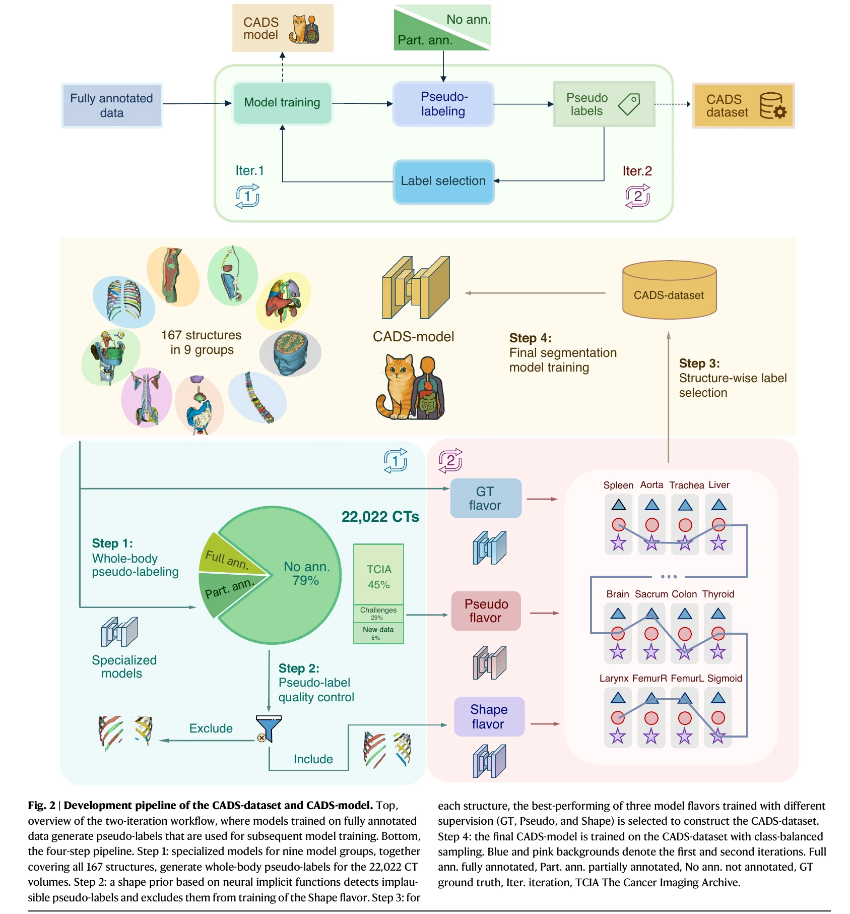

【FACT · paper】Fig. 2: development pipeline of the CADS-dataset and CADS-model (top: two-iteration workflow; bottom: four steps).Reproduced from Xu, M. et al. Nat. Commun. (2026), Fig. 2, [doi:10.1038/s41467-026-78732-1](https://doi.org/10.1038/s41467-026-78732-1), licensed under [CC BY 4.0](https://creativecommons.org/licenses/by/4.0/). Cropped from the Article-in-Press PDF page (original caption kept), resized and converted to WebP; no other changes.

【TEACHING】Analogy: Pseudo is "many trainees contouring", Shape is "a senior removing anatomically absurd contours first", GT is "a small expert gold standard". CADS picks, per structure, whichever generalises best. The Discussion notes that averaging across models mainly reduces the random (variance) part of pseudo-label error; systematic errors need targeted anatomical fixes such as preserving costovertebral joints.

## 04 · The 167 structures: interactive label browser

Browse by teaching system or by model group (T551–T559); click a structure for its SNOMED CT code, prevalence and median size.

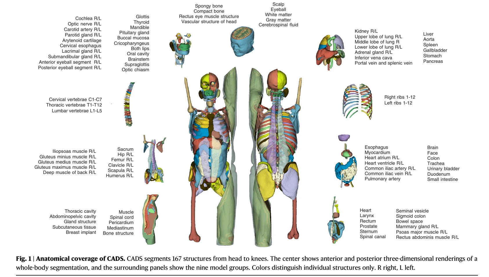

【FACT · paper】Fig. 1: CADS segments 167 structures from head to knees; centre, anterior and posterior 3D renderings; around it, the nine model groups.Reproduced from Xu, M. et al. Nat. Commun. (2026), Fig. 1, [doi:10.1038/s41467-026-78732-1](https://doi.org/10.1038/s41467-026-78732-1), licensed under [CC BY 4.0](https://creativecommons.org/licenses/by/4.0/). Cropped from the Article-in-Press PDF page (original caption kept), resized and converted to WebP; no other changes.

【FACT · paper】Names and groups: official labelmap.md (Apache-2.0); SNOMED CT and parent systems: Suppl. Table 1; prevalence and median voxels: Table 2. 【TEACHING】"By system" is the author's teaching grouping (Fig. 3 of the paper uses a similar, not identical, colour scheme), not an official grouping.

### 【FACT · paper】The nine model groups

| Task | Content (official README)                                              | Name in 3D Slicer | Labels |
|------|------------------------------------------------------------------------|-------------------|--------|
| T551 | Major abdominal organs, lung lobes and abdominal vessels               | Core organs       | 17     |
| T552 | Individual vertebrae C1–L5                                             | Spine complete    | 24     |
| T553 | Thoracic/abdominal organs, heart chambers, brain, pelvic vessels, face | Heart & vessels   | 18     |
| T554 | Appendicular bones, sacrum and large trunk muscles                     | Trunk muscles     | 21     |
| T555 | Ribs 1–12, left and right                                              | Ribs complete     | 24     |
| T556 | Miscellaneous structures for radiation therapy                         | RT risk organs    | 15     |
| T557 | Brain and head tissues                                                 | Brain tissues     | 9      |
| T558 | Head and neck structures                                               | Head-neck organs  | 29     |
| T559 | General tissue types and body cavities                                 | Body regions      | 10     |

【TEACHING】The label space is hierarchical: coarse and fine labels coexist and may overlap. T559 "Muscle" covers all muscular soft tissue, while T554 iliopsoas and T556 psoas major are finer labels inside it; T556 "Heart" includes the pericardial sac, while T553 adds four chambers and myocardium. Decide which level you need before measuring.

## 05 · CADS-model: weight variants and licences

Same architecture, same nine tasks (T551–T559) and 167 targets; the variants differ in which licensed data were used for training.

| Variant (CLI name) | Weight licence                       | Max. training set | Intended use                                                                                                                |
|--------------------|--------------------------------------|-------------------|-----------------------------------------------------------------------------------------------------------------------------|
| `reference`        | CADS customised model licence        | 21,277            | Reproduce the paper; additionally trained on EXACT09, LOLA11, SLIVER07, EMPIRE10, whose terms apply                         |
| `research`         | CC BY-NC-SA 4.0                      | 21,124            | Officially recommended for most academic, non-commercial research; nearly identical to reference in the reported evaluation |
| `open`             | CC BY-SA 4.0                         | 13,269            | When redistributable (incl. commercial) derived weights are needed; some detailed head–neck OARs may degrade                |
| CADS-region        | Same customised licence as reference | –                 | Reorganised into 13 region tasks (T601–T613)                                                                                |

【FACT · paper】Source: official README and cads/LICENSE_MODEL; the code itself is Apache-2.0. "Max. training set" is the largest per-task training set after filtering.

#### 【FACT · paper】Engineering facts (official docs)

- Code release v1.0.3; reference weights release v1.0.0.
- About 727 MB per task model; reserve about 7 GB for all nine tasks.
- CPU mode is slower: 10+ minutes for a chest–abdomen CT (3D Slicer plugin README).
- Outputs can be shown with SNOMED CT standard names for clinical-research workflows.

#### 【FACT · paper】Architecture benchmark (Suppl. Note 3)

With identical data, preprocessing and split, ResEnc-L was compared with MedNeXt-M, SegResNet, SwinUNETR and U-Mamba Bot; this is a supplementary analysis and the main claims do not rely on a new architecture.

## 06 · Evaluation: 18 public datasets

The main baseline is TotalSegmentator v2.4.0 (strongest inference setting), which also uses nnU-Net — isolating the contribution of data from that of architecture.^([\[3\]](#ref-3))

| Test data                                      | TotalSeg Dice % | CADS Dice % | TotalSeg HD95 mm | CADS HD95 mm |
|------------------------------------------------|-----------------|-------------|------------------|--------------|
| Primary (complete labels, 117 mutual targets)  | 89.22           | 91.51       | 5.63             | 3.21         |
| Secondary (partial labels)                     | 81.78           | 83.90       | 10.70            | 7.60         |
| Full test data (117 mutual targets)            | 88.12           | 90.52       | 7.38             | 4.36         |
| CADS all targets (Fig. 4a: 166, face excluded) | –               | 85.87       | –                | 5.23         |

【FACT · paper】Source: Fig. 4a table and text. Macro-averaged Dice on mutual targets: CADS 90.52% (95% CI 88.12–92.41; median 92.33) vs TotalSegmentator 88.12% (95% CI 85.18–90.48; median 90.13). CADS had higher Dice in 71 structures, 44 with p \< 0.05 (structure-wise paired tests, no multiple-testing correction).

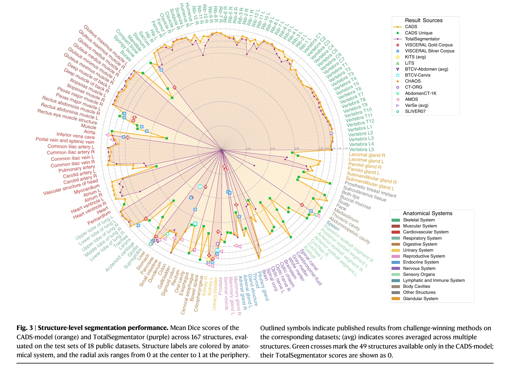

【FACT · paper】Fig. 3: mean Dice for all 167 structures (orange CADS, purple TotalSegmentator). Green crosses mark the 49 structures only CADS segments.Reproduced from Xu, M. et al. Nat. Commun. (2026), Fig. 3, [doi:10.1038/s41467-026-78732-1](https://doi.org/10.1038/s41467-026-78732-1), licensed under [CC BY 4.0](https://creativecommons.org/licenses/by/4.0/). Cropped from the Article-in-Press PDF page (original caption kept), resized and converted to WebP; no other changes.

#### 【FACT · paper】Dataset level: Dice difference (CADS − TotalSeg, percentage points)

BTCV-Cervix+18.63

HaN-Seg+12.18

VISCERAL GC-Extra+9.01

SAROS+3.67

KiTS+2.95

TotalSegmentator+1.66

VISCERAL SC+1.16

AbdomenCT-1K+0.78

VISCERAL GC+0.27

VerSe+0.22

SLIVER07+0.22

LiTS+0.19

AMOS+0.18

Learn2reg+0.15

CHAOS+0.06

CT-ORG-0.24

BTCV-Abdomen-1.31

EMPIRE10-6.49

Values as annotated in Fig. 4b. Higher Dice in 15 of 18 datasets and lower HD95 in 16; on average +2.40 points Dice and −3.96 mm HD95; largest HD95 reductions in BTCV-Cervix (42.21 mm) and HaN-Seg (14.18 mm).

#### 【FACT · paper】Why is the all-167 average lower?

- Limited training data: e.g. buccal mucosa appears in fewer than 1,000 scans with only 30 ground-truth annotations.
- Very small organs (\< 0.5 mL) such as the arytenoid cartilage, limited by CT resolution and partial-volume effects.
- Anatomically complex structures, particularly small glands.

#### 【FACT · paper】Reference labels can be wrong too

The authors reviewed 4,597 case–structure pairs in the TotalSegmentator test set; 3,002 were judged reliable and kept, with errors most prominent in ribs and vertebrae. Radiologists corrected 72 excluded pairs across nine structures as a mini-benchmark. On the expert-verified subset CADS reached a Dice of 93.15%.

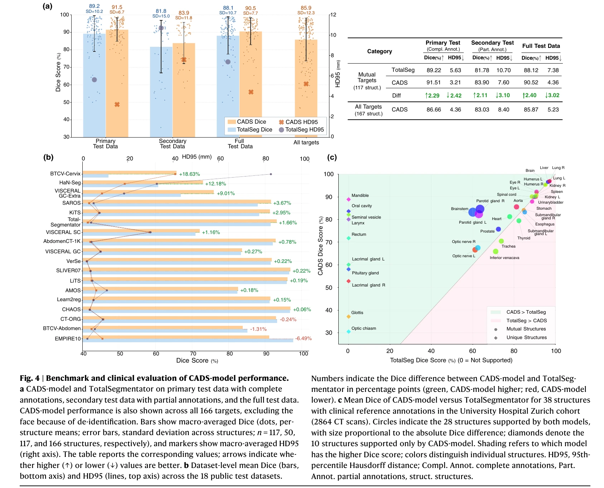

【FACT · paper】Fig. 4: (a) Dice and HD95 on primary/secondary/full test data; (b) per-dataset Dice and HD95 across 18 datasets; (c) Dice for 38 structures in the University Hospital Zurich cohort.Reproduced from Xu, M. et al. Nat. Commun. (2026), Fig. 4, [doi:10.1038/s41467-026-78732-1](https://doi.org/10.1038/s41467-026-78732-1), licensed under [CC BY 4.0](https://creativecommons.org/licenses/by/4.0/). Cropped from the Article-in-Press PDF page (original caption kept), resized and converted to WebP; no other changes.

【TEACHING】Reading tip: Dice measures overlap (higher is better); HD95 measures near-worst boundary distance (lower is better). The paper cautions that CADS differs from the baseline in scale, coverage, diversity and curation, so gains should not be attributed to training-set size alone.

## 07 · Real world: 2,864 oncology CTs from University Hospital Zurich

An independent cohort not used in development; reference masks were generated in MIM and validated by physicians, or contoured directly by radiation oncologists to clinical protocols.

#### 【FACT · paper】Cohort

2,864 CTs; 38 structures with clinical references (28 supported by both models, 10 by CADS only); largest disease groups CNS malignancies, bone tumours and head–neck cancers. Data are not available externally.

#### 【FACT · paper】Largest gains

All radiotherapy-relevant: brainstem +23.08 points, parotid glands left +19.40 and right +21.02.

#### 【FACT · paper】Expert review

A radiation oncologist with 5.5 years of experience reviewed slice by slice — three cases around the median Dice per structure, to reflect typical rather than best-case performance. Six further external cohorts with 1,160 CTs are in Suppl. Note 6.

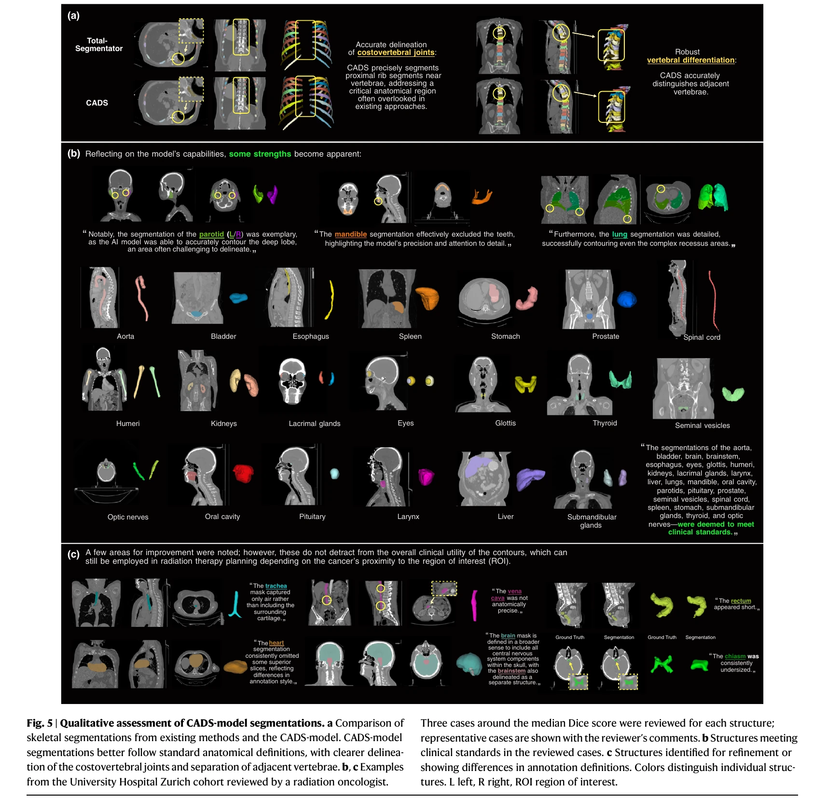

【FACT · paper】Fig. 5: (a) costovertebral joints and separation of adjacent vertebrae; (b) structures meeting clinical standards with reviewer comments; (c) structures needing refinement or defined differently (trachea air only, imprecise IVC, short rectum, heart missing superior slices, broad brain mask, undersized chiasm).Reproduced from Xu, M. et al. Nat. Commun. (2026), Fig. 5, [doi:10.1038/s41467-026-78732-1](https://doi.org/10.1038/s41467-026-78732-1), licensed under [CC BY 4.0](https://creativecommons.org/licenses/by/4.0/). Cropped from the Article-in-Press PDF page (original caption kept), resized and converted to WebP; no other changes.

【FACT · paper】In the paper's words, this qualitative assessment suggests potential relevance for radiation-oncology contouring but does not constitute a formal demonstration of clinical utility, which would require blinded multi-reader studies against manual clinical contours. There was a single, non-blinded reviewer.

## 08 · Real-CT viewer: one openly licensed trauma CT

【REAL DATA】Case s0423 (TotalSegmentator dataset v2.0.1, CC BY 4.0): 65-year-old man, neck–chest–abdomen–pelvis CT, metadata "trauma, thorax". The overlay is the dataset's own 117-class reference masks (not CADS output). Every third slice is shown (4.5 mm apart), 147 slices.

Note: when opened directly from disk, browsers block reading label pixels. Serve locally with `python3 -m http.server`.

### 【REAL DATA】We actually ran CADS: task T554 (trunk muscles and pelvis) on CPU

Model: official CADS-model-research weights (CC BY-NC-SA 4.0) for task 554, run through the nnU-Net 2.5.2 predictor on a 2-core CPU in about 10 min. To fit ~8 GB RAM we reduced the sliding-window patch from 192³ to 128³, inferred only the trunk from the pelvis up to L2 (crop recorded in the data file), and skipped the official TPTBox post-processing — so this is a real output of a near-official pipeline, not a reproduction of the paper's reported performance. Weights are not redistributed here.

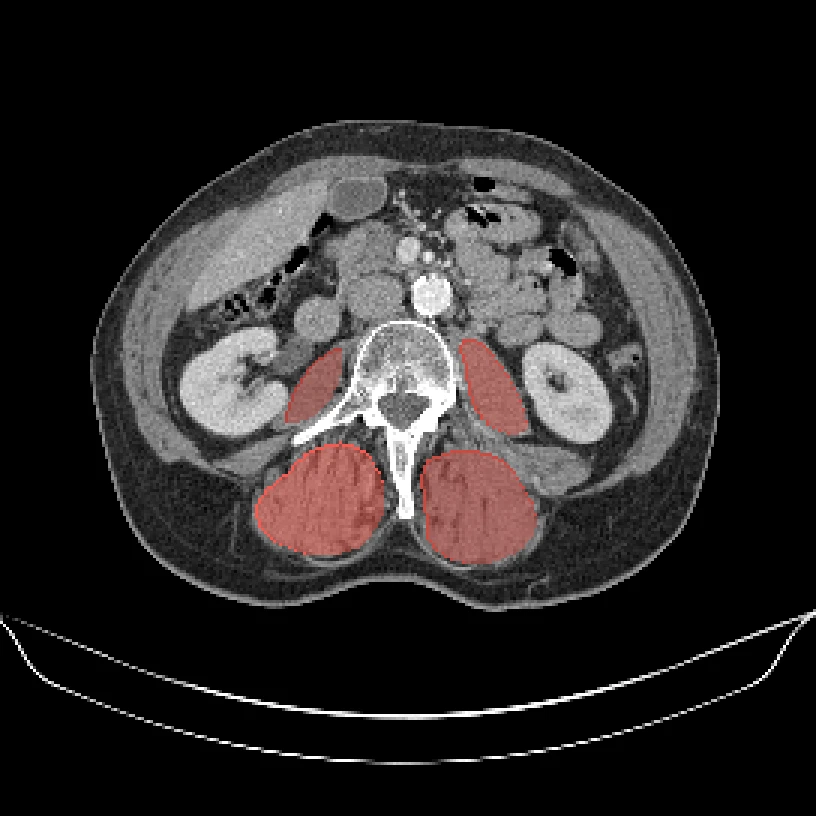

【REAL DATA】L3 level: real CADS T554 inference (iliopsoas, deep back muscles).Rendered by the author in code from case s0423 of the TotalSegmentator dataset v2.0.1 (Wasserthal et al., [doi:10.5281/zenodo.10047292](https://doi.org/10.5281/zenodo.10047292), CC BY 4.0). Overlay = the dataset's own reference masks (not CADS output) unless stated. Image left = patient right.

【REAL DATA】Same slice: the dataset's reference masks for the same structures.Rendered by the author in code from case s0423 of the TotalSegmentator dataset v2.0.1 (Wasserthal et al., [doi:10.5281/zenodo.10047292](https://doi.org/10.5281/zenodo.10047292), CC BY 4.0). Overlay = the dataset's own reference masks (not CADS output) unless stated. Image left = patient right.

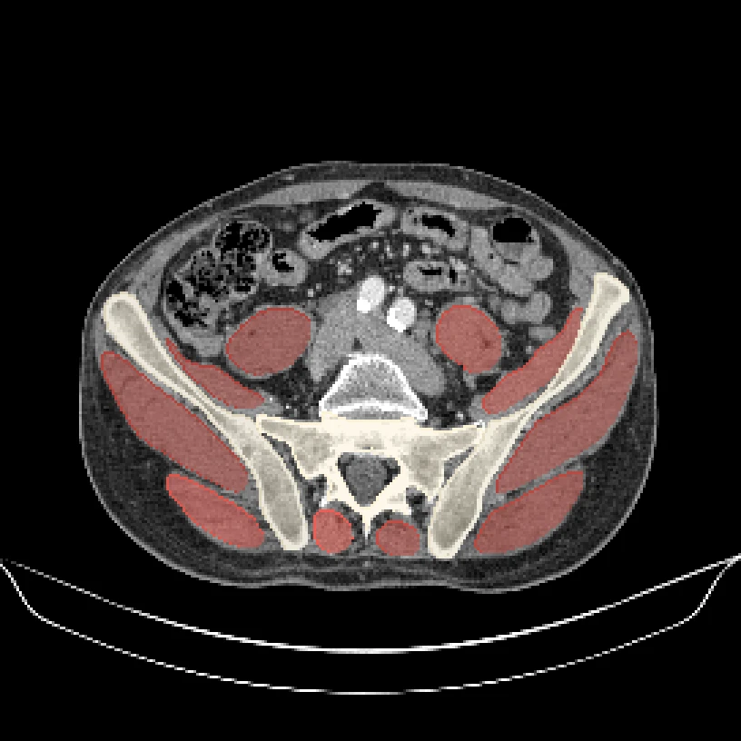

【REAL DATA】Iliac-wing / upper-sacrum level: CADS T554 inference (hip bones, sacrum, gluteal muscles, iliopsoas, deep back muscles).Rendered by the author in code from case s0423 of the TotalSegmentator dataset v2.0.1 (Wasserthal et al., [doi:10.5281/zenodo.10047292](https://doi.org/10.5281/zenodo.10047292), CC BY 4.0). Overlay = the dataset's own reference masks (not CADS output) unless stated. Image left = patient right.

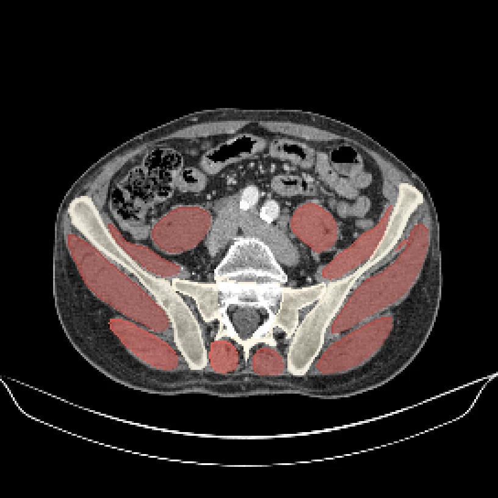

【REAL DATA】Same slice: reference masks.Rendered by the author in code from case s0423 of the TotalSegmentator dataset v2.0.1 (Wasserthal et al., [doi:10.5281/zenodo.10047292](https://doi.org/10.5281/zenodo.10047292), CC BY 4.0). Overlay = the dataset's own reference masks (not CADS output) unless stated. Image left = patient right.

#### 【DERIVED】Dice against the reference masks (inside the inferred region, voxel level)

| CADS T554                | TotalSegmentator      | Dice  | Ref. voxels | Pred. voxels |
|--------------------------|-----------------------|-------|-------------|--------------|
| Hip L                    | hip_left              | 0.988 | 56,186      | 56,415       |
| Hip R                    | hip_right             | 0.986 | 53,623      | 53,529       |
| Sacrum                   | sacrum                | 0.811 | 45,124      | 59,068       |
| Gluteus maximus muscle L | gluteus_maximus_left  | 0.976 | 22,822      | 22,246       |
| Gluteus maximus muscle R | gluteus_maximus_right | 0.968 | 21,022      | 20,002       |
| Gluteus medius muscle L  | gluteus_medius_left   | 0.971 | 45,340      | 43,679       |
| Gluteus medius muscle R  | gluteus_medius_right  | 0.972 | 40,913      | 39,573       |
| Gluteus minimus muscle L | gluteus_minimus_left  | 0.937 | 5,202       | 4,968        |
| Gluteus minimus muscle R | gluteus_minimus_right | 0.939 | 3,165       | 2,967        |
| Deep muscle of back L    | autochthon_left       | 0.941 | 106,277     | 94,591       |
| Deep muscle of back R    | autochthon_right      | 0.940 | 102,935     | 91,477       |
| Iliopsoas muscle L       | iliopsoas_left        | 0.952 | 62,192      | 57,928       |
| Iliopsoas muscle R       | iliopsoas_right       | 0.960 | 56,522      | 52,687       |

【TEACHING】Caveats: (1) a single case cannot represent overall performance; (2) the reference is TotalSegmentator's model-plus-manual-correction labelling, whose definitions differ slightly from CADS (e.g. "deep muscle of back" ↔ autochthon); (3) structures cut by the inferred region (e.g. lower femur) lower the Dice; (4) this case is in the published CADS test split, so it was not used for training.

## 09 · Clinical teaching cases (emergency & trauma surgery perspective)

【TEACHING】Three cases on the same real CT show what whole-body segmentation can help clinicians see. They are teaching interpretations, not paper findings or diagnostic advice.

### Case 1 · Anatomical orientation in trauma CT: counting ribs and vertebrae

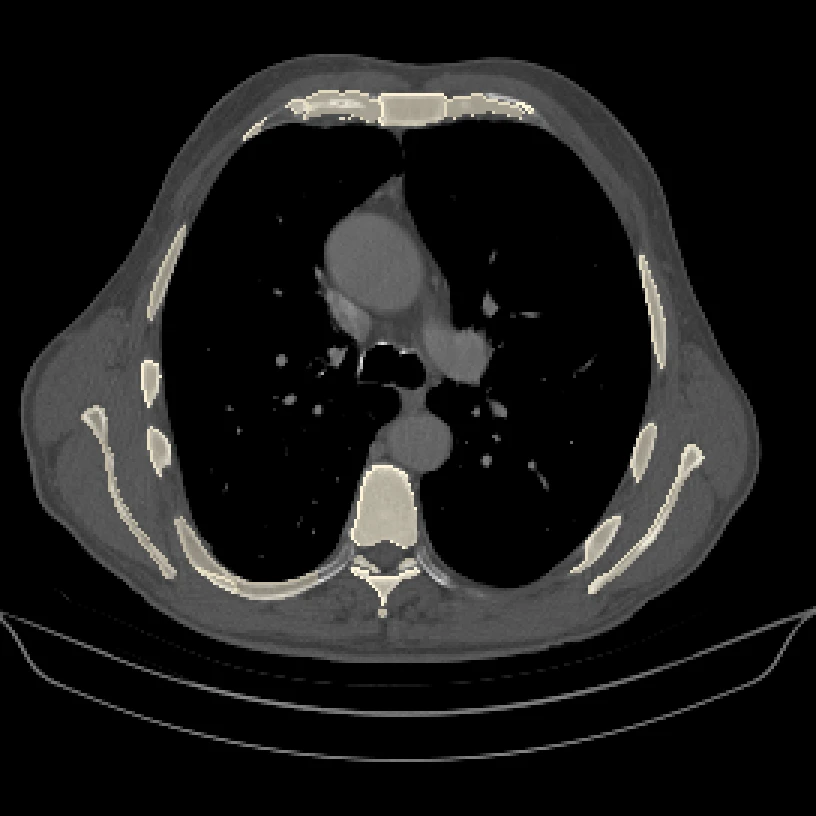

【REAL DATA】T6 level, bone window: each rib, the thoracic vertebra, sternum and scapulae coloured separately.Rendered by the author in code from case s0423 of the TotalSegmentator dataset v2.0.1 (Wasserthal et al., [doi:10.5281/zenodo.10047292](https://doi.org/10.5281/zenodo.10047292), CC BY 4.0). Overlay = the dataset's own reference masks (not CADS output) unless stated. Image left = patient right.

#### 【TEACHING】Teaching points

- In trauma reports, "left 6th rib fracture" depends on counting correctly; per-rib and per-vertebra segmentation (CADS T552, T555) can serve as a counting cross-check.
- 【FACT · paper】CADS specifically refined rib labels to keep the costovertebral joints often missing from public datasets, and better separates adjacent vertebrae (Fig. 5a).
- Caution: segmentation models do not detect fractures; the CADS label space has no lesion classes such as fracture, haemorrhage or pneumothorax.
- 【FACT · paper】Upper cervical vertebrae (C1–C5) are rare in the data (905–3,255 volumes), which is why class-balanced sampling was used.

### Case 2 · Radiotherapy organs at risk (OARs)

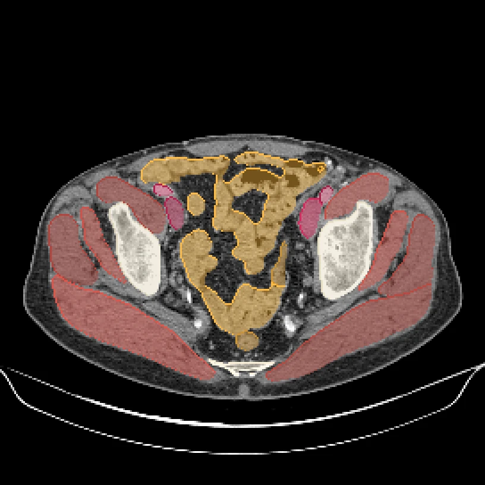

【REAL DATA】Acetabular level, soft-tissue window: bladder, hip bones, femoral heads, gluteal muscles, iliac vessels.Rendered by the author in code from case s0423 of the TotalSegmentator dataset v2.0.1 (Wasserthal et al., [doi:10.5281/zenodo.10047292](https://doi.org/10.5281/zenodo.10047292), CC BY 4.0). Overlay = the dataset's own reference masks (not CADS output) unless stated. Image left = patient right.

#### 【TEACHING】Teaching points

- 【FACT · paper】T556 (RT structures: spinal canal, larynx, heart, bowel space, sigmoid, rectum, prostate, seminal vesicle, mammary glands, sternum, psoas major, rectus abdominis) and T558 (29 head–neck OARs) serve radiotherapy contouring directly.
- 【FACT · paper】Several T556 structures follow RT conventions: "bowel space" is the space bowel may occupy from pylorus to rectosigmoid junction, "heart" includes the pericardial sac; head–neck OARs follow HaN-Seg and consensus guidance.^([\[9\]](#ref-9),[\[13\]](#ref-13))
- Auto-contours are a first draft for physicians to edit slice by slice; the issues flagged by the expert (short rectum, undersized chiasm, etc.) are exactly where human review is needed.

### Case 3 · Body composition: muscle at the L3 level

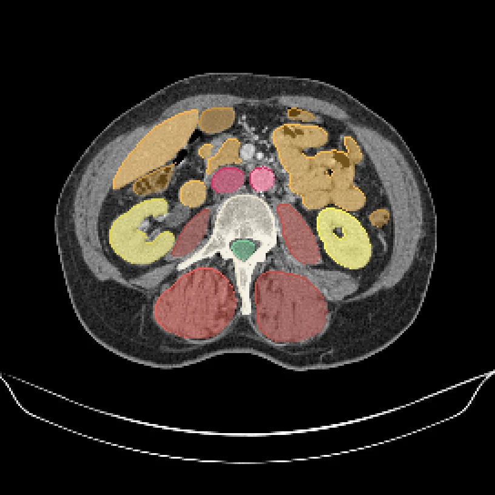

【REAL DATA】Mid-L3 level, soft-tissue window: reference masks of iliopsoas, deep back muscles, kidneys, liver, colon, small bowel, aorta and IVC.Rendered by the author in code from case s0423 of the TotalSegmentator dataset v2.0.1 (Wasserthal et al., [doi:10.5281/zenodo.10047292](https://doi.org/10.5281/zenodo.10047292), CC BY 4.0). Overlay = the dataset's own reference masks (not CADS output) unless stated. Image left = patient right.

#### 【TEACHING】Teaching points

- Tissue areas on a single L3 slice correlate strongly with whole-body fat and fat-free mass (r = 0.86–0.94), which is why L3 is the usual landmark for CT body composition.^([\[16\]](#ref-16))
- Muscle area is usually normalised by height² as the skeletal muscle index (SMI); diagnostic cut-offs vary by population and should be taken from the original literature.^([\[17\]](#ref-17),[\[18\]](#ref-18))
- 【FACT · paper】CADS offers muscle labels at several levels: T559 "Muscle" (all muscular soft tissue, SAROS definition including fascia and intermuscular fat, with inter/intramuscular fat subtracted automatically), T556 psoas major and rectus abdominis, T554 iliopsoas and deep back muscles.
- 【DERIVED】At mid-L3 in this case the reference masks give: iliopsoas (both sides) 16.4 cm², deep back muscles (both sides) 58.1 cm² (pixel 1.5 × 1.5 mm). This only demonstrates mask-to-area arithmetic; it is not total skeletal muscle area and no HU thresholding was applied.

## 10 · Hands-on: command line and 3D Slicer

【FACT · paper】Steps from the official READMEs (November 2026). Using the weights means accepting the corresponding model licence.

#### A. Python command line

    # 1) clone
    git clone https://github.com/murong-xu/CADS.git
    # 2) environment (Python ≥ 3.9)
    conda create -n CADS_env python=3.11
    conda activate CADS_env
    # 3) install PyTorch for your OS/CUDA (torch ≥ 2.1.2), e.g. Linux + CUDA 12.4:
    pip install torch==2.5.1 torchvision==0.20.1 torchaudio==2.5.1 \
      --index-url https://download.pytorch.org/whl/cu124
    # 4) install CADS
    cd CADS && pip install -e .

    # one-command inference (-task all or 551–559; -license reference/research/open)
    python cads/scripts/predict_images.py \
      -in /path/to/ct_images -out /path/to/output \
      -task all -license research          # add --cpu without a GPU

For large batches (≈100–1000+ scans) use the staged pipeline: `run_01_preprocess.py` (CPU, reorient + resample) → `run_02_inference.py` (GPU, outputs \_part_551…\_part_559) → `run_03_restore_seg.py` (CPU, back to original geometry).

#### B. 3D Slicer extension (CADSWholeBodyCTSeg)

1.  Install 3D Slicer (tested with stable 5.10.0 and preview 5.11.0).
2.  Extension Manager → install **PyTorch**, restart; in PyTorch Utils enter `>=2.1.2` and install (2.1.2–2.8.0 work).
3.  Extension Manager → install **NNUNet**, restart; in the nnUNet module install **exactly** `==2.5.2`.
4.  Extension Manager → install **CADSWholeBodyCTSeg**, restart.
5.  Load a CT → choose Input volume, Segmentation task (or All), Target mode → Apply. SNOMED CT names are shown by default; tick Force to use CPU if you have no GPU.
6.  Each task downloads about 727 MB on first run; reserve ~7 GB for all. Windows with Slicer ≤ 5.10.0 may hit a backslash path issue; upgrading to 5.11.0 is recommended.

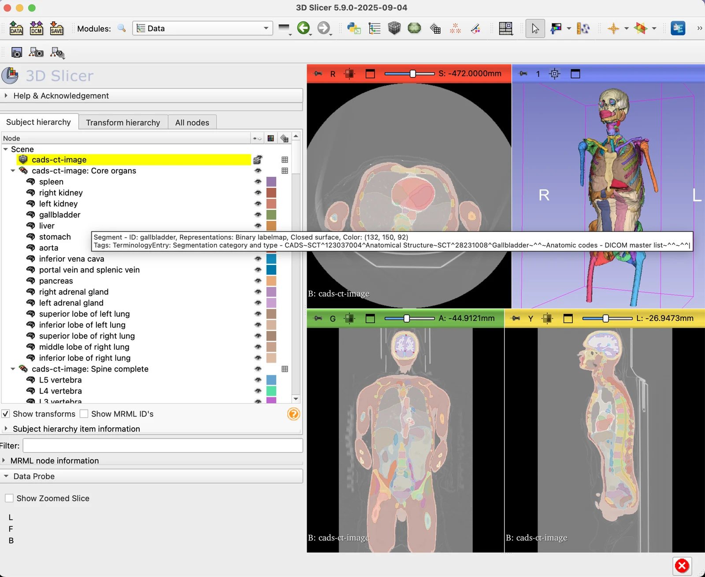

【FACT · paper】Plugin after a run: structures listed by model group; hovering shows SNOMED CT terminology.Screenshot_02.png from [murong-xu/SlicerCADSWholeBodyCTSeg](https://github.com/murong-xu/SlicerCADSWholeBodyCTSeg) (Apache-2.0), resized and converted to WebP.

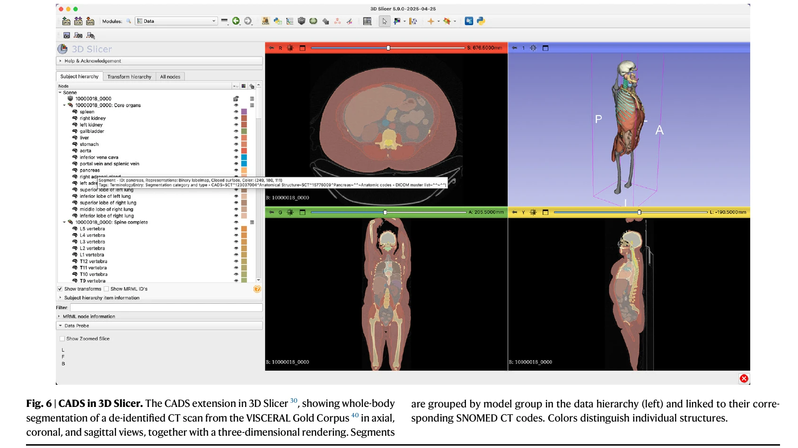

【FACT · paper】Fig. 6: the CADS extension in 3D Slicer, whole-body segmentation of a de-identified VISCERAL Gold Corpus CT (axial, coronal, sagittal and 3D).Reproduced from Xu, M. et al. Nat. Commun. (2026), Fig. 6, [doi:10.1038/s41467-026-78732-1](https://doi.org/10.1038/s41467-026-78732-1), licensed under [CC BY 4.0](https://creativecommons.org/licenses/by/4.0/). Cropped from the Article-in-Press PDF page (original caption kept), resized and converted to WebP; no other changes.

【TEACHING】Classroom tip: run a single task in 3D Slicer first (e.g. T551 abdominal organs) so learners see the output, then discuss "model output ≠ diagnosis"; use the command line for batch research. `示例/` in this repository has a script computing L3 muscle area on open data.

## 11 · Quick quiz

Click an option to answer; each comes with its source point. Score: 0 / 0

#### 1. How many CT volumes are in the CADS-dataset?

◻️ A. 4,695

✅ B. 22,022

◻️ C. 2,864

◻️ D. 1,203

22,022 from 40 sources; only 4,695 (21%) carry partial annotations.

#### 2. What is the core contribution of CADS?

◻️ A. 一种新的 Transformer 网络

✅ B. 数据为中心：统一、补全并整理大规模标注，再用成熟的 nnU-Net 训练

◻️ C. 一种新的骨折检测算法

◻️ D. 一台新的 CT 设备

The paper states the contribution "is not a new network architecture" but consistently curated large-scale labels.

#### 3. Which metric does the shape QC use to flag implausible pseudo-labels?

◻️ A. Dice

✅ B. 90 百分位 Hausdorff 距离（伪标签与其形状重建之间）

◻️ C. 体积

◻️ D. HU 均值

It is outlier-sensitive yet robust to a few far voxels; the worst 10% of images are withheld from the Shape flavour.

#### 4. Where does each structure's final label come from?

◻️ A. 永远来自 Pseudo 模型

✅ B. 原始真标注优先；没有时用在验证集上排名最高的口味（GT/Pseudo/Shape）

◻️ C. 随机挑一个

◻️ D. 由 3D Slicer 用户手工勾画

Selection is per structure, preferring out-of-distribution validation for ranking.

#### 5. On the 117 mutual targets, macro-averaged Dice for CADS vs TotalSegmentator was?

◻️ A. 85.87% vs 88.12%

✅ B. 90.52% vs 88.12%

◻️ C. 93.15% vs 90.52%

◻️ D. 99% vs 80%

90.52% (95% CI 88.12–92.41) vs 88.12% (95% CI 85.18–90.48). 93.15% is on the expert-verified subset; 85.87% is CADS over all targets.

#### 6. Which structure gained most in the real-world cohort?

◻️ A. 肝

✅ B. 脑干（+23.08 个百分点）

◻️ C. 股骨

◻️ D. 主动脉

Brainstem +23.08, parotids +19.40 (L) and +21.02 (R) — all radiotherapy-relevant.

#### 7. Which is a limitation acknowledged by the paper?

◻️ A. 覆盖了手和足

✅ B. 定性审阅只有一位未设盲的专家

◻️ C. CADS 不能在 CPU 上运行

◻️ D. 数据全部来自一家医院

Others: shape QC may filter informative pathological/atypical anatomy; coverage is head to knees without hands/feet; trachea, chiasm, rectum and brain labels need refinement.

#### 8. Which weight variant's licence allows commercial use (share-alike)?

◻️ A. reference

◻️ B. research（CC BY-NC-SA 4.0）

✅ C. open（CC BY-SA 4.0）

◻️ D. CADS-region

open is CC BY-SA 4.0; research is non-commercial; reference and CADS-region use a customised licence. Always check the licence and regulations yourself.

Options are in Chinese where wording differs (numbers and terms are shared); questions and explanations follow the language toggle.

## 12 · Limitations and cautions

#### 【FACT · paper】The paper's own limitations

- Pseudo-labels: shape QC withholds low-quality pseudo-labels from the Shape flavour, but may also filter clinically important pathological or atypical anatomy; manual correction is not feasible at this scale.
- Clinical evaluation: a single non-blinded radiation oncologist reviewed to find strengths and weaknesses, not to prove clinical utility; multiple readers, blinding and clinical endpoints are needed.
- Coverage: head to knees, without hands and feet; fine-grained CNS, musculoskeletal and vascular structures are still missing.
- Label definitions: the brain mask includes all intracranial CNS components (too broad for some uses); trachea covers the lumen, not cartilage; optic chiasm under-segmented; rectum shorter than its anatomical extent; facial anonymisation limits facial analysis.
- Source of gains: scale, coverage, diversity and curation all changed, so gains cannot be attributed to size alone.

#### 【TEACHING】Teaching and usage reminders

- Segmentation ≠ diagnosis: CADS does not detect fractures, haemorrhage or tumours, and normal-anatomy labels may distort around lesions.
- Layered licences: code Apache-2.0; weights reference (customised), research (CC BY-NC-SA 4.0), open (CC BY-SA 4.0); data follow each of the 40 sources' licences. Check each before commercial or clinical use.
- The CPU inference here is one case with deviations from the official setup (patch size, crop, no post-processing); it cannot be used to judge performance.
- The paper is an Article in Press; the final Version of Record may still change. Numbers here follow the version retrieved on 2026-11-13.

## 13 · Resources

| Resource                 | Link                                                                                                                                | Licence                                                   |
|--------------------------|-------------------------------------------------------------------------------------------------------------------------------------|-----------------------------------------------------------|
| Paper                    | [doi:10.1038/s41467-026-78732-1](https://doi.org/10.1038/s41467-026-78732-1) · [arXiv:2507.22953](https://arxiv.org/abs/2507.22953) | CC BY 4.0                                                 |
| Code and weights         | [github.com/murong-xu/CADS](https://github.com/murong-xu/CADS) · [releases](https://github.com/murong-xu/CADS/releases)             | Code Apache-2.0; weights see above                        |
| CADS-dataset             | [huggingface.co/datasets/mrmrx/CADS-dataset](https://huggingface.co/datasets/mrmrx/CADS-dataset)                                    | "cadsdataset" terms + each source's licence; gated access |
| 3D Slicer extension      | [github.com/murong-xu/SlicerCADSWholeBodyCTSeg](https://github.com/murong-xu/SlicerCADSWholeBodyCTSeg)                              | Apache-2.0                                                |
| Real CT used here        | [TotalSegmentator dataset v2.0.1（Zenodo）](https://doi.org/10.5281/zenodo.10047292)                                                | CC BY 4.0                                                 |
| This module's repository | [github.com/TUANZIDING/cads-ct-teaching](https://github.com/TUANZIDING/cads-ct-teaching)                                            | see licence below                                         |

## 14 · References

Every DOI was checked against Crossref / DataCite (title, year, volume, pages).

1.  Xu, Navarro, Fritsak et al.. CADS: a comprehensive anatomical dataset and segmentation for whole-body anatomy in computed tomography. *Nature Communications* (2026). [doi:10.1038/s41467-026-78732-1](https://doi.org/10.1038/s41467-026-78732-1)
2.  Xu, Navarro, Fritsak et al.. CADS: A Comprehensive Anatomical Dataset and Segmentation for Whole-Body Anatomy in Computed Tomography. *arXiv preprint 2507.22953* (2025). [doi:10.48550/arXiv.2507.22953](https://doi.org/10.48550/arXiv.2507.22953)
3.  Wasserthal, Breit, Meyer et al.. TotalSegmentator: Robust Segmentation of 104 Anatomic Structures in CT Images. *Radiology: Artificial Intelligence* (2023), 5, e230024. [doi:10.1148/ryai.230024](https://doi.org/10.1148/ryai.230024)
4.  Wasserthal et al.. Dataset with segmentations of 117 important anatomical structures in 1228 CT images. *Zenodo (TotalSegmentator dataset v2.0.1)* (2023). [doi:10.5281/zenodo.10047292](https://doi.org/10.5281/zenodo.10047292)
5.  Isensee, Jaeger, Kohl et al.. nnU-Net: a self-configuring method for deep learning-based biomedical image segmentation. *Nature Methods* (2021), 18, 203-211. [doi:10.1038/s41592-020-01008-z](https://doi.org/10.1038/s41592-020-01008-z)
6.  Isensee, Wald, Ulrich et al.. nnU-Net Revisited: A Call for Rigorous Validation in 3D Medical Image Segmentation. *MICCAI 2024, Lecture Notes in Computer Science* (2024), 488-498. [doi:10.1007/978-3-031-72114-4_47](https://doi.org/10.1007/978-3-031-72114-4_47)
7.  Amiranashvili, Lüdke, Li et al.. Learning continuous shape priors from sparse data with neural implicit functions. *Medical Image Analysis* (2024), 94, 103099. [doi:10.1016/j.media.2024.103099](https://doi.org/10.1016/j.media.2024.103099)
8.  Fedorov, Beichel, Kalpathy-Cramer et al.. 3D Slicer as an image computing platform for the Quantitative Imaging Network. *Magnetic Resonance Imaging* (2012), 30, 1323-1341. [doi:10.1016/j.mri.2012.05.001](https://doi.org/10.1016/j.mri.2012.05.001)
9.  Podobnik, Strojan, Peterlin et al.. HaN‐Seg: The head and neck organ‐at‐risk CT and MR segmentation dataset. *Medical Physics* (2023), 50, 1917-1927. [doi:10.1002/mp.16197](https://doi.org/10.1002/mp.16197)
10. Koitka, Baldini, Kroll et al.. SAROS: A dataset for whole-body region and organ segmentation in CT imaging. *Scientific Data* (2024), 11, 483. [doi:10.1038/s41597-024-03337-6](https://doi.org/10.1038/s41597-024-03337-6)
11. Sekuboyina, Husseini, Bayat et al.. VerSe: A Vertebrae labelling and segmentation benchmark for multi-detector CT images. *Medical Image Analysis* (2021), 73, 102166. [doi:10.1016/j.media.2021.102166](https://doi.org/10.1016/j.media.2021.102166)
12. Clark, Vendt, Smith et al.. The Cancer Imaging Archive (TCIA): Maintaining and Operating a Public Information Repository. *Journal of Digital Imaging* (2013), 26, 1045-1057. [doi:10.1007/s10278-013-9622-7](https://doi.org/10.1007/s10278-013-9622-7)
13. Mir, Kelly, Xiao et al.. Organ at risk delineation for radiation therapy clinical trials: Global Harmonization Group consensus guidelines. *Radiotherapy and Oncology* (2020), 150, 30-39. [doi:10.1016/j.radonc.2020.05.038](https://doi.org/10.1016/j.radonc.2020.05.038)
14. Shi, Hu, Wu et al.. Deep learning empowered volume delineation of whole-body organs-at-risk for accelerated radiotherapy. *Nature Communications* (2022), 13, 6566. [doi:10.1038/s41467-022-34257-x](https://doi.org/10.1038/s41467-022-34257-x)
15. Weston, Korfiatis, Kline et al.. Automated Abdominal Segmentation of CT Scans for Body Composition Analysis Using Deep Learning. *Radiology* (2019), 290, 669-679. [doi:10.1148/radiol.2018181432](https://doi.org/10.1148/radiol.2018181432)
16. Mourtzakis, Prado, Lieffers et al.. A practical and precise approach to quantification of body composition in cancer patients using computed tomography images acquired during routine care. *Applied Physiology, Nutrition, and Metabolism* (2008), 33, 997-1006. [doi:10.1139/H08-075](https://doi.org/10.1139/H08-075)
17. Prado, Lieffers, McCargar et al.. Prevalence and clinical implications of sarcopenic obesity in patients with solid tumours of the respiratory and gastrointestinal tracts: a population-based study. *The Lancet Oncology* (2008), 9, 629-635. [doi:10.1016/S1470-2045(08)70153-0](https://doi.org/10.1016/S1470-2045(08)70153-0)
18. Mitsiopoulos, Baumgartner, Heymsfield et al.. Cadaver validation of skeletal muscle measurement by magnetic resonance imaging and computerized tomography. *Journal of Applied Physiology* (1998), 85, 115-122. [doi:10.1152/jappl.1998.85.1.115](https://doi.org/10.1152/jappl.1998.85.1.115)

## 15 · Copyright and licence

| Part                                                                                               | Licence                                                                                                                 |
|----------------------------------------------------------------------------------------------------|-------------------------------------------------------------------------------------------------------------------------|
| Author's text, handouts, curated data (author parts of assets/data/\*.json), screenshots and cover | [CC BY-NC 4.0](https://creativecommons.org/licenses/by-nc/4.0/)                                                         |
| Code: page structure and scripts, CSS/JS, scripts in 工具/, 验证/, 示例/                           | [PolyForm Noncommercial 1.0.0](https://polyformproject.org/licenses/noncommercial/1.0.0/)                               |
| Paper figures 1–6 (Xu et al., Nat Commun 2026)                                                     | Remain the original authors' CC BY 4.0; not covered by this repository's non-commercial licence                         |
| Real CT slices and mask renderings (derived from the TotalSegmentator dataset)                     | CC BY 4.0 (Wasserthal et al., Zenodo 10047292); rendering in 工具/渲染CTv1.0.py                                         |
| 3D Slicer plugin screenshot, CADS labelmap (labelmap.md)                                           | Apache-2.0 (murong-xu/CADS, SlicerCADSWholeBodyCTSeg), attribution kept                                                 |
| CADS inference outputs (4 L3/pelvis images and the Dice table)                                     | Produced with CADS-model-research (CC BY-NC-SA 4.0) and shared under its attribution, non-commercial, share-alike terms |

Commercial use requires prior permission from the author (third-party material remains under its original licence): [tuanziding.github.io/#contact](https://tuanziding.github.io/#contact)

No CADS-dataset images or masks and no CADS model weights are redistributed here.

## Appendix · the 167 structures (sources: official labelmap, Table 2, Suppl. Table 1)

| Group | # | English | Chinese | SNOMED CT | Present in (/22,022) | Median voxels |
| --- | --- | --- | --- | --- | --- | --- |
| T551 | 1 | Spleen | 脾 | 78961009 | 21,097 | 59,202 |
| T551 | 2 | Kidney R | 右肾 | 64033007 \| R:24028007 | 18,482 | 22,472 |
| T551 | 3 | Kidney L | 左肾 | 64033007 \| L:7771000 | 20,110 | 24,004 |
| T551 | 4 | Gallbladder | 胆囊 | 28231008 | 15,429 | 3,633 |
| T551 | 5 | Liver | 肝 | 10200004 | 21,191 | 430,341 |
| T551 | 6 | Stomach | 胃 | 69695003 | 21,118 | 72,764 |
| T551 | 7 | Aorta | 主动脉 | 15825003 | 21,342 | 58,888 |
| T551 | 8 | Inferior vena cava | 下腔静脉 | 64131007 | 21,046 | 13,554 |
| T551 | 9 | Portal vein and splenic vein | 门静脉与脾静脉 | 110765007 | 20,602 | 3,603 |
| T551 | 10 | Pancreas | 胰腺 | 15776009 | 20,641 | 17,155 |
| T551 | 11 | Adrenal gland R | 右肾上腺 | 23451007 \| R:24028007 | 20,652 | 960 |
| T551 | 12 | Adrenal gland L | 左肾上腺 | 23451007 \| L:7771000 | 20,406 | 1,114 |
| T551 | 13 | Upper lobe of lung L | 左肺上叶 | 45653009 \| L:7771000 | 21,011 | 307,385 |
| T551 | 14 | Lower lobe of lung L | 左肺下叶 | 90572001 \| L:7771000 | 21,137 | 275,330 |
| T551 | 15 | Upper lobe of lung R | 右肺上叶 | 45653009 \| R:24028007 | 18,241 | 281,021 |
| T551 | 16 | Middle lobe of lung R | 右肺中叶 | 72481006 | 20,725 | 109,989 |
| T551 | 17 | Lower lobe of lung R | 右肺下叶 | 90572001 \| R:24028007 | 21,379 | 304,069 |
| T552 | 1 | Vertebra L5 | 腰5 椎骨 | 49668003 | 5,413 | 17,458 |
| T552 | 2 | Vertebra L4 | 腰4 椎骨 | 11994002 | 6,519 | 17,874 |
| T552 | 3 | Vertebra L3 | 腰3 椎骨 | 36470004 | 8,733 | 16,921 |
| T552 | 4 | Vertebra L2 | 腰2 椎骨 | 14293000 | 15,049 | 13,274 |
| T552 | 5 | Vertebra L1 | 腰1 椎骨 | 66794005 | 19,730 | 13,718 |
| T552 | 6 | Vertebra T12 | 胸12 椎骨 | 23215003 | 20,811 | 13,119 |
| T552 | 7 | Vertebra T11 | 胸11 椎骨 | 12989004 | 20,891 | 12,054 |
| T552 | 8 | Vertebra T10 | 胸10 椎骨 | 7610001 | 20,732 | 11,152 |
| T552 | 9 | Vertebra T9 | 胸9 椎骨 | 82687006 | 20,352 | 9,930 |
| T552 | 10 | Vertebra T8 | 胸8 椎骨 | 11068009 | 19,667 | 8,931 |
| T552 | 11 | Vertebra T7 | 胸7 椎骨 | 62487009 | 18,750 | 8,357 |
| T552 | 12 | Vertebra T6 | 胸6 椎骨 | 45296009 | 17,932 | 7,649 |
| T552 | 13 | Vertebra T5 | 胸5 椎骨 | 56401006 | 17,475 | 7,195 |
| T552 | 14 | Vertebra T4 | 胸4 椎骨 | 73071006 | 17,332 | 6,738 |
| T552 | 15 | Vertebra T3 | 胸3 椎骨 | 1626008 | 17,318 | 6,426 |
| T552 | 16 | Vertebra T2 | 胸2 椎骨 | 53733008 | 17,289 | 6,650 |
| T552 | 17 | Vertebra T1 | 胸1 椎骨 | 64864005 | 17,255 | 6,165 |
| T552 | 18 | Vertebra C7 | 颈7 椎骨 | 87391001 | 16,744 | 2,601 |
| T552 | 19 | Vertebra C6 | 颈6 椎骨 | 36054005 | 9,792 | 570 |
| T552 | 20 | Vertebra C5 | 颈5 椎骨 | 36978003 | 3,255 | 499 |
| T552 | 21 | Vertebra C4 | 颈4 椎骨 | 5329002 | 1,167 | 3,111 |
| T552 | 22 | Vertebra C3 | 颈3 椎骨 | 113205007 | 905 | 3,349 |
| T552 | 23 | Vertebra C2 | 颈2 椎骨 | 39976000 | 1,276 | 4,007 |
| T552 | 24 | Vertebra C1 | 颈1 椎骨 | 14806007 | 1,249 | 3,317 |
| T553 | 1 | Esophagus | 食管 | 32849002 | 21,030 | 9,350 |
| T553 | 2 | Trachea | 气管 | 44567001 | 17,547 | 9,773 |
| T553 | 3 | Myocardium | 心肌 | 74281007 | 20,619 | 31,054 |
| T553 | 4 | Heart atrium L | 左心房 | 82471001 | 20,352 | 17,734 |
| T553 | 5 | Heart ventricle L | 左心室 | 87878005 | 20,574 | 29,043 |
| T553 | 6 | Heart atrium R | 右心房 | 73829009 | 20,516 | 22,501 |
| T553 | 7 | Heart ventricle R | 右心室 | 53085002 | 20,684 | 38,916 |
| T553 | 8 | Pulmonary artery | 肺动脉 | 81040000 | 17,701 | 18,132 |
| T553 | 9 | Brain | 脑 | 12738006 | 1,268 | 358,424 |
| T553 | 10 | Common iliac artery L | 左髂总动脉 | 73634005 \| L:7771000 | 6,803 | 2,701 |
| T553 | 11 | Common iliac artery R | 右髂总动脉 | 73634005 \| R:24028007 | 6,240 | 3,160 |
| T553 | 12 | Common iliac vein L | 左髂总静脉 | 46027005 \| L:7771000 | 5,703 | 6,974 |
| T553 | 13 | Common iliac vein R | 右髂总静脉 | 46027005 \| R:24028007 | 5,901 | 5,545 |
| T553 | 14 | Small intestine | 小肠（空肠+回肠） | 30315005 | 17,026 | 36,292 |
| T553 | 15 | Duodenum | 十二指肠 | 38848004 | 17,601 | 6,784 |
| T553 | 16 | Colon | 结肠 | 71854001 | 20,347 | 54,292 |
| T553 | 17 | Urinary bladder | 膀胱 | 89837001 | 4,022 | 41,437 |
| T553 | 18 | Face | 面部（去标识区域） | 89545001 | 4,793 | 47 |
| T554 | 1 | Humerus L | 左肱骨 | 85050009 \| L:7771000 | 16,344 | 9,753 |
| T554 | 2 | Humerus R | 右肱骨 | 85050009 \| R:24028007 | 16,629 | 10,476 |
| T554 | 3 | Scapula L | 左肩胛骨 | 79601000 \| L:7771000 | 18,569 | 28,550 |
| T554 | 4 | Scapula R | 右肩胛骨 | 79601000 \| R:24028007 | 18,568 | 27,772 |
| T554 | 5 | Clavicle L | 左锁骨 | 51299004 \| L:7771000 | 17,302 | 6,226 |
| T554 | 6 | Clavicle R | 右锁骨 | 51299004 \| R:24028007 | 17,310 | 6,731 |
| T554 | 7 | Femur L | 左股骨 | 71341001 \| L:7771000 | 3,628 | 48,277 |
| T554 | 8 | Femur R | 右股骨 | 71341001 \| R:24028007 | 3,573 | 48,168 |
| T554 | 9 | Hip L | 左髋骨 | 29836001 \| L:7771000 | 5,290 | 96,869 |
| T554 | 10 | Hip R | 右髋骨 | 29836001 \| R:24028007 | 5,272 | 97,104 |
| T554 | 11 | Sacrum | 骶骨 | 54735007 | 4,494 | 62,408 |
| T554 | 12 | Gluteus maximus muscle L | 左臀大肌 | 206007 \| L:7771000 | 4,122 | 131,518 |
| T554 | 13 | Gluteus maximus muscle R | 右臀大肌 | 206007 \| R:24028007 | 4,188 | 133,948 |
| T554 | 14 | Gluteus medius muscle L | 左臀中肌 | 78333006 \| L:7771000 | 4,776 | 63,677 |
| T554 | 15 | Gluteus medius muscle R | 右臀中肌 | 78333006 \| R:24028007 | 4,803 | 62,294 |
| T554 | 16 | Gluteus minimus muscle L | 左臀小肌 | 75297007 \| L:7771000 | 3,784 | 16,844 |
| T554 | 17 | Gluteus minimus muscle R | 右臀小肌 | 75297007 \| R:24028007 | 3,810 | 17,984 |
| T554 | 18 | Deep muscle of back L | 左背深肌（竖脊肌群） | 244849004 \| L:7771000 | 21,344 | 86,627 |
| T554 | 19 | Deep muscle of back R | 右背深肌（竖脊肌群） | 244849004 \| R:24028007 | 21,343 | 85,689 |
| T554 | 20 | Iliopsoas muscle L | 左髂腰肌 | 68455001 \| L:7771000 | 16,617 | 3,361 |
| T554 | 21 | Iliopsoas muscle R | 右髂腰肌 | 68455001 \| R:24028007 | 17,524 | 2,838 |
| T555 | 1 | Rib-1 L | 左第 1 肋 | 48535007 \| L:7771000 | 17,318 | 2,850 |
| T555 | 2 | Rib-2 L | 左第 2 肋 | 78247007 \| L:7771000 | 17,363 | 3,374 |
| T555 | 3 | Rib-3 L | 左第 3 肋 | 25888004 \| L:7771000 | 17,483 | 3,992 |
| T555 | 4 | Rib-4 L | 左第 4 肋 | 25523003 \| L:7771000 | 18,180 | 4,910 |
| T555 | 5 | Rib-5 L | 左第 5 肋 | 15339008 \| L:7771000 | 19,522 | 5,405 |
| T555 | 6 | Rib-6 L | 左第 6 肋 | 59558009 \| L:7771000 | 20,547 | 5,947 |
| T555 | 7 | Rib-7 L | 左第 7 肋 | 24915002 \| L:7771000 | 20,776 | 6,218 |
| T555 | 8 | Rib-8 L | 左第 8 肋 | 5953002 \| L:7771000 | 20,870 | 5,471 |
| T555 | 9 | Rib-9 L | 左第 9 肋 | 22565002 \| L:7771000 | 20,893 | 4,948 |
| T555 | 10 | Rib-10 L | 左第 10 肋 | 77644006 \| L:7771000 | 20,897 | 3,963 |
| T555 | 11 | Rib-11 L | 左第 11 肋 | 58830002 \| L:7771000 | 20,862 | 2,313 |
| T555 | 12 | Rib-12 L | 左第 12 肋 | 43993008 \| L:7771000 | 19,871 | 838 |
| T555 | 13 | Rib-1 R | 右第 1 肋 | 48535007 \| R:24028007 | 17,316 | 2,883 |
| T555 | 14 | Rib-2 R | 右第 2 肋 | 78247007 \| R:24028007 | 17,369 | 3,394 |
| T555 | 15 | Rib-3 R | 右第 3 肋 | 25888004 \| R:24028007 | 17,487 | 4,034 |
| T555 | 16 | Rib-4 R | 右第 4 肋 | 25523003 \| R:24028007 | 18,074 | 5,122 |
| T555 | 17 | Rib-5 R | 右第 5 肋 | 15339008 \| R:24028007 | 19,445 | 5,661 |
| T555 | 18 | Rib-6 R | 右第 6 肋 | 59558009 \| R:24028007 | 20,488 | 6,046 |
| T555 | 19 | Rib-7 R | 右第 7 肋 | 24915002 \| R:24028007 | 20,720 | 6,371 |
| T555 | 20 | Rib-8 R | 右第 8 肋 | 5953002 \| R:24028007 | 20,825 | 5,648 |
| T555 | 21 | Rib-9 R | 右第 9 肋 | 22565002 \| R:24028007 | 20,856 | 5,078 |
| T555 | 22 | Rib-10 R | 右第 10 肋 | 77644006 \| R:24028007 | 20,879 | 3,813 |
| T555 | 23 | Rib-11 R | 右第 11 肋 | 58830002 \| R:24028007 | 20,848 | 2,206 |
| T555 | 24 | Rib-12 R | 右第 12 肋 | 43993008 \| R:24028007 | 19,790 | 759 |
| T556 | 1 | Spinal canal | 椎管 | 61853006 | 21,939 | 16,463 |
| T556 | 2 | Larynx | 喉 | 4596009 | 16,531 | 751 |
| T556 | 3 | Heart | 心脏（含心包囊） | 119202000 | 20,805 | 137,449 |
| T556 | 4 | Bowel space | 肠道空间 | 113276009 | 21,367 | 186,750 |
| T556 | 5 | Sigmoid colon | 乙状结肠 | 60184004 | 6,263 | 13,524 |
| T556 | 6 | Rectum | 直肠 | 34402009 | 5,850 | 9,185 |
| T556 | 7 | Prostate | 前列腺 | 41216001 | 3,618 | 6,225 |
| T556 | 8 | Seminal vesicle | 精囊 | 64739004 | 3,619 | 2,145 |
| T556 | 9 | Mammary gland L | 左乳腺 | 279009002 \| L:7771000 | 10,784 | 94,565 |
| T556 | 10 | Mammary gland R | 右乳腺 | 279009002 \| R:24028007 | 9,602 | 119,226 |
| T556 | 11 | Sternum | 胸骨 | 56873002 | 20,786 | 15,512 |
| T556 | 12 | Psoas major muscle R | 右腰大肌 | 57240007 \| R:24028007 | 20,251 | 2,601 |
| T556 | 13 | Psoas major muscle L | 左腰大肌 | 57240007 \| L:7771000 | 20,218 | 2,999 |
| T556 | 14 | Rectus abdominis muscle R | 右腹直肌 | 31243008 \| R:24028007 | 21,059 | 13,604 |
| T556 | 15 | Rectus abdominis muscle L | 左腹直肌 | 31243008 \| L:7771000 | 21,054 | 14,002 |
| T557 | 1 | White matter | 脑白质 | 1295387002 | 3,336 | 1,106 |
| T557 | 2 | Gray matter | 脑灰质 | 1295386006 | 1,729 | 163,903 |
| T557 | 3 | Cerebrospinal fluid | 脑脊液 | 65216001 | 2,612 | 1,546 |
| T557 | 4 | Scalp | 头皮 | 41695006 | 4,622 | 12,311 |
| T557 | 5 | Eyeballs | 眼球 | 81745001 | 1,071 | 4,283 |
| T557 | 6 | Compact bone | 密质骨（颅骨） | 32217005 | 4,952 | 861 |
| T557 | 7 | Spongy bone | 松质骨（颅骨） | 20870005 | 3,578 | 892 |
| T557 | 8 | Vascular structure of head | 头部血管结构 | 281231009 | 2,319 | 2,125 |
| T557 | 9 | Rectus eye muscle structure | 眼直肌 | 307707009 | 1,083 | 503 |
| T558 | 1 | Carotid artery L | 左颈动脉 | 69105007 \| L:7771000 | 17,746 | 510 |
| T558 | 2 | Carotid artery R | 右颈动脉 | 69105007 \| R:24028007 | 16,281 | 175 |
| T558 | 3 | Arytenoid cartilage | 杓状软骨 | 77578007 | 4,522 | 60 |
| T558 | 4 | Mandible | 下颌骨 | 91609006 | 5,080 | 2,217 |
| T558 | 5 | Brain stem | 脑干 | 15926001 | 1,234 | 5,551 |
| T558 | 6 | Buccal mucosa | 颊黏膜 | 16811007 | 1,108 | 761 |
| T558 | 7 | Oral cavity | 口腔 | 74262004 | 2,244 | 4,116 |
| T558 | 8 | Cochlea L | 左耳蜗 | 80169004 \| L:7771000 | 1,068 | 33 |
| T558 | 9 | Cochlea R | 右耳蜗 | 80169004 \| R:24028007 | 1,104 | 39 |
| T558 | 10 | Cricopharyngeus | 环咽肌（环咽入口） | 28276008 | 10,050 | 508 |
| T558 | 11 | Cervical esophagus | 颈段食管 | 60075002 | 16,216 | 549 |
| T558 | 12 | Anterior eyeball segment L | 左眼前节 | 32259006 \| L:7771000 | 403 | 239 |
| T558 | 13 | Anterior eyeball segment R | 右眼前节 | 32259006 \| R:24028007 | 397 | 240 |
| T558 | 14 | Posterior eyeball segment L | 左眼后节 | 77205005 \| L:7771000 | 1,035 | 731 |
| T558 | 15 | Posterior eyeball segment R | 右眼后节 | 77205005 \| R:24028007 | 945 | 457 |
| T558 | 16 | Lacrimal gland L | 左泪腺 | 13561001 \| L:7771000 | 771 | 50 |
| T558 | 17 | Lacrimal gland R | 右泪腺 | 13561001 \| R:24028007 | 711 | 57 |
| T558 | 18 | Submandibular gland L | 左下颌下腺 | 385296007 \| L:7771000 | 1,350 | 904 |
| T558 | 19 | Submandibular gland R | 右下颌下腺 | 385296007 \| R:24028007 | 1,418 | 782 |
| T558 | 20 | Thyroid | 甲状腺 | 69748006 | 17,074 | 3,424 |
| T558 | 21 | Glottis | 声门区 | 1307006 | 7,573 | 566 |
| T558 | 22 | Supraglottis | 声门上区 | 119255006 | 3,951 | 1,138 |
| T558 | 23 | Lip | 唇 | 48477009 | 1,740 | 2,231 |
| T558 | 24 | Optic chiasm | 视交叉 | 244453006 | 1,019 | 72 |
| T558 | 25 | Optic nerve L | 左视神经 | 18234004 \| L:7771000 | 1,030 | 152 |
| T558 | 26 | Optic nerve R | 右视神经 | 18234004 \| R:24028007 | 1,031 | 157 |
| T558 | 27 | Parotid gland L | 左腮腺 | 45289007 \| L:7771000 | 1,301 | 4,629 |
| T558 | 28 | Parotid gland R | 右腮腺 | 45289007 \| R:24028007 | 1,313 | 4,738 |
| T558 | 29 | Pituitary gland | 垂体 | 56329008 | 1,045 | 96 |
| T559 | 1 | Subcutaneous tissue | 皮下组织 | 71966008 | 22,022 | 1,410,735 |
| T559 | 2 | Muscle | 肌肉（全身肌肉软组织） | 71616004 | 22,022 | 1,609,604 |
| T559 | 3 | Abdominopelvic cavity | 腹盆腔 | 818987002 | 21,990 | 1,280,645 |
| T559 | 4 | Thoracic cavity | 胸腔 | 43799004 | 22,001 | 1,329,453 |
| T559 | 5 | Bone structure | 骨骼（整体） | 272673000 | 22,022 | 590,596 |
| T559 | 6 | Gland structure | 腺体（合并类） | 362884007 | 18,294 | 2,879 |
| T559 | 7 | Pericardium | 心包 | 76848001 | 21,283 | 205,442 |
| T559 | 8 | Breast implant | 乳房假体 | 2282003 | 3,341 | 75 |
| T559 | 9 | Mediastinum | 纵隔 | 72410000 | 21,419 | 175,396 |
| T559 | 10 | Spinal cord | 脊髓 | 2748008 | 21,703 | 17,388 |
