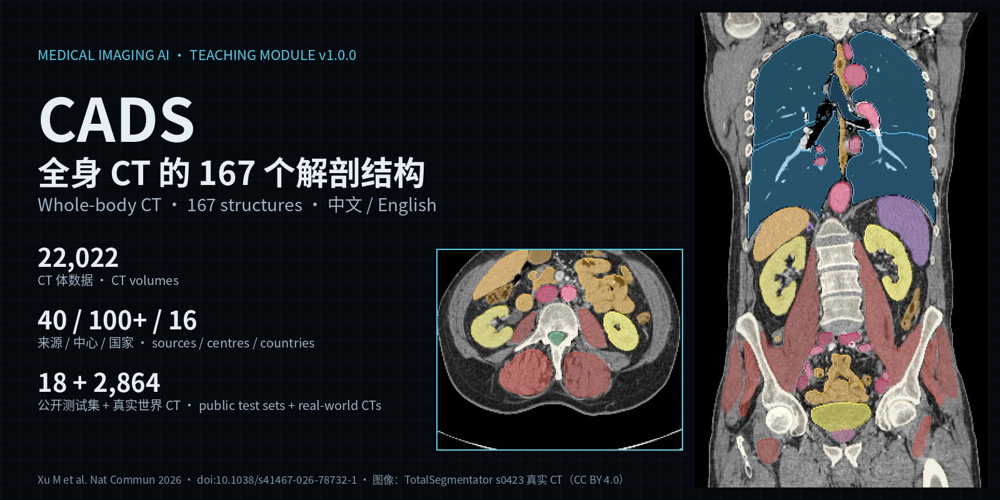
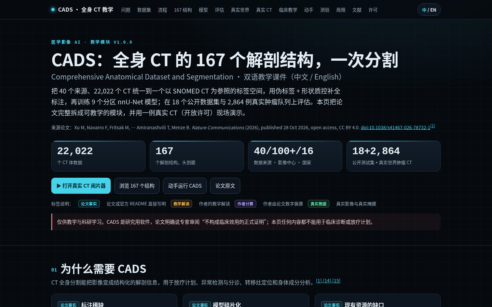
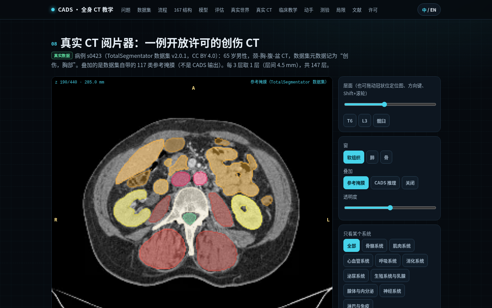
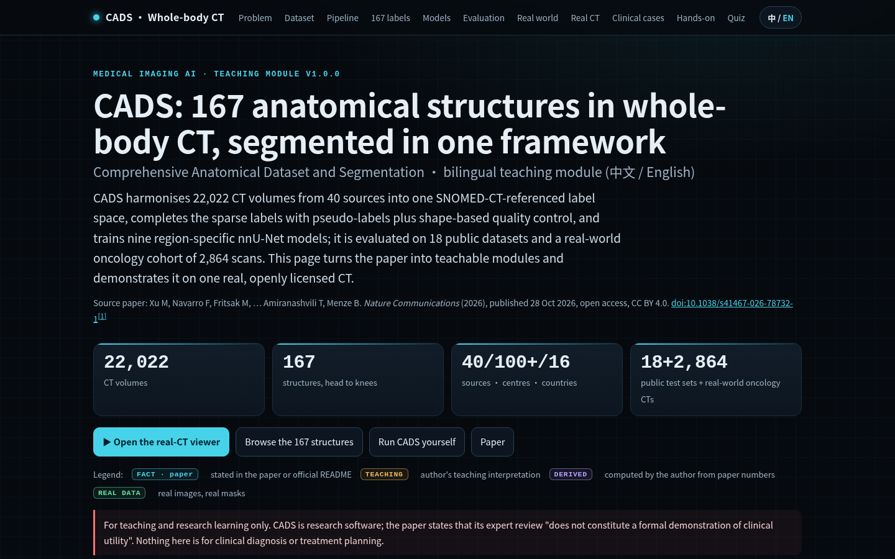
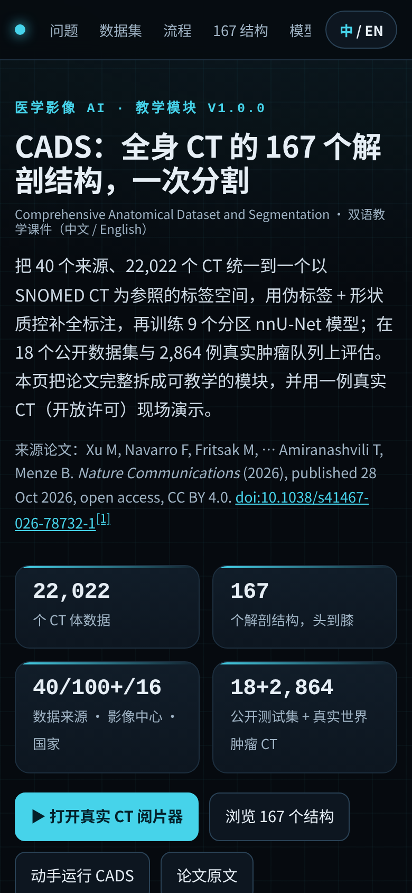
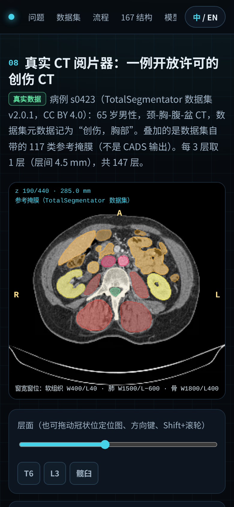

<p align="center">
  
</p>

<h1 align="center">CADS Whole-body CT Anatomy Segmentation · Bilingual Teaching Module</h1>

<p align="center">
  <strong>One framework, 167 anatomical structures, head to knees. Learn how it was built, then watch it segment one real CT.</strong>
</p>

<h3 align="center">
  <a href="https://tuanziding.github.io/cads-ct-teaching/">▶ Read online</a>
</h3>

<p align="center">
  <a href="../README.md">简体中文</a> · <a href="英文说明v1.0.md">English</a>
</p>

<p align="center">
  <code>15 modules</code> · <code>167 structures · 9 model groups</code> · <code>real-CT viewer (147 slices)</code> · <code>one real CADS inference</code> · <code>6 paper figures</code> · <code>18 DOI-verified references</code> · <code>Chinese / English</code> · <code>static · offline · mobile-friendly</code>
</p>

> ⚠️ For teaching and research learning only. CADS is research software; the paper states that its expert review "does not constitute a formal demonstration of clinical utility". Nothing here is for clinical diagnosis or treatment planning. This is independent teaching material, not affiliated with or endorsed by the CADS authors.

## What CADS is

**CADS** (Comprehensive Anatomical Dataset and Segmentation) harmonises 22,022 CT volumes from 40 sources into one SNOMED-CT-referenced label space, completes the sparse labels with pseudo-labels plus shape-based quality control, and trains nine region-specific nnU-Net (ResEnc-L) models that together segment 167 structures from head to knees. It is evaluated on 18 public datasets and a real-world oncology cohort of 2,864 scans from University Hospital Zurich. Code is Apache-2.0; weights come as reference, research (CC BY-NC-SA 4.0) and open (CC BY-SA 4.0) variants, plus a 3D Slicer plugin.

> Xu M, Navarro F, Fritsak M, … Amiranashvili T, Menze B. CADS: a comprehensive anatomical dataset and segmentation for whole-body anatomy in computed tomography. *Nature Communications* (2026). doi:[10.1038/s41467-026-78732-1](https://doi.org/10.1038/s41467-026-78732-1). Open access, [CC BY 4.0](https://creativecommons.org/licenses/by/4.0/).

## What the module contains

| Module | Content |
| --- | --- |
| 01 Why CADS | Uses of whole-body segmentation (radiotherapy OARs, abnormality detection, metastasis localisation, body composition) and the label-scarcity problem |
| 02 Dataset | 22,022 CTs, 40 sources, 100+ centres, 16 countries |
| 03 Four-step pipeline | From sparse labels to 167 whole-body classes: label harmonisation → pseudo-labels → shape QC → training |
| 04 Label browser | All 167 structures, searchable, filterable by the 9 model groups or by body system, with Chinese names, SNOMED CT codes and prevalence |
| 05 Weights and licences | reference / research / open / CADS-region, and when to use each |
| 06–07 Evaluation and real world | 18 public benchmarks, the 2,864-scan oncology cohort and the expert review |
| 08 Real-CT viewer | One openly licensed trauma CT (147 slices), soft-tissue / lung / bone windows, overlay of reference masks or the **real CADS inference** |
| 09 Clinical teaching cases | Emergency and trauma surgery view: counting ribs and vertebrae, body composition at L3, pelvic muscles and bone |
| 10 Hands-on | Command-line install and inference, the 3D Slicer plugin |
| 11–15 | Quiz, limitations, resources, references, licence |

Every statement is tagged by kind: 【FACT · paper】【TEACHING】【DERIVED】【REAL DATA】. Markdown handouts: [Chinese](教学讲义-中文v1.0.md) · [English](教学讲义-英文v1.0.md).

## Showcase

[](https://tuanziding.github.io/cads-ct-teaching/)

| Real-CT viewer | English interface |
| --- | --- |
| [](https://tuanziding.github.io/cads-ct-teaching/#lab) | [](https://tuanziding.github.io/cads-ct-teaching/) |

| Mobile · home | Mobile · viewer |
| --- | --- |
|  |  |

<sub>Real screenshots of the v1.0.0 page rendered with Chromium (desktop 1440 px, mobile 390 px).</sub>

## A real CADS inference

The "CADS inference" overlay in the viewer is real model output, not an illustration:

- **Model**: CADS-model-research task 554 (trunk muscles and pelvis); weights CC BY-NC-SA 4.0, **not redistributed here**.
- **Input**: TotalSegmentator dataset v2.0.1, case s0423 (doi:[10.5281/zenodo.10047292](https://doi.org/10.5281/zenodo.10047292), CC BY 4.0), which is in the CADS public test split.
- **Hardware**: 2-core CPU, ~8 GB RAM; 6 sliding-window patches in 634 s.
- **Deviations from the official pipeline**: 128³ patch instead of 192³ (memory); only a cropped pelvis–L2 region; no official TPTBox post-processing.
- **Result**: Dice against the dataset's reference masks from 0.81 (sacrum) to 0.99 (left and right hip bones); gluteal muscles 0.94–0.98, deep back muscles 0.94, iliopsoas 0.95–0.96.

One case only, and the reference-mask definitions differ slightly from CADS; **this does not measure model performance**. Full parameters, deviations and reproduction steps: [`验证/推理记录v1.0.md`](../验证/推理记录v1.0.md).

## Quick start

```sh
git clone https://github.com/TUANZIDING/cads-ct-teaching.git
cd cads-ct-teaching && python3 -m http.server 8000      # open http://localhost:8000
python3 验证/项目检查v1.0.py                             # offline check: links, references, labels, figure credits, licences
```

Use the "中 / EN" button at the top right to switch language.

## Verification

- All 18 references carry a DOI, checked against Crossref (16) or DataCite (2 datasets); every [n] on the page links to the reference list.
- Key numbers from the paper are logged in [`验证/数字核验v1.0.json`](../验证/数字核验v1.0.json).
- [`验证/项目检查v1.0.py`](../验证/项目检查v1.0.py) runs on every push: local links and images, citation numbering, the 167 labels, paper-figure attribution and DOI, real-CT data source, licence files, privacy (no personal e-mail or phone), file naming, and that no CADS weights or NIfTI volumes are redistributed.

## How to cite

Please cite both this module and the original CADS paper; see [`CITATION.cff`](../CITATION.cff).

> Ding H. CADS Whole-body CT Anatomy Segmentation: A Bilingual Teaching Module. Version 1.0.0. 2026-11-13. https://github.com/TUANZIDING/cads-ct-teaching

## Licence

For **non-commercial** use only.

| Part | Scope | Licence |
| --- | --- | --- |
| Paper figures | `图片/论文原图/` (6 figures, Xu et al., Nat Commun 2026) | **Not** covered by this repository's licence: © original authors, [CC BY 4.0](https://creativecommons.org/licenses/by/4.0/), doi:10.1038/s41467-026-78732-1 |
| Real-CT derivatives | `图片/真实CT/`, `assets/ct/` (TotalSegmentator v2.0.1 case s0423) | [CC BY 4.0](https://creativecommons.org/licenses/by/4.0/), doi:[10.5281/zenodo.10047292](https://doi.org/10.5281/zenodo.10047292) |
| CADS inference images | `图片/真实CT/*cads554*`, `assets/ct/*-cads.png` | [CC BY-NC-SA 4.0](https://creativecommons.org/licenses/by-nc-sa/4.0/) (follows the CADS-model-research weight licence) |
| CADS / Slicer plugin material | `图片/插件截图/`, structure names and group numbers | [Apache-2.0](../LICENSES/Apache-2.0.txt) (murong-xu/CADS, murong-xu/SlicerCADSWholeBodyCTSeg) |
| Author's original content | `文档/`, page and README text, `验证/` records, author-curated parts of `assets/data/`, cover and screenshots | [CC BY-NC 4.0](https://creativecommons.org/licenses/by-nc/4.0/) |
| Code | page structure and scripts in `index.html`, `assets/*.css`, `assets/*.js`, `工具/`, `验证/*.py`, `示例/`, `.github/` | [PolyForm Noncommercial 1.0.0](../LICENSES/PolyForm-Noncommercial-1.0.0.md) |

No CADS-dataset images or masks and no CADS model weights are redistributed. Per-file credits: [`图片说明v1.0.md`](图片说明v1.0.md); overview: [`LICENSE`](../LICENSE).

### Commercial use

**Commercial use requires prior permission** (third-party material remains under its original licence). 👉 [Contact the author](https://tuanziding.github.io/#contact)

<p align="center"><sub>Haixiang Ding · <a href="https://tuanziding.github.io/#research">Homepage</a></sub></p>
