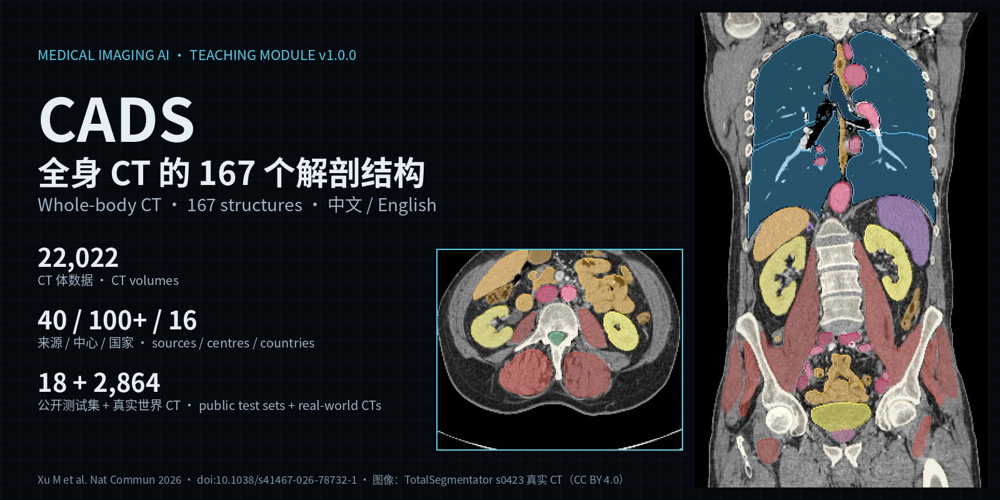
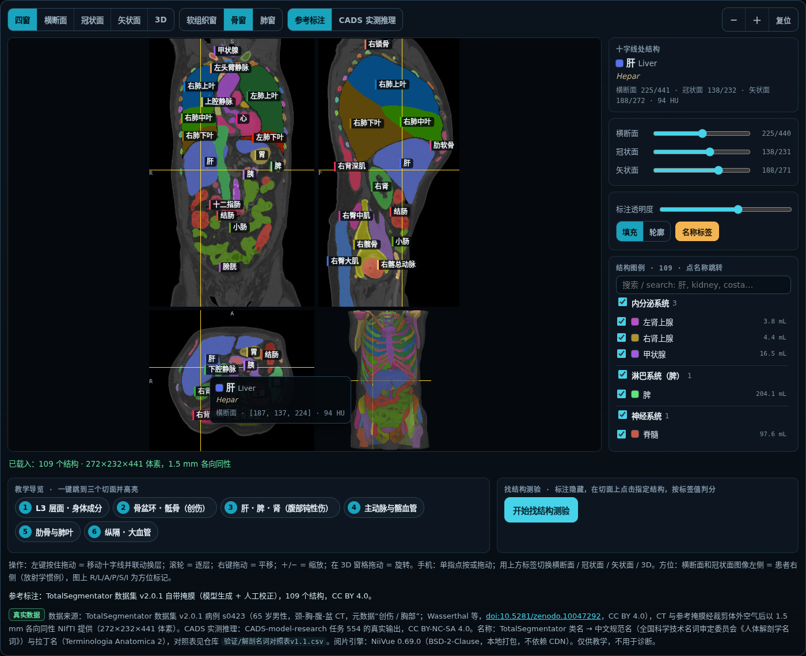
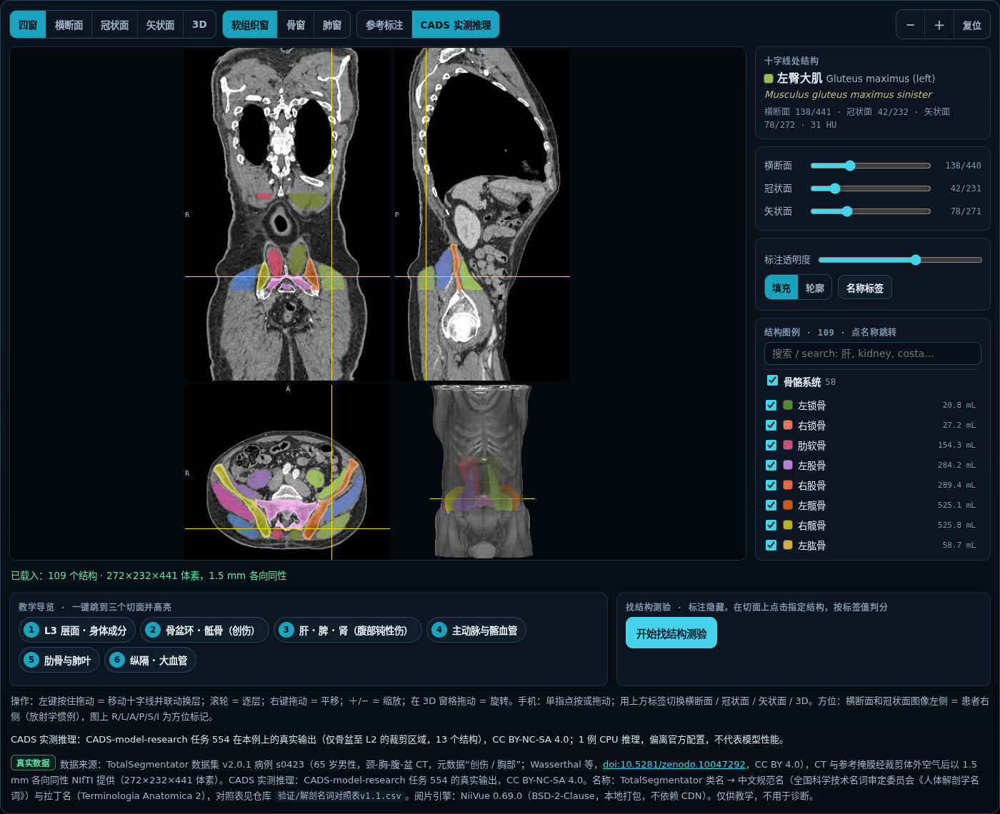
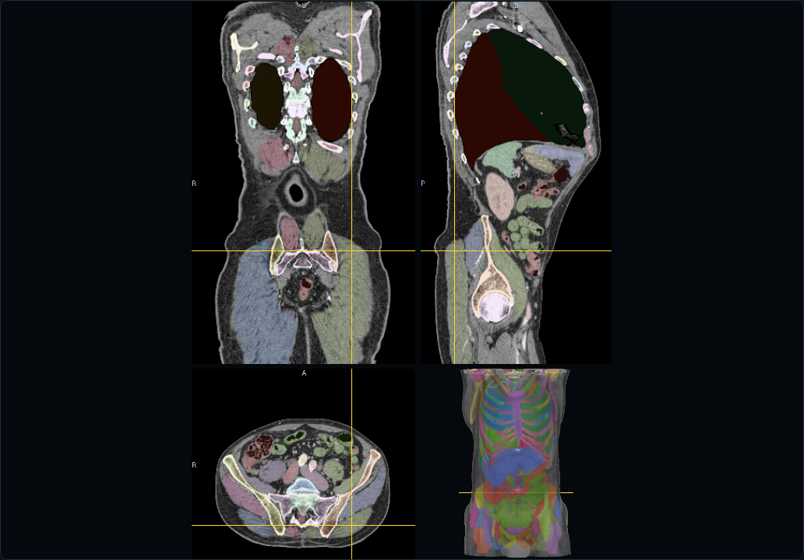
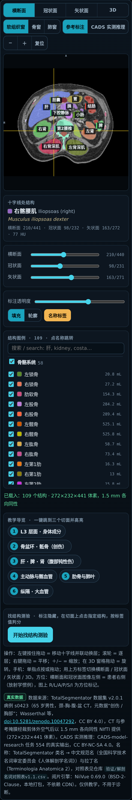
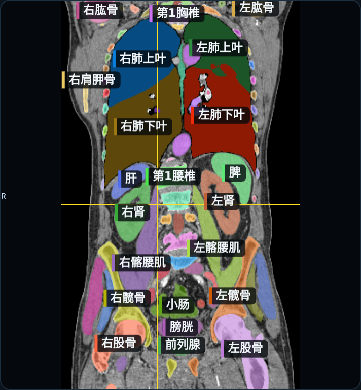

<p align="center">
  
</p>

<h1 align="center">CADS Whole-body CT · Interactive Anatomy Viewer &amp; Bilingual Course</h1>

<p align="center">
  <strong>Drag through the axial, coronal and sagittal planes of a real whole-body CT with a linked 3D view; hover or tap to see each structure's Chinese, English and Latin name. 109 structures, one distinct colour each. Then learn how CADS segments 167 structures from head to knees.</strong>
</p>

<h3 align="center">
  <a href="https://tuanziding.github.io/cads-ct-teaching/">▶ Read online</a>
</h3>

<p align="center">
  <a href="../README.md">简体中文</a> · <a href="英文说明v1.1.md">English</a>
</p>

<p align="center">
  <code>axial / coronal / sagittal / 3D, linked</code> · <code>109 colour-coded structures · zh / EN / Latin</code> · <code>reference ↔ CADS inference</code> · <code>6 guided stops + quiz</code> · <code>15 modules</code> · <code>167 structures · 9 model groups</code> · <code>one real CADS inference</code> · <code>6 paper figures</code> · <code>18 DOI-verified references</code> · <code>Chinese / English</code> · <code>static · offline · mobile-friendly</code>
</p>

> ⚠️ For teaching and research learning only. CADS is research software; the paper states that its expert review "does not constitute a formal demonstration of clinical utility". Nothing here is for clinical diagnosis or treatment planning. This is independent teaching material, not affiliated with or endorsed by the CADS authors.

## Interactive viewer (new in v1.1)

| Feature | Details |
| --- | --- |
| Linked planes | 4-up layout: axial, coronal, sagittal + 3D volume rendering. Press and drag on any plane to move the crosshair; the other planes and the 3D view follow. Mouse wheel steps slices; one slider per plane; right-drag pans; ＋/− zoom |
| Windows | Soft tissue / bone / lung presets |
| Segmentation overlay | All non-empty reference masks of case s0423 (109 of TotalSegmentator's 117 classes) merged into one label volume; every structure has its own colour chosen in CIELAB so that touching structures, left/right pairs and neighbouring ribs/vertebrae differ by at least ΔE 45; opacity slider; fill / outline |
| Names | Hover (tap on phones) shows Chinese · English · Latin (TA2), plane, voxel coordinates and HU; optional persistent name tags on the current slices |
| Legend | Grouped by system (skeletal, muscular, cardiovascular, respiratory, digestive, urinary, reproductive, endocrine, lymphatic, nervous); search in Chinese or English; show/hide per structure or group; click a name to jump all planes to it and highlight it (the jump point is the voxel farthest from the boundary on the structure’s median axial slice, so it always lands inside the structure) |
| Source switch | **Reference labels** (dataset masks, CC BY 4.0) ↔ **CADS inference** (real output of CADS-model-research task 554, pelvis to L2, CC BY-NC-SA 4.0); same colour for the same structure |
| Guided stops | L3 body composition · pelvic ring and sacrum · liver/spleen/kidneys (blunt abdominal trauma) · aorta and iliac vessels · ribs and lung lobes · mediastinal great vessels |
| Quiz | Labels hidden; click the named structure on any plane; scored by the label value under the click |
| Phones | Narrow screens switch to a single pane with axial / coronal / sagittal / 3D tabs |

- **Orientation**: radiological convention — on axial and coronal images, image left = patient right; R/L/A/P/S/I markers on every pane.
- **Data**: 1.5 mm isotropic NIfTI (272 × 232 × 441 voxels, air outside the body cropped), about 22 MB (CT 20.8 MB, reference labels 1.2 MB, CADS output 0.25 MB) + NiiVue 2.3 MB, with a progress indicator.
- **Names**: every name comes from [`验证/解剖名词对照表v1.1.csv`](../验证/解剖名词对照表v1.1.csv) (TotalSegmentator class → standard Chinese term of the CNTERM *Human Anatomy Terms* + Terminologia Anatomica 2 Latin); sources and caveats in [`验证/解剖名词来源v1.1.md`](../验证/解剖名词来源v1.1.md).
- **Engine**: [NiiVue](https://github.com/niivue/niivue) 0.69.0 (BSD-2-Clause, WebGL2), bundled locally in `assets/viewer/` — no CDN, so it works from mainland China. Needs a WebGL2 browser.

## What CADS is

**CADS** (Comprehensive Anatomical Dataset and Segmentation) harmonises 22,022 CT volumes from 40 sources into one SNOMED-CT-referenced label space, completes the sparse labels with pseudo-labels plus shape-based quality control, and trains nine region-specific nnU-Net (ResEnc-L) models that together segment 167 structures from head to knees. It is evaluated on 18 public datasets and a real-world oncology cohort of 2,864 scans from University Hospital Zurich. Code is Apache-2.0; weights come as reference, research (CC BY-NC-SA 4.0) and open (CC BY-SA 4.0) variants, plus a 3D Slicer plugin.

> Xu M, Navarro F, Fritsak M, … Amiranashvili T, Menze B. CADS: a comprehensive anatomical dataset and segmentation for whole-body anatomy in computed tomography. *Nature Communications* (2026). doi:[10.1038/s41467-026-78732-1](https://doi.org/10.1038/s41467-026-78732-1). Open access, [CC BY 4.0](https://creativecommons.org/licenses/by/4.0/).

## What the module contains

| Module | Content |
| --- | --- |
| 01 Why CADS | Uses of whole-body segmentation (radiotherapy OARs, abnormality detection, metastasis localisation, body composition) and the label-scarcity problem |
| 02 Dataset | 22,022 CTs, 40 sources, 100+ centres, 16 countries |
| 03 Four-step pipeline | From sparse labels to 167 whole-body classes: label harmonisation → pseudo-labels → shape QC → training |
| 04 Label browser | All 167 structures, searchable, filterable by the 9 model groups or by body system, with Chinese names, SNOMED CT codes and prevalence |
| 05 Weights and licences | reference / research / open / CADS-region, and when to use each |
| 06–07 Evaluation and real world | 18 public benchmarks, the 2,864-scan oncology cohort and the expert review |
| Top · interactive viewer | See above |
| 08 A real CADS run | CADS T554 output on this case, static comparisons and Dice (switchable voxel by voxel in the viewer) |
| 09 Clinical teaching cases | Emergency and trauma surgery view: counting ribs and vertebrae, body composition at L3, pelvic muscles and bone |
| 10 Hands-on | Command-line install and inference, the 3D Slicer plugin |
| 11–15 | Quiz, limitations, resources, references, licence |

Every statement is tagged by kind: 【FACT · paper】【TEACHING】【DERIVED】【REAL DATA】. Markdown handouts: [Chinese](教学讲义-中文v1.0.md) · [English](教学讲义-英文v1.0.md).

## Showcase

[](https://tuanziding.github.io/cads-ct-teaching/)

| CADS inference | Outline mode |
| --- | --- |
| [](https://tuanziding.github.io/cads-ct-teaching/) | [](https://tuanziding.github.io/cads-ct-teaching/) |

| Mobile · axial | Mobile · coronal |
| --- | --- |
|  |  |

<sub>Real screenshots of the v1.1.0 page rendered with headless Chromium + SwiftShader WebGL (desktop 1440 px, mobile 390 px @2x).</sub>

## A real CADS inference

The "CADS inference" switch in the viewer shows real model output voxel by voxel, not an illustration:

- **Model**: CADS-model-research task 554 (trunk muscles and pelvis); weights CC BY-NC-SA 4.0, **not redistributed here**.
- **Input**: TotalSegmentator dataset v2.0.1, case s0423 (doi:[10.5281/zenodo.10047292](https://doi.org/10.5281/zenodo.10047292), CC BY 4.0), which is in the CADS public test split.
- **Hardware**: 2-core CPU, ~8 GB RAM; 6 sliding-window patches in 634 s.
- **Deviations from the official pipeline**: 128³ patch instead of 192³ (memory); only a cropped pelvis–L2 region; no official TPTBox post-processing.
- **Result**: Dice against the dataset's reference masks from 0.81 (sacrum) to 0.99 (left and right hip bones); gluteal muscles 0.94–0.98, deep back muscles 0.94, iliopsoas 0.95–0.96.

One case only, and the reference-mask definitions differ slightly from CADS; **this does not measure model performance**. Full parameters, deviations and reproduction steps: [`验证/推理记录v1.0.md`](../验证/推理记录v1.0.md).

## Quick start

```sh
git clone https://github.com/TUANZIDING/cads-ct-teaching.git
cd cads-ct-teaching && python3 -m http.server 8000      # open http://localhost:8000
python3 验证/项目检查v1.1.py                             # offline check: viewer data & names, links, references, credits, licences
python3 工具/阅片检查v1.1.py http://localhost:8000/ out   # drive the viewer in headless Chromium (needs playwright; a few minutes)
```

Use the "中 / EN" button at the top right to switch language.

## Verification

- All 18 references carry a DOI, checked against Crossref (16) or DataCite (2 datasets); every [n] on the page links to the reference list.
- Key numbers from the paper are logged in [`验证/数字核验v1.0.json`](../验证/数字核验v1.0.json).
- [`验证/项目检查v1.1.py`](../验证/项目检查v1.1.py) runs on every push: viewer files present and size-capped (< 50 MB each, < 30 MB total), every name traceable to the term table, 109 unique colours with ΔE ≥ 30 between neighbours, NIfTI dimensions and spacing, NiiVue bundled locally with its licence, no CDN references, viewer controls present; plus links, citations, the 167 labels, figure credits, licences, privacy, naming, and no CADS weights or CADS-dataset data.
- [`工具/阅片检查v1.1.py`](../工具/阅片检查v1.1.py) drives the viewer in headless Chromium (SwiftShader WebGL): dragging and linked planes, wheel, sliders; hover names for 12 structures checked against the mask values (including left/right kidneys and hip bones for orientation); source switch, outline, name tags, legend search and group hiding, click-to-jump, guided stops, quiz scoring, language toggle; mobile single-pane tabs; no console errors.

## How to cite

Please cite both this module and the original CADS paper; see [`CITATION.cff`](../CITATION.cff).

> Ding H. CADS Whole-body CT: Interactive Anatomy Viewer and Bilingual Teaching Module. Version 1.1.0. 2026-11-13. https://github.com/TUANZIDING/cads-ct-teaching

## Licence

For **non-commercial** use only.

| Part | Scope | Licence |
| --- | --- | --- |
| Paper figures | `图片/论文原图/` (6 figures, Xu et al., Nat Commun 2026) | **Not** covered by this repository's licence: © original authors, [CC BY 4.0](https://creativecommons.org/licenses/by/4.0/), doi:10.1038/s41467-026-78732-1 |
| Real CT and masks (derived) | `图片/真实CT/`, `assets/viewer/ct-s0423-v1.1.nii.gz`, `assets/viewer/ref-s0423-v1.1.nii.gz` (TotalSegmentator v2.0.1 case s0423) | [CC BY 4.0](https://creativecommons.org/licenses/by/4.0/), doi:[10.5281/zenodo.10047292](https://doi.org/10.5281/zenodo.10047292) |
| CADS inference | `图片/真实CT/*cads554*`, `assets/viewer/cads554-s0423-v1.1.nii.gz` | [CC BY-NC-SA 4.0](https://creativecommons.org/licenses/by-nc-sa/4.0/) (follows the CADS-model-research weight licence) |
| CADS / Slicer plugin material | `图片/插件截图/`, structure names and group numbers | [Apache-2.0](../LICENSES/Apache-2.0.txt) (murong-xu/CADS, murong-xu/SlicerCADSWholeBodyCTSeg) |
| Author's original content | `文档/`, page and README text, `验证/` records and the term table, author-curated parts of `assets/data/` and `assets/viewer/structures-v1.1.json`, cover and screenshots | [CC BY-NC 4.0](https://creativecommons.org/licenses/by-nc/4.0/) |
| Code | page structure and scripts in `index.html`, `assets/*.css`, `assets/*.js` (incl. the viewer `cads-viewerv1.1.js`), `工具/`, `验证/*.py`, `示例/`, `.github/` | [PolyForm Noncommercial 1.0.0](../LICENSES/PolyForm-Noncommercial-1.0.0.md) |
| Viewer engine | `assets/viewer/niivue-v0.69.0.umd.js` (NiiVue 0.69.0, unmodified) | [BSD-2-Clause](../LICENSES/NiiVue-BSD-2-Clause.txt) |

No CADS-dataset images or masks and no CADS model weights are redistributed (the viewer only carries public TotalSegmentator case s0423 and its CADS output). Per-file credits: [`图片说明v1.1.md`](图片说明v1.1.md); overview: [`LICENSE`](../LICENSE).

### Commercial use

**Commercial use requires prior permission** (third-party material remains under its original licence). 👉 [Contact the author](https://tuanziding.github.io/#contact)

<p align="center"><sub>Haixiang Ding · <a href="https://tuanziding.github.io/#research">Homepage</a></sub></p>
